# Apuntes de inteligencia artificial

Una guía para entender cómo una máquina pasa del texto a una respuesta. El recorrido empieza por las piezas básicas y termina en los modelos de lenguaje actuales.

Lee los apartados en orden la primera vez. Para repasar, usa el índice y las preguntas de **Comprueba lo aprendido**. Las soluciones y los detalles técnicos están en bloques desplegables.

## Índice

1. [El mapa: IA, PLN y LLM](#1-el-mapa-ia-pln-y-llm) ✅
2. [Tokens: dividir el texto en piezas](#2-tokens-dividir-el-texto-en-piezas) ✅
3. [Contexto: la información disponible](#3-contexto-la-información-disponible) ✅
4. [N-gramas: predecir contando](#4-n-gramas-predecir-contando) ✅
5. [Redes neuronales: aprender ajustando](#5-redes-neuronales-aprender-ajustando) ✅
6. [Embeddings: representar con números](#6-embeddings-representar-con-números) ✅
7. [RNN: leer con una memoria que se actualiza](#7-rnn-leer-con-una-memoria-que-se-actualiza) ✅
8. [Transformer: relacionar partes del texto](#8-transformer-relacionar-partes-del-texto) ✅
9. [Entrenamiento: de la arquitectura al LLM](#9-entrenamiento-de-la-arquitectura-al-llm)
10. [Inferencia: del mensaje a la respuesta](#10-inferencia-del-mensaje-a-la-respuesta)
11. [RAG: buscar información antes de responder](#11-rag-buscar-información-antes-de-responder)
12. [Historia: cómo llegamos hasta aquí](#12-historia-cómo-llegamos-hasta-aquí)
13. [Práctica opcional en C#: aprender los puntos de un juego](#13-práctica-opcional-en-c-aprender-los-puntos-de-un-juego)
14. [Práctica con Ollama: ejecutar modelos locales](#14-práctica-con-ollama-ejecutar-modelos-locales)
15. [Prompts: cómo pedir lo que necesitas](#15-prompts-cómo-pedir-lo-que-necesitas)
16. [Vibe coding: crear software con lenguaje natural](#16-vibe-coding-crear-software-con-lenguaje-natural)
17. [Instrucciones para agentes: /init y AGENTS.md](#17-instrucciones-para-agentes-init-y-agentsmd)
18. [Skills: procedimientos reutilizables con datos de entrada](#18-skills-procedimientos-reutilizables-con-datos-de-entrada)
19. [MCP: conectar la IA con datos y herramientas](#19-mcp-conectar-la-ia-con-datos-y-herramientas)

<a id="1-el-mapa-ia-pln-y-llm"></a>

## 1. El mapa: IA, PLN y LLM ✅

La **inteligencia artificial (IA)** es el campo que desarrolla sistemas capaces de realizar tareas como reconocer imágenes, interpretar mensajes o planificar acciones.

Dentro de ese campo, el **procesamiento del lenguaje natural (PLN, o NLP en inglés)** se ocupa del lenguaje humano. Incluye tareas de comprensión —detectar qué pide una persona— y de generación —redactar una respuesta—.

Un **modelo** es un sistema matemático que transforma entradas en resultados. Un **modelo de lenguaje de gran tamaño (LLM, Large Language Model)** aprende patrones a partir de grandes cantidades de texto. Puede servir para resumir, traducir o responder preguntas.

Piensa en una biblioteca: la IA sería todo el edificio; el PLN, la sección dedicada al lenguaje; y los LLM, una de las herramientas disponibles en esa sección. [Referencia: Stanford, PLN](https://hai.stanford.edu/ai-definitions/what-is-nlp).

Muchos LLM generativos producen texto mediante una tarea repetida: **estimar cuál podría ser la siguiente pieza del texto**. Estas piezas se llaman tokens y son el siguiente paso del recorrido. Que una continuación resulte probable no garantiza que sea cierta. [Referencia: GPT-3](https://arxiv.org/abs/2005.14165).

Dos conceptos relacionados:

| Concepto | Qué añade | Ejemplo |
| --- | --- | --- |
| **Multimodalidad** | Trabajar con varios tipos de información. | Recibir una imagen y describirla con texto. |
| **Agente basado en un LLM** | Combinar el modelo con herramientas para realizar una tarea. | Añadir un producto a una lista de la compra. |

**Ejemplo sencillo de agente:** le dices «Añade leche a mi lista de la compra». El agente interpreta la petición, utiliza una herramienta para abrir y actualizar la lista, comprueba que la leche está anotada y te confirma que ha terminado. El objetivo que le das se convierte en acciones sobre una aplicación.

Las capacidades concretas dependen del sistema. [Referencias: GPT-4](https://arxiv.org/abs/2303.08774) y [ReAct](https://arxiv.org/abs/2210.03629).

**Comprueba lo aprendido**

1. ¿Un LLM es todo el campo de la IA o una herramienta dentro de él?
2. ¿Qué añade un agente al uso de un modelo de lenguaje?

<details>
<summary>Ver respuestas</summary>

1. Es una herramienta dentro de la IA, muy utilizada en PLN.
2. Herramientas y un proceso que permite encadenar acciones y utilizar sus resultados.

</details>

<a id="2-tokens-dividir-el-texto-en-piezas"></a>

## 2. Tokens: dividir el texto en piezas ✅

La **tokenización** divide el texto en unidades llamadas **tokens**. Un token puede ser una palabra, un fragmento, un signo o una secuencia que incluya espacios.

Cuando escribes un mensaje como **«Necesito un cargador»**, el sistema lo prepara antes de pasarlo al modelo. Puede conservar algunas palabras completas y dividir otras en fragmentos reutilizables, como «carga» y «dor». Así representa muchas palabras combinando un vocabulario limitado de fragmentos.

El **tokenizador** aplica las reglas de división y asigna a cada token un **identificador (ID)** de su vocabulario. Es como el número de una ficha de catálogo: identifica una entrada, pero su valor numérico no expresa significado.

Ejemplo con división e identificadores inventados:

```text
«Necesito un cargador» → [«Necesito», « un», « carga», «dor»] → [48, 207, 310, 92]
```

Los espacios forman parte del segundo y tercer token. Esta división es ilustrativa: otro tokenizador podría conservar «cargador» completo o dividirlo de otra manera. Los acentos, emojis y palabras frecuentes tampoco tienen un número universal de tokens. [Referencia: palabras y tokens](https://web.stanford.edu/~jurafsky/slp3/2.pdf).

**El proceso habitual** prepara el texto según sus reglas, delimita fragmentos, los segmenta, asigna IDs y, cuando corresponde, añade tokens especiales de inicio, fin o separación. La **decodificación** convierte los IDs de salida en texto. Algunas transformaciones previas, como pasar a minúsculas, pueden impedir recuperar exactamente el original. [Referencia: proceso de tokenización](https://huggingface.co/docs/tokenizers/pipeline).

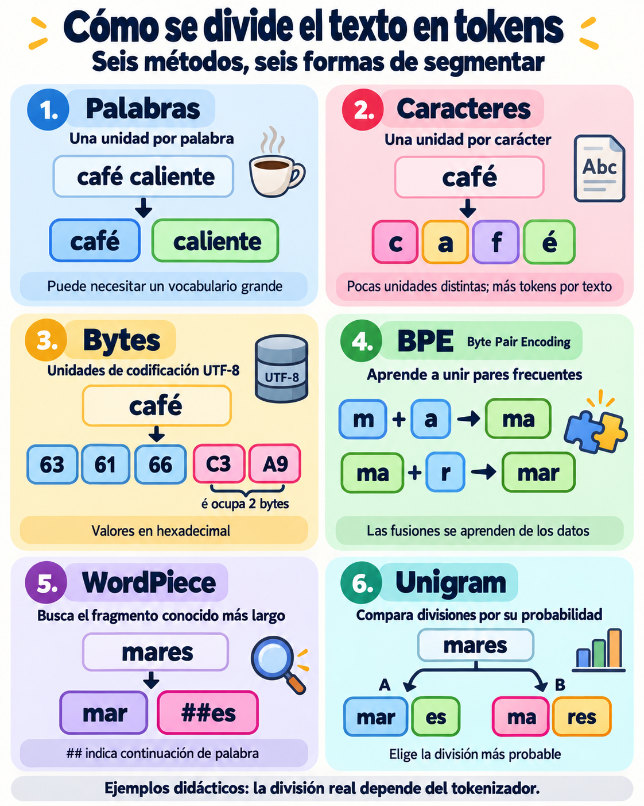

En la imagen, **palabras, caracteres y bytes** muestran distintos tamaños de unidad. **BPE, WordPiece y Unigram** aprenden vocabularios de fragmentos y aplican reglas para segmentar. Se omiten los espacios en los ejemplos visuales para centrarse en cada método.

| Método | Idea básica |
| --- | --- |
| **Palabras** | Una pieza por palabra, con reglas para puntuación. El vocabulario puede crecer mucho. |
| **Caracteres** | Piezas pequeñas, pero secuencias más largas. |
| **Bytes** | Usa unidades de codificación del texto. Un carácter puede ocupar varios bytes. |
| **BPE (Byte Pair Encoding)** | Aprende a unir pares frecuentes de piezas consecutivas. |
| **WordPiece** | Al segmentar, busca el fragmento conocido más largo desde cada posición. |
| **Unigram** | Utiliza probabilidades para elegir entre posibles divisiones. |

**SentencePiece** es una herramienta para crear y aplicar tokenizadores, incluidos BPE y Unigram. [Referencias: comparación de métodos](https://huggingface.co/docs/transformers/tokenizer_summary) y [SentencePiece](https://github.com/google/sentencepiece).

<details>
<summary>BPE paso a paso: por qué se unen unos fragmentos y otros no</summary>

Imagina unos textos en los que aparecen **«mar» 8 veces, «mares» 4 veces y «mapa» 3 veces**. BPE empieza aquí separando las letras y cuenta qué pares aparecen juntos más veces.

| Paso | Qué encuentra | Qué aprende |
| --- | --- | --- |
| **1. Contar** | «m» seguido de «a» aparece en las tres palabras: 8 + 4 + 3 = **15 veces**. Es el par más frecuente. | Unir «m» + «a» para crear **«ma»**. |
| **2. Volver a contar** | Después de esa unión, «ma» seguido de «r» aparece en «mar» y «mares»: 8 + 4 = **12 veces**. Es el nuevo par más frecuente. | Unir «ma» + «r» para crear **«mar»**. |
| **3. Usar las reglas** | Si detenemos el aprendizaje tras esas dos fusiones, ya podemos dividir los textos con las unidades aprendidas. | «mar» → **[mar]**; «mares» → **[mar, e, s]**; «mapa» → **[ma, p, a]**. |

**Qué hemos ganado:** «mar» se procesa con un token en vez de tres, y «ma» se reutiliza también en «mapa». Si continuamos aprendiendo, otras fusiones podrían cambiar la división.

Se trabaja dentro de cada palabra y se omiten espacios y marcas de final. Las uniones se aprenden por frecuencia; no necesitan coincidir con raíces o sufijos gramaticales. Después se aplican las reglas ya aprendidas a los mensajes nuevos. [Referencia: aprendizaje de BPE](https://huggingface.co/learn/llm-course/chapter6/5).

</details>

Se tokenizan tanto los datos de entrenamiento como los mensajes que recibe el modelo. Debe utilizarse un tokenizador compatible con él. La tokenización permite representar texto; corregir faltas de ortografía es otra tarea.

**Comprueba lo aprendido**

1. Si una frase tiene diez palabras, ¿tendrá necesariamente diez tokens?
2. ¿El token con ID 900 tiene más significado que el token con ID 20?

<details>
<summary>Ver respuestas</summary>

1. No: depende del tokenizador, los fragmentos, los espacios y la puntuación.
2. No: los números solo identifican entradas del vocabulario.

</details>

<a id="3-contexto-la-información-disponible"></a>

## 3. Contexto: la información disponible ✅

El **contexto** es la información que el modelo puede consultar para interpretar un mensaje o continuar un texto.

> El barco avanzó al desplegar la **vela**.
>
> Durante el apagón encendimos una **vela**.

Las palabras que rodean a «vela» ayudan a distinguir sus usos. El significado depende de la situación, como cuando una persona necesita escuchar una conversación completa para entender una frase.

### Ventana de contexto: qué cabe y cuánto espacio hay

La **ventana de contexto** limita cuántos tokens puede manejar el modelo para trabajar con una petición y continuarla. Imagínala como una **mesa de trabajo**: el límite es el tamaño de la mesa; el contexto ocupado son los documentos que tienes encima.

**Los ejemplos de este apartado se centran en un chat con un LLM.** La misma idea se aplica a una petición individual, como enviar un documento para resumirlo.

| Qué ocupa espacio | Ejemplo en un chat |
| --- | --- |
| **Instrucciones** | El rol y las reglas de la aplicación. |
| **Historial seleccionado** | Tus preguntas anteriores y las respuestas del asistente. |
| **Petición actual** | La pregunta que acabas de escribir. |
| **Información aportada** | Documentos, imágenes o datos que la aplicación incluye. |
| **Respuesta en curso** | Los tokens que el modelo va generando. |

Importa lo que la aplicación **envía realmente al modelo**: un mensaje antiguo puede seguir visible en pantalla aunque ya no se incluya íntegramente. También ocupan espacio las marcas que separan mensajes y sus roles. [Referencias: componentes del contexto](https://platform.claude.com/docs/en/build-with-claude/context-windows) y [formato de una conversación](https://huggingface.co/docs/transformers/chat_templating).

Cada modelo tiene un límite y la aplicación puede trabajar con uno menor. **Una ventana mayor permite aportar más información, pero no garantiza que se aproveche cada detalle.**

### ¿Se acumula durante un chat?

**Sí, si la aplicación conserva y vuelve a aportar el historial:**

```text
Turno 1: instrucciones + pregunta 1 → respuesta 1
Turno 2: instrucciones + pregunta 1 + respuesta 1 + pregunta 2 → respuesta 2
```

Crece el **contenido ocupado**, no la capacidad de la ventana. Cuando falta espacio, la aplicación debe gestionar qué mantiene: puede seleccionar mensajes o sustituirlos por resúmenes. El contexto disponible puede ser distinto del historial completo que ves. [Referencia: contexto e historial](https://platform.claude.com/docs/en/build-with-claude/context-windows).

Por eso conviene aportar información **relevante para la petición actual**. Más adelante veremos cómo gestionar el espacio durante la generación. Primero estudiaremos cómo distintos modelos utilizan la información anterior para predecir lo que viene.

**Comprueba lo aprendido**

1. ¿Qué palabras permiten distinguir los dos sentidos de «vela»?
2. ¿Adjuntar un documento a una conversación equivale por sí solo a entrenar el modelo?
3. Una condición sigue visible al principio del chat, pero el modelo deja de respetarla. ¿Por qué verla en pantalla no asegura que siga disponible?
4. ¿Añadir veinte mensajes aumenta la capacidad de la ventana? Explica qué cambia realmente.

<details>
<summary>Ver respuestas</summary>

1. «Barco» y «desplegar» orientan hacia navegación; «apagón» y «encendimos», hacia iluminación.
2. No: normalmente aporta contexto para esa interacción.
3. La aplicación puede haber recortado o resumido ese mensaje antes de preparar la solicitud actual. Incluso si lo incluye, el modelo puede utilizarlo mal.
4. La capacidad no aumenta automáticamente: crece el contenido que se intenta incluir. La aplicación puede necesitar seleccionar o resumirlo.

</details>

<a id="4-n-gramas-predecir-contando"></a>

## 4. N-gramas: predecir contando ✅

Un **n-grama** es una secuencia de *n* tokens consecutivos. Un modelo de n-gramas predice el siguiente token mirando los **n − 1 anteriores** y contando continuaciones en sus ejemplos.

Se parece a un autocompletado que consulta una libreta: «Después de este fragmento, ¿qué apareció más veces?». En este apartado tratamos cada palabra como un token y omitimos la puntuación.

| Modelo | Secuencia de ejemplo | Contexto usado para predecir |
| --- | --- | --- |
| **Unigrama** | «brisa» | Ninguno. |
| **Bigrama** | «brisa suave» | Una palabra anterior. |
| **Trigrama** | «brisa suave mueve» | Dos palabras anteriores. |

En «La brisa suave mueve las hojas», los bigramas son «La brisa», «brisa suave», «suave mueve», «mueve las» y «las hojas»: se solapan al avanzar una posición.

Supongamos estos datos de entrenamiento:

> La brisa suave mueve las hojas.
>
> La brisa suave mueve las cortinas.
>
> La brisa suave refresca el patio.
>
> Una voz suave transmite calma.

| Modelo y contexto | Continuaciones observadas |
| --- | --- |
| Bigrama: «suave» | «mueve»: 2/4 = 50 %; «refresca»: 25 %; «transmite»: 25 %. |
| Trigrama: «brisa suave» | «mueve»: 2/3 ≈ 66,7 %; «refresca»: 1/3 ≈ 33,3 %. |
| Trigrama: «voz suave» | «transmite»: 1/1 = 100 %. |

El trigrama dispone de una pista adicional y distingue «brisa suave» de «voz suave». Estos porcentajes describen únicamente los ejemplos disponibles.

Esta limitación del historial está relacionada con la **suposición de Markov**: aproximar lo que ocurrirá usando un pasado reducido. Un bigrama usa una dependencia de primer orden; un trigrama, de segundo orden.

La llamada **«amnesia»** aparece cuando una pista queda fuera de esa ventana:

> Clara vive en Toledo y mañana regresará a…
>
> Clara vive en Cuenca y mañana regresará a…

Un trigrama solo ve «regresará a» y asigna las mismas probabilidades en ambos casos. Conserva sus estadísticas aprendidas, pero no utiliza directamente la ciudad lejana.

Aumentar *n* amplía el historial, aunque exige observar muchas más combinaciones. El **suavizado** reserva probabilidad para continuaciones no vistas, en vez de tratarlas automáticamente como imposibles. [Referencia: modelos de n-gramas](https://web.stanford.edu/~jurafsky/slp3/3.pdf).

**Comprueba lo aprendido**

1. Escribe los trigramas de «El tren llega temprano».
2. ¿Cuántos tokens anteriores consulta un modelo de 4-gramas?

<details>
<summary>Ver respuestas</summary>

1. «El tren llega» y «tren llega temprano».
2. Tres: en general, n − 1.

</details>

<a id="5-redes-neuronales-aprender-ajustando"></a>

## 5. Redes neuronales: aprender ajustando ✅

Una **red neuronal** conecta unidades matemáticas llamadas **neuronas artificiales**. Su inspiración biológica es simplificada: reciben señales, las combinan y producen una salida.

Piensa en calcular el precio de un taxi: una estimación sencilla suma **kilómetros × precio por kilómetro + minutos de espera × precio por minuto + tarifa inicial**.

En una neurona, los kilómetros y minutos serían las **entradas**; los precios que los multiplican, los **pesos**; y la tarifa inicial, el **sesgo**. Por ejemplo, 3 km × 2 €/km + 4 min × 0,50 €/min + 3 € de inicio = **11 €**. El sesgo aporta una cantidad incluso cuando las entradas valen cero.

Los pesos y el sesgo son **parámetros**. Al entrenar con trayectos y precios conocidos, el modelo ajustaría esos valores para aproximar los precios observados. Las cifras de este ejemplo son inventadas.

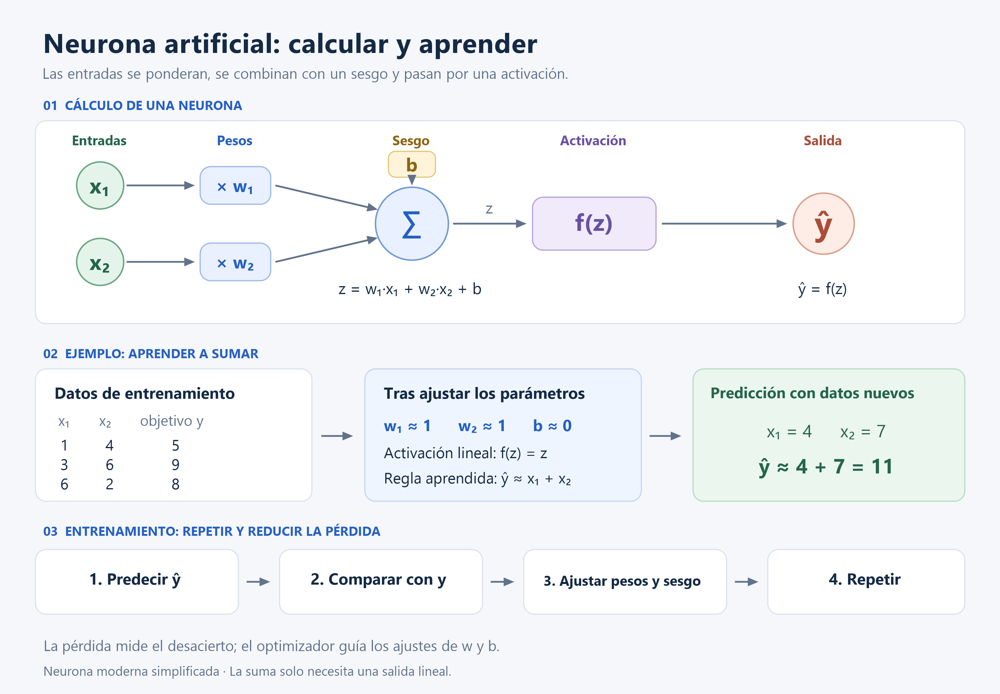

Para dos entradas, el cálculo es:

**suma = entrada₁ × peso₁ + entrada₂ × peso₂ + sesgo**

La **función de activación** transforma esa suma antes de entregarla como salida. Por ejemplo, ReLU conserva los valores positivos y convierte los negativos en cero. Estas transformaciones permiten que varias capas aprendan relaciones complejas.

Para aprender a sumar basta una salida lineal, que deja la suma tal cual. Con pesos 1 y 1 y sesgo 0, las entradas 4 y 7 producen 11. [Referencia: neuronas y activaciones](https://developers.google.com/machine-learning/crash-course/neural-networks/nodes-hidden-layers).

**Aprender** consiste en predecir, medir el desacierto y ajustar los parámetros. La medida del desacierto se llama **pérdida**. El **optimizador** calcula ajustes para reducirla: en el ejemplo del taxi, modificaría los importes estimados al comparar las predicciones con los precios conocidos.

La **tasa de aprendizaje** controla el tamaño de cada ajuste: pasos excesivos pueden desestabilizar el aprendizaje; pasos muy pequeños lo hacen lento. El ciclo completo se desarrolla en [entrenamiento de un LLM](#9-entrenamiento-de-la-arquitectura-al-llm). [Referencia: descenso de gradiente](https://developers.google.com/machine-learning/crash-course/linear-regression/gradient-descent).

Al conectar muchas neuronas aparecen **capas**: entrada, capas intermedias u **ocultas**, y salida. «Ocultas» significa internas al cálculo. El **aprendizaje profundo** utiliza redes con múltiples capas de procesamiento.

**Vídeo de apoyo:** [¿Qué es una red neuronal? Parte 1: La neurona — DotCSV](https://youtu.be/MRIv2IwFTPg).

**Comprueba lo aprendido**

1. Con entradas 2 y 3, pesos 4 y 1, sesgo 2 y salida lineal, ¿qué resultado se obtiene?
2. Durante el entrenamiento, ¿se ajustan las entradas de los ejemplos o los parámetros de la red?

<details>
<summary>Ver respuestas</summary>

1. 2 × 4 + 3 × 1 + 2 = **13**.
2. Los parámetros. Los ejemplos proporcionan los datos con los que aprender.

</details>

<a id="6-embeddings-representar-con-números"></a>

## 6. Embeddings: representar con números ✅

Los IDs de tokens identifican piezas de texto. Para procesarlas, una red usa **embeddings**: listas de números llamadas **vectores**. Cada número es una componente o **dimensión** del vector.

La analogía es un mapa: el ID identifica un lugar y el vector aporta unas coordenadas. El entrenamiento puede situar cerca elementos con usos relacionados. La **semántica** se refiere al significado; esas relaciones numéricas pueden reflejar semejanzas semánticas.

Ejemplo inventado, suponiendo un token por palabra:

| Token | ID | Vector de tres dimensiones |
| --- | --- | --- |
| violín | 314 | [0,80; 0,20; 0,10] |
| guitarra | 572 | [0,75; 0,25; 0,12] |
| bicicleta | 901 | [−0,30; 0,60; 0,80] |

La **tabla de embeddings** guarda una fila por token. Su ID permite recuperar esa fila y sus valores aprendidos. [Referencias: espacio de embeddings](https://developers.google.com/machine-learning/crash-course/embeddings/embedding-space) y [consulta por ID](https://docs.pytorch.org/docs/stable/generated/torch.nn.Embedding.html).

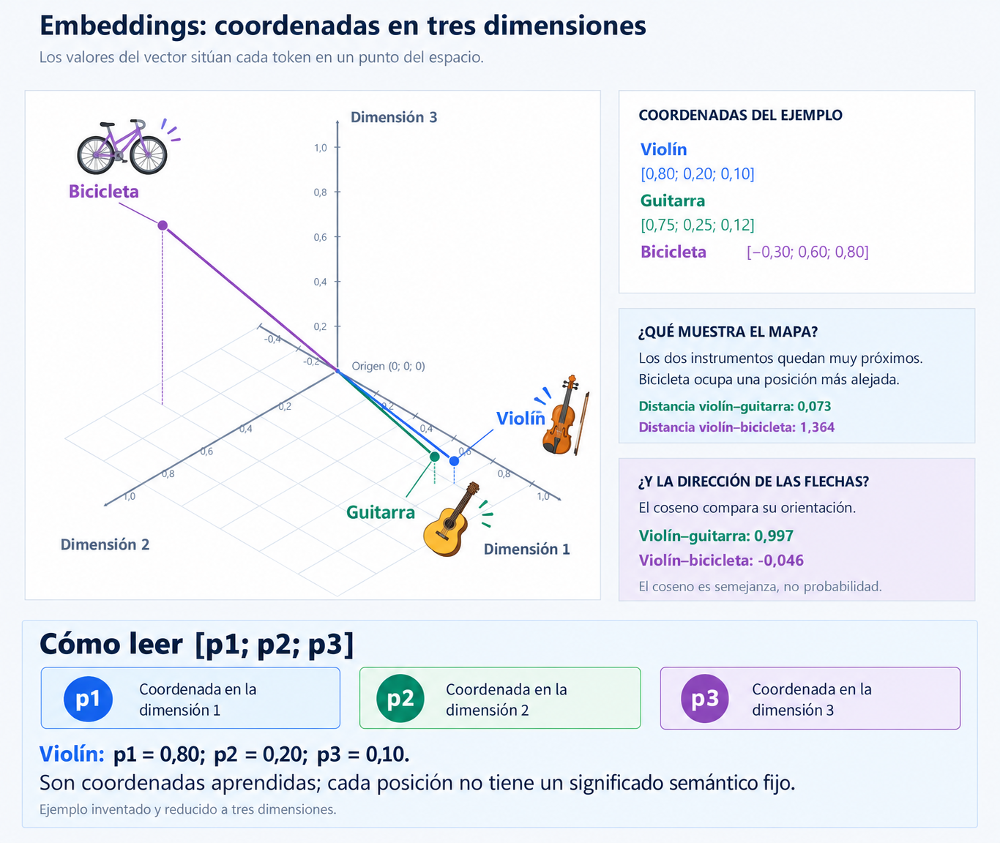

**Cómo leer `[p1; p2; p3]`:** cada posición contiene una coordenada. **p1** corresponde a la dimensión 1; **p2**, a la dimensión 2; y **p3**, a la dimensión 3. En el vector de violín, p1 = **0,80**, p2 = **0,20** y p3 = **0,10**.

Cada eje representa una de esas dimensiones. Las flechas parten del origen y llegan a las coordenadas de cada token: **violín y guitarra quedan próximos**, mientras **bicicleta queda más alejada**. Las componentes son características aprendidas; no tienen por qué corresponder a propiedades fijas como «música» o «tamaño». Los valores del dibujo son inventados.

Para comparar vectores se puede medir su distancia o la semejanza de su dirección. La **similitud del coseno** compara direcciones y va de −1 a 1. Con los números de la tabla, violín–guitarra da aproximadamente **0,997**; violín–bicicleta, **−0,046**. Son valores ilustrativos, no probabilidades. Solo deben compararse vectores de espacios compatibles. [Referencia: medidas de similitud](https://www.sbert.net/docs/sentence_transformer/usage/semantic_textual_similarity.html).

Hay dos momentos distintos:

| Momento | Qué sucede |
| --- | --- |
| **Consulta inicial** | Con parámetros fijos, el mismo ID recupera el mismo vector de la tabla. |
| **Procesamiento del contexto** | Las capas calculan nuevas representaciones según la posición y la información disponible. |

Estas representaciones internas se llaman **estados ocultos** (*hidden states*). En el ejemplo de [«vela»](#3-contexto-la-información-disponible), un mismo token puede partir del mismo vector y terminar con representaciones distintas para navegación e iluminación.

La tabla suele inicializarse aleatoriamente al entrenar desde cero y se ajusta con el [ciclo de aprendizaje](#9-entrenamiento-de-la-arquitectura-al-llm); también puede reutilizarse una tabla ya entrenada. Durante el uso habitual cambian los estados calculados para cada texto, mientras los parámetros permanecen fijos. [Referencia: aprendizaje y contextualización de embeddings](https://developers.google.com/machine-learning/crash-course/embeddings/obtaining-embeddings).

También hay modelos que representan frases o documentos mediante un vector. Permiten, por ejemplo, encontrar «Reparación de neumáticos de bicicleta» al buscar «arreglar una rueda pinchada»: es **búsqueda semántica**.

**Comprueba lo aprendido**

1. ¿Qué diferencia hay entre el ID de un token y su embedding?
2. ¿Un mismo token debe tener el mismo estado contextual en cualquier frase?

<details>
<summary>Ver respuestas</summary>

1. El ID identifica una entrada; el embedding es la lista de valores que utiliza la red.
2. No: la representación contextual depende de la información que lo acompaña.

</details>

<a id="7-rnn-leer-con-una-memoria-que-se-actualiza"></a>

## 7. RNN: leer con una memoria que se actualiza ✅

Una **red neuronal recurrente (RNN, Recurrent Neural Network)** procesa datos **secuenciales**, en los que el orden importa: una frase, una grabación o las mediciones de un sensor.

Imagina que lees una historia y reescribes una nota breve después de cada palabra. La RNN hace algo parecido con un estado interno numérico:

1. Recibe la entrada actual.
2. La combina con el estado anterior.
3. Calcula un estado nuevo.
4. Lo pasa al siguiente paso.

Los pesos se reutilizan durante la lectura; lo que va cambiando es el estado. [Referencia: funcionamiento de una RNN](https://d2l.ai/chapter_recurrent-neural-networks/rnn.html).

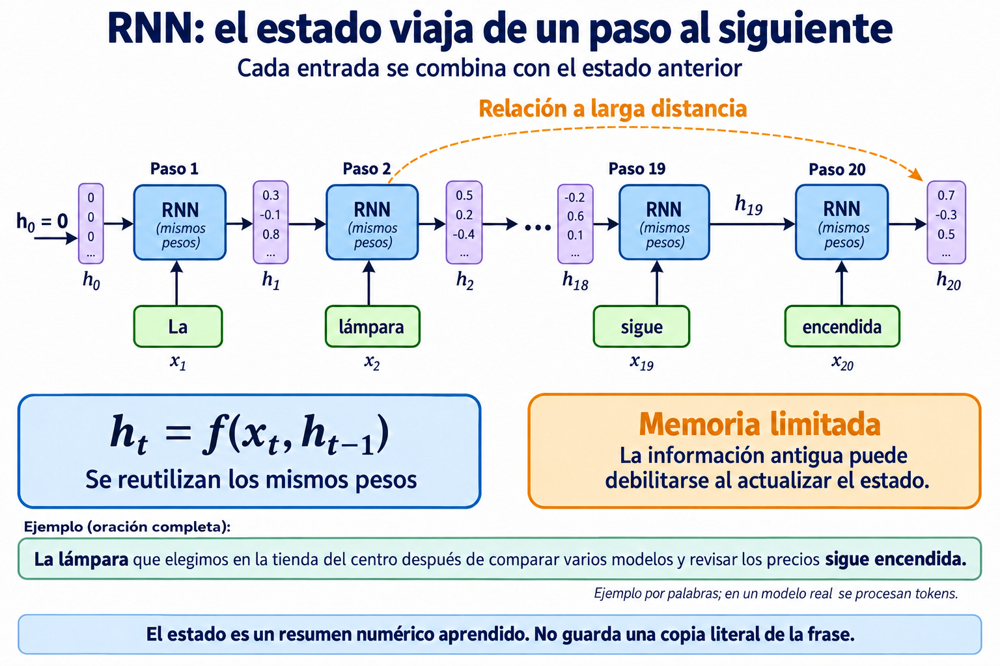

El diagrama omite pasos intermedios y usa valores ilustrativos. En la frase:

> La lámpara que elegimos en la tienda del centro después de comparar varios modelos y revisar los precios sigue encendida.

La información sobre **«lámpara»** debe conservarse hasta **«encendida»**. Cada palabra cuenta como un paso en este ejemplo.

La **memoria de corto plazo** describe la tendencia de una RNN básica a conservar mejor lo reciente. Su nota tiene un tamaño fijo: al actualizarla repetidamente, puede perder detalles antiguos. Esa dificultad suele llamarse «amnesia».

Durante el entrenamiento, la señal que indica qué ajustar también puede debilitarse al recorrer muchos pasos: es el **desvanecimiento del gradiente**, parecido a un mensaje que llega cada vez más tenue. En otros casos crece demasiado: son los **gradientes explosivos**. No existe una cantidad universal de palabras tras la que la red olvide. [Referencia: aprendizaje a través del tiempo](https://d2l.ai/chapter_recurrent-neural-networks/bptt.html).

### LSTM: conservar una memoria y elegir qué utilizar

Una **LSTM** (*Long Short-Term Memory*) es una variante de RNN diseñada para conservar información relevante durante más pasos. Imagina leer con una **libreta de datos que quieres mantener** y un **resumen de lo que necesitas ahora**.

La libreta representa el **estado de celda**, una memoria interna adicional. El resumen representa el **estado oculto**, que se transmite al paso siguiente y puede utilizarse para producir una salida.

Tres **compuertas** regulan el proceso:

| Compuerta | Qué controla | En la analogía |
| --- | --- | --- |
| **Olvido** | Cuánto de la memoria anterior se conserva. | Mantener o atenuar apuntes anteriores. |
| **Entrada** | Cuánta información nueva se incorpora. | Añadir datos a la libreta. |
| **Salida** | Cuánto del estado de celda transformado pasa al estado oculto. | Elegir qué usar en el resumen actual. |

Son cálculos aprendidos, con valores entre 0 y 1 para regular cada componente. La libreta es una analogía: la red guarda vectores, no frases escritas. [Referencia: memoria y compuertas de una LSTM](https://d2l.ai/chapter_recurrent-modern/lstm.html).

### GRU: actualizar una única memoria

Una **GRU** (*Gated Recurrent Unit*) también regula qué recordar, con una estructura más sencilla: utiliza **un estado interno**, sin separar una memoria de celda y un estado oculto.

Tiene dos compuertas:

- **Reinicio:** regula cuánto del estado anterior se utiliza al preparar información nueva candidata.
- **Actualización:** combina esa propuesta con el estado anterior y determina cuánto se conserva y cuánto se sustituye.

En la analogía, trabajas con **una sola nota**: preparas una revisión usando más o menos información anterior y después decides cuánto cambiar. A igual tamaño de estado y de entrada, una GRU estándar tiene menos parámetros que una LSTM estándar. La elección depende de la tarea. [Referencia: compuertas de una GRU](https://d2l.ai/chapter_recurrent-modern/gru.html).

**Aplicado a la frase de la lámpara:** estas redes pueden aprender a conservar información del objeto principal mientras pasan los detalles de la tienda y los precios, y utilizarla al procesar «encendida». Las compuertas facilitan esa continuidad y el aprendizaje de relaciones lejanas; no garantizan recordar todos los detalles ni eliminan todos los problemas del gradiente.

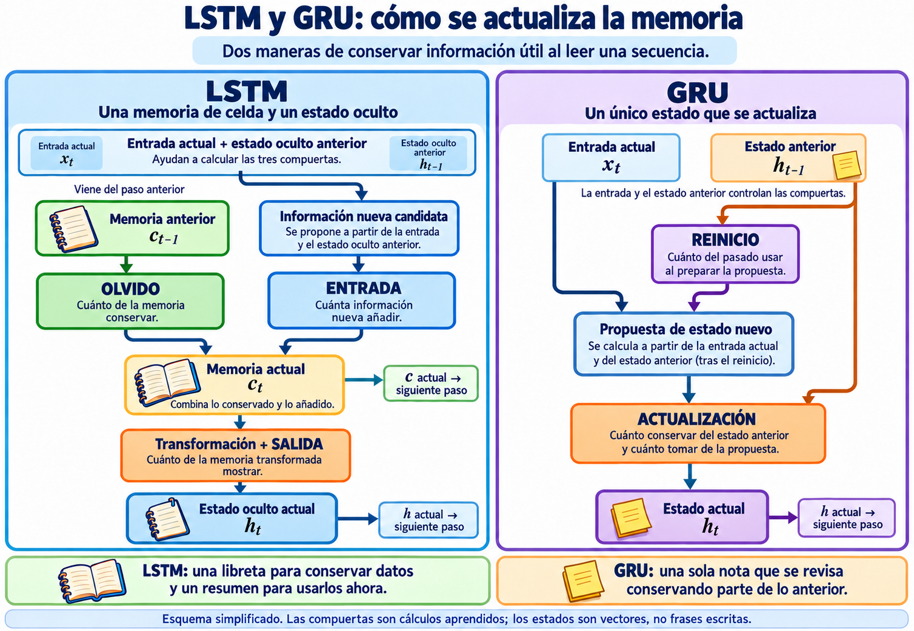

El diagrama muestra **un paso de lectura**. Sigue las flechas de arriba abajo: **c** representa el estado de celda y **h**, el estado oculto que se transmite al paso siguiente.

La pregunta siguiente es: **¿y si el modelo pudiera consultar directamente una parte anterior, en vez de depender solo de una nota que se transmite paso a paso?**

**Comprueba lo aprendido**

1. ¿Qué dos elementos combina una RNN en cada paso?
2. En la analogía, ¿qué diferencia hay entre la memoria de una LSTM y la de una GRU?

<details>
<summary>Ver respuestas</summary>

1. La entrada actual y el estado anterior.
2. La LSTM tiene una libreta —estado de celda— y un resumen actual —estado oculto—; la GRU actualiza un único estado interno.

</details>

<a id="8-transformer-relacionar-partes-del-texto"></a>

## 8. Transformer: relacionar partes del texto ✅

Un **Transformer** es una forma de organizar una red neuronal, es decir, una **arquitectura**. Su mecanismo principal, la **atención**, combina información de distintas posiciones del texto.

La analogía es leer con un subrayador: al interpretar una palabra, puedes volver a las partes relevantes. El modelo calcula pesos de atención para decidir cuánto aporta cada posición permitida.

> La ventana que instalamos junto al balcón tras comparar varios modelos sigue **abierta**.

Para representar «abierta», resulta útil relacionarla con «ventana». La **autoatención** consulta elementos de la misma secuencia. Varias **cabezas de atención** realizan cálculos distintos y combinan sus resultados; sus funciones se aprenden, sin asignar de antemano una cabeza a la gramática y otra al significado.

El recorrido básico es:

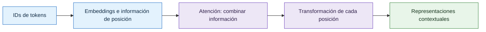

La información de posición permite distinguir el orden: «Ana llamó a Luis» y «Luis llamó a Ana» contienen las mismas palabras, pero cuentan cosas diferentes. Las transformaciones se repiten en varias capas. [Referencias: Transformer original](https://arxiv.org/abs/1706.03762) y [posición](https://d2l.ai/chapter_attention-mechanisms-and-transformers/self-attention-and-positional-encoding.html).

### Para qué se usa la máscara causal

Un modelo que aprende a **continuar texto** debe practicar con la información que tendría al escribirlo. Si pudiera consultar la palabra que debe predecir, podría copiar la respuesta en vez de aprender a anticiparla.

La **máscara causal** establece qué posiciones puede consultar la atención: **cada posición ve su propio token y los anteriores; las posiciones posteriores quedan bloqueadas**. Es como tapar la parte final de una frase al practicar cómo completarla.

Por ejemplo, para predecir «llaves» en «Marta guardó las llaves», se utiliza «Marta guardó las», sin consultar «llaves» ni lo que venga después. Aquí tratamos cada palabra como un token para simplificar.

Esta regla distingue las siguientes variantes: los **decodificadores causales** la utilizan para aprender a generar continuaciones; un codificador como BERT puede consultar ambos lados del texto. [Referencias: máscara del Transformer](https://arxiv.org/abs/1706.03762) y [contexto bidireccional de BERT](https://arxiv.org/abs/1810.04805).

| Variante | Función habitual | Ejemplo |
| --- | --- | --- |
| **Codificador** | Construye representaciones consultando ambos lados del texto. | BERT. |
| **Decodificador causal** | Predice la continuación usando las posiciones permitidas hasta ese momento. | GPT. |
| **Codificador y decodificador** | Uno representa la entrada; el otro genera una salida consultándola. | Transformer original, aplicado a traducción. |

En el entrenamiento pueden calcularse muchas posiciones en paralelo manteniendo esa restricción. Al generar de forma **autorregresiva**, se añade un token cada vez y se usa para continuar, como veremos en [inferencia](#10-inferencia-del-mensaje-a-la-respuesta). [Referencias: Transformer](https://arxiv.org/abs/1706.03762) y [GPT](https://openai.com/index/language-unsupervised/).

<details>
<summary>Ampliación visual: leer el diagrama del Transformer original</summary>

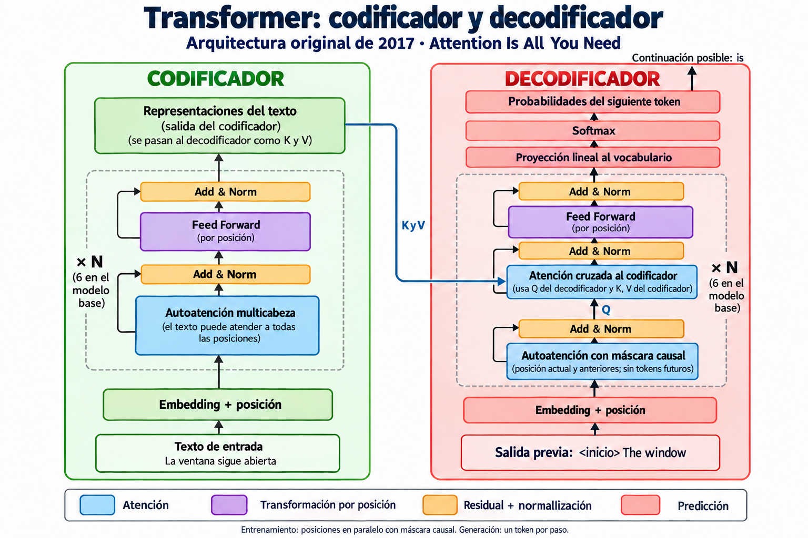

El diagrama se lee **de abajo arriba** y representa una **traducción del español al inglés**. El codificador recibe «La ventana sigue abierta». El decodificador construye «The window is open»: cuando ya tiene «The window» —«La ventana»—, puede proponer «is» —«está»— como continuación. El inglés aparece como idioma de salida de este ejemplo.

Algunas etiquetas conservan sus nombres técnicos en inglés para reconocerlas en el diagrama:

| Bloque | Qué hace |
| --- | --- |
| **Embedding + posición** | Prepara las representaciones y la información de orden. |
| **Autoatención multicabeza** | Combina información dentro de una secuencia. |
| **Atención enmascarada** | Excluye posiciones futuras. |
| **Atención cruzada** | Permite que el decodificador consulte la salida del codificador. |
| **Red de avance hacia delante (Feed Forward)** | Transforma cada posición con una pequeña red neuronal. |
| **Suma y normalización (Add & Norm)** | Suma una entrada con su transformación y normaliza valores para facilitar el procesamiento. |
| **Proyección lineal y softmax** | Calcula puntuaciones para los tokens del vocabulario y las convierte en probabilidades que suman 1. |

Los bloques se repiten: seis capas en cada pila del modelo base original, con parámetros propios por capa. En su entrenamiento, la salida objetivo se desplaza una posición para que cada paso aprenda a predecir el siguiente token.

Para calcular atención se obtienen tres vectores:

- **Q — consulta:** qué se busca.
- **K — clave:** con qué se compara la consulta.
- **V — valor:** información que se combinará.

Como al buscar en un catálogo, la consulta se compara con las claves y determina qué información recuperar. Matemáticamente, se puntúan las coincidencias Q–K, se normalizan y se combinan los V con esos pesos. Son representaciones aprendidas, no etiquetas escritas por una persona.

En autoatención proceden de la misma secuencia; en atención cruzada, Q viene del decodificador y K y V del codificador. [Referencias: artículo original](https://proceedings.neurips.cc/paper_files/paper/2017/file/3f5ee243547dee91fbd053c1c4a845aa-Paper.pdf) y [cálculo de atención](https://d2l.ai/chapter_attention-mechanisms-and-transformers/attention-scoring-functions.html).

</details>

La atención facilita conectar posiciones lejanas, pero el modelo sigue limitado por su [ventana de contexto](#3-contexto-la-información-disponible) y por su capacidad para aprovecharla.

**Vídeo de apoyo:** [¿Qué es un Transformer? La red neuronal que lo cambió todo](https://youtu.be/aL-EmKuB078).

**Comprueba lo aprendido**

1. ¿Qué permite conectar «ventana» con «abierta» sin transmitir toda la información palabra a palabra?
2. ¿Por qué un decodificador causal no puede consultar la respuesta futura durante el entrenamiento?

<details>
<summary>Ver respuestas</summary>

1. La atención entre posiciones.
2. Porque debe aprender a predecir con la información disponible antes de esa respuesta; la máscara bloquea el acceso al futuro.

</details>

## 9. Entrenamiento: de la arquitectura al LLM

El Transformer describe la organización de la red. El **entrenamiento** ajusta sus parámetros para que aprenda a trabajar con lenguaje. Es como pasar del diseño de un instrumento a un instrumento afinado mediante práctica.

**Arquitectura + tokenizador + datos + entrenamiento → modelo de lenguaje entrenado.**

En muchos LLM conversacionales, el recorrido es el siguiente. Las fases concretas varían y la evaluación acompaña a todo el proceso.

| Fase | Qué ocurre | Analogía |
| --- | --- | --- |
| **1. Preparar datos** | Reunir un **corpus** —conjunto de textos—, filtrar contenido, limpiar y reducir duplicados. Separar datos de entrenamiento, validación y prueba. | Elegir material de estudio y reservar ejercicios para comprobar el aprendizaje. |
| **2. Configurar** | Tokenizar los datos, organizarlos en lotes y definir las capas y tamaños del modelo. Inicializar parámetros o recuperar los de un modelo existente. | Preparar el material y el equipo. |
| **3. Preentrenar** | Aprender patrones generales. En un modelo causal, el propio texto proporciona el siguiente token que se debe predecir. | Practicar con muchos ejercicios cuya solución ya está disponible. |
| **4. Ajustar con instrucciones (SFT)** | Continuar el entrenamiento con ejemplos de instrucciones y respuestas deseadas. | Practicar cómo resolver tareas concretas. |
| **5. Ajustar según preferencias** | Utilizar comparaciones de respuestas para favorecer comportamientos elegidos. | Recibir comentarios sobre qué respuesta es más útil o fiel. |
| **6. Evaluar y revisar** | Medir capacidades, errores, invenciones, sesgos, seguridad y rendimiento; revisar datos o ajustes cuando haga falta. | Examinarse con ejercicios nuevos y revisar los fallos. |

La **validación** orienta decisiones durante el desarrollo; las **pruebas** permiten valorar el resultado final con datos reservados. [Referencias: preparación de datos, FineWeb](https://arxiv.org/abs/2406.17557), [preentrenamiento](https://huggingface.co/learn/llm-course/chapter7/6) y [SFT](https://huggingface.co/learn/llm-course/chapter11/3).

El núcleo del preentrenamiento se repite:

```text
Lote de tokens → embeddings → predicción → pérdida
                                ↑            ↓
                         nuevo cálculo ← ajuste de parámetros
```

Por ejemplo, en «Al amanecer sale el sol», el contexto «Al amanecer sale el» permite practicar la predicción de «sol». Se usa una palabra completa para simplificar; el objetivo real se define por tokens.

La **retropropagación** calcula cómo influye cada parámetro entrenable en la pérdida. Esa información forma los **gradientes**, que el optimizador utiliza para ajustar parámetros, incluidos los embeddings entrenables. Se parece a averiguar qué controles conviene mover y cuánto para reducir un error.

Un **lote** es un grupo de ejemplos; un **paso** aplica una actualización; una **época** recorre una vez el conjunto de entrenamiento. [Referencia: optimización por lotes](https://d2l.ai/chapter_optimization/minibatch-sgd.html).

<details>
<summary>Ampliación: instrucciones, RLHF y DPO</summary>

**SFT** significa *Supervised Fine-Tuning*, o ajuste fino supervisado. Un ejemplo puede ser:

> **Instrucción:** Resume: «El barco salió del puerto y llegó a la isla».
>
> **Respuesta deseada:** El barco llegó a la isla.

Para ajustar preferencias, se puede comparar esa respuesta con otra que invente un día de llegada. Las evaluaciones se convierten en datos para favorecer respuestas más fieles.

- **RLHF**, aprendizaje por refuerzo con retroalimentación humana: en un enfoque habitual, primero se aprende un modelo que puntúa respuestas y luego se utiliza esa señal para ajustar el modelo de lenguaje.
- **DPO**, optimización directa de preferencias: utiliza pares de respuestas preferidas y descartadas sin entrenar un modelo de recompensa separado.

Son enfoques posibles del **posentrenamiento**, las etapas posteriores al preentrenamiento. No forman una receta obligatoria e idéntica para todos los modelos. [Referencias: InstructGPT](https://arxiv.org/abs/2203.02155) y [DPO](https://arxiv.org/abs/2305.18290).

</details>

Tras entrenar, llega la [inferencia](#10-inferencia-del-mensaje-a-la-respuesta): usar lo aprendido para responder. La siguiente sección explica cómo se construye cada continuación.

**Comprueba lo aprendido**

1. ¿Por qué conviene evaluar con ejemplos distintos de los utilizados para ajustar parámetros?
2. ¿Qué diferencia hay entre preentrenamiento y ajuste con instrucciones?

<details>
<summary>Ver respuestas</summary>

1. Para comprobar si el modelo aplica lo aprendido a casos nuevos, en vez de limitarse a reproducir ejemplos conocidos.
2. El preentrenamiento aprende patrones generales; el ajuste con instrucciones orienta el modelo mediante ejemplos de tareas y respuestas.

</details>

## 10. Inferencia: del mensaje a la respuesta

La **inferencia** es el uso de un modelo ya entrenado. Para generar texto, un LLM causal calcula posibles continuaciones, elige un token y vuelve a continuar con él.

Es como escribir con un autocompletado que se actualiza después de cada elección. La respuesta se construye paso a paso; el contexto va creciendo y los parámetros habitualmente permanecen fijos.

### El recorrido paso a paso

| Paso | Qué ocurre |
| --- | --- |
| **1. Preparar el contexto** | Se reúne el **prompt** —instrucción, pregunta o texto inicial— junto con las instrucciones y el historial disponibles. |
| **2. Tokenizar** | El [tokenizador](#2-tokens-dividir-el-texto-en-piezas) convierte ese texto en IDs de tokens compatibles con el modelo. |
| **3. Consultar embeddings** | Cada ID recupera su vector de la [tabla aprendida](#6-embeddings-representar-con-números). |
| **4. Incorporar posición** | Se introduce información sobre el orden de los tokens mediante el mecanismo de la arquitectura. |
| **5. Procesar las capas** | Las representaciones recorren las capas del [Transformer](#8-transformer-relacionar-partes-del-texto). Los pasos 6 y 7 ocurren dentro de ellas. |
| **6. Aplicar autoatención causal** | Cada posición combina información de sí misma y de posiciones anteriores permitidas. La máscara impide consultar tokens futuros. |
| **7. Transformar las representaciones** | La atención y las demás operaciones de las capas producen estados ocultos contextuales. El estado final de la última posición disponible se utiliza para predecir la continuación. |
| **8. Calcular posibilidades** | Una capa de salida convierte ese estado en puntuaciones para el vocabulario, llamadas **logits**. Softmax permite convertirlas en probabilidades. |
| **9. Elegir y añadir un token** | La regla de selección escoge un ID y lo incorpora a la secuencia. |
| **10. Continuar o terminar** | Se calcula la siguiente continuación hasta alcanzar una señal de fin, un límite de tokens u otra condición de parada. |

Las operaciones internas se desarrollan en el [diagrama del Transformer](#8-transformer-relacionar-partes-del-texto). La decodificación de los IDs permite mostrar texto; puede hacerse progresivamente mientras llega la respuesta. [Referencias: generación de texto](https://huggingface.co/docs/transformers/llm_tutorial) y [arquitectura original](https://arxiv.org/abs/1706.03762).

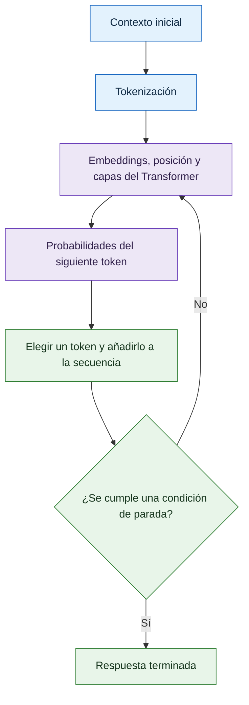

### Ejemplo: completar una frase

Texto inicial: **«Marta guardó las llaves en»**. Para simplificar, cada palabra y signo de puntuación cuenta como un token; la segmentación real puede ser distinta.

Una distribución inventada para el siguiente token sería:

| Continuación | Probabilidad |
| --- | --- |
| el | 50 % |
| la | 25 % |
| su | 15 % |
| Otras opciones, agrupadas | 10 % |

Hay dos formas sencillas de elegir:

- **Selección determinista:** escoger el token más probable; aquí, «el».
- **Muestreo:** sortear según las probabilidades, como sacar una papeleta de una bolsa. Puede salir una opción diferente de «el».

**Probabilístico** describe las posibilidades calculadas; **aleatorio** describe una forma de elegir. Un modelo probabilístico puede utilizar una selección determinista. [Referencia: estrategias de selección](https://huggingface.co/docs/transformers/generation_strategies).

Una continuación posible sería:

```text
Marta guardó las llaves en        → el
Marta guardó las llaves en el     → cajón
Marta guardó las llaves en el cajón → .
Marta guardó las llaves en el cajón. → [fin]
```

En cada fila se calculan nuevas probabilidades con el contexto ampliado. **[fin]** representa aquí una señal especial de terminación; el punto por sí solo no obliga a detenerse. Elegir una continuación probable tampoco garantiza que lo escrito sea cierto.

### Gestionar el contexto durante la inferencia

La [ventana de contexto](#3-contexto-la-información-disponible) determina qué información hay disponible. Al generar una respuesta, también hay que considerar **cuánto espacio queda para continuar**.

**Entrada y salida:** el límite de contexto y el de salida son distintos. Cuando comparten presupuesto, las instrucciones, el historial y los datos de entrada deben dejar margen para los tokens nuevos:

```text
Ventana de ejemplo: 8.192 tokens
Entrada:           6.500 tokens
Margen restante:   1.692 tokens para la generación
```

El reparto y los límites concretos dependen del modelo y del servicio. Por ejemplo, con una entrada de 7.500 tokens solo quedarían **692**, por lo que generar 1.000 no cabría en esa ventana compartida. Habría que reducir la entrada, acortar la salida o ampliar la configuración si es compatible. [Referencia: presupuestos de entrada y salida](https://ai.google.dev/gemini-api/docs/long-context).

**Razonamiento:** algunos modelos generan tokens intermedios antes de la respuesta final. Pueden consumir presupuesto aunque la interfaz no los muestre. Que se conserven en turnos posteriores depende del modelo y la aplicación. Los cálculos internos de las capas, por sí solos, no equivalen a nuevos tokens añadidos al historial. [Referencia: contexto con razonamiento](https://platform.claude.com/docs/en/build-with-claude/context-windows#the-context-window-with-thinking).

**Al alcanzar el límite:** el sistema puede recortar historial, resumirlo, detener la generación o rechazar la solicitud. Puede priorizar lo reciente y mantener ciertas instrucciones. La «amnesia» describe aquí la pérdida de acceso a información del contexto, no un borrado de los pesos aprendidos. Si «el presupuesto es de 300 €» quedó fuera del contexto enviado, el modelo puede dejar de respetarlo. [Referencias: límites y gestión del contexto](https://platform.claude.com/docs/en/build-with-claude/context-windows#context-window-overflow-behavior) y [selección y resumen](https://ai.google.dev/gemini-api/docs/long-context).

**Cuándo abrir una sesión nueva:** es útil al cambiar de tarea o acumular intentos descartados e instrucciones contradictorias. Para continuar el mismo proyecto, lleva un resumen con **objetivo, restricciones, decisiones vigentes y datos imprescindibles**. Las instrucciones propias de la aplicación pueden seguir presentes en la sesión nueva.

### Temperatura, top-k y top-p

Estos ajustes controlan cómo se elige el **siguiente token** durante la inferencia. Piensa en una lista de sugerencias ordenadas de más a menos probables:

| Ajuste | Pregunta que resuelve |
| --- | --- |
| **Temperatura** | ¿Cuánto favorecemos las opciones que ya son más probables? |
| **Top-k** | ¿Con cuántas opciones de la lista nos quedamos? |
| **Top-p** | ¿Cuántas opciones necesitamos para acumular una probabilidad determinada? |

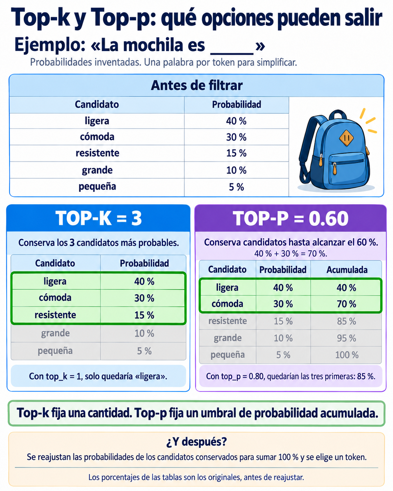

**Temperatura:** modifica la concentración de las probabilidades. Un valor bajo, como **0.2**, favorece más las opciones mejor puntuadas y suele producir respuestas más predecibles. Al subirla, las opciones menos probables ganan peso relativo y puede aumentar la variedad. Una temperatura baja con muestreo aún puede dar resultados distintos. [Referencia: temperatura y top-k](https://huggingface.co/docs/transformers/internal/generation_utils#transformers.TemperatureLogitsWarper).

**Top-k:** conserva los *k* candidatos más probables y descarta el resto. En el ejemplo, **top_k = 1** deja solo «ligera»; **top_k = 3** permite «ligera», «cómoda» y «resistente». Un *k* pequeño restringe las elecciones; uno mayor permite más alternativas. Con *k* mayor que 1 todavía puede haber azar, y las opciones no se eligen todas con la misma probabilidad.

**Top-p**, o **muestreo de núcleo**, ordena los candidatos y conserva el conjunto mínimo cuya probabilidad acumulada alcanza el umbral:

- **top_p = 0.60:** el 40 % de «ligera» no basta; al sumar el 30 % de «cómoda» se llega al **70 %**. Se conservan ambas.
- **top_p = 0.80:** hace falta añadir «resistente» para llegar al **85 %**. Se conservan tres opciones.

El umbral se expresa entre 0 y 1: **0.60 significa 60 %**, no el 60 % del número de candidatos. Tras filtrar, se reajustan las probabilidades para que las opciones conservadas sumen 100 %. Con las dos primeras, pasarían a aproximadamente **57,1 % y 42,9 %**. [Referencia: muestreo de núcleo](https://arxiv.org/abs/1904.09751).

En la imagen se estudia cada filtro por separado. **Los ajustes pueden combinarse:** `top_p` puede recortar opciones que `top_k` había permitido. Si solo queda un candidato, cambiar la temperatura no crea alternativas.

Estos controles regulan la variedad, no verifican los hechos. Una **alucinación** es información inventada presentada como cierta; puede aparecer incluso con ajustes muy restrictivos. Más variedad no equivale automáticamente a mayor creatividad útil ni implica necesariamente más errores.

En la [parte práctica](#ajustar-la-generación-durante-una-conversación) aplicaremos estos valores y aprenderemos a guardarlos en una configuración reutilizable.

<details>
<summary>Ampliación: cómo se evita recalcular todo</summary>

La primera lectura del prompt suele llamarse **prefill**. Después llega la **generación incremental** o *decoding*: se producen nuevos tokens sucesivamente.

Para acelerar ese ciclo, una **caché KV** conserva las claves y los valores de atención de los tokens ya procesados. Es como guardar resultados intermedios de una cuenta para reutilizarlos. Así, cada nuevo paso puede aprovechar el trabajo anterior y procesar la nueva entrada sin recalcular todas las representaciones previas. Esta memoria de cálculo no implica entrenar el modelo. [Referencia: caché de atención](https://huggingface.co/docs/transformers/cache_explanation).

</details>

<details>
<summary>Ampliación: determinismo, azar y semillas</summary>

En programación, un proceso es **determinista** si repite el resultado con las mismas entradas, estado y condiciones. Sumar 8 y 5 siempre da 13; barajar tarjetas incorpora azar.

Muchos programas usan **pseudoaleatoriedad**: algoritmos que generan secuencias con apariencia aleatoria. Una **semilla** fija el punto de partida. Es como escoger dónde empezar a leer una lista muy larga: reiniciar el mismo generador con la misma semilla permite repetir la secuencia bajo las mismas condiciones; las llamadas sucesivas no tienen por qué dar el mismo número. [Referencia: generadores y semillas](https://docs.python.org/3/library/random.html).

Repetir exactamente una respuesta de un LLM depende también del modelo, el contexto, la configuración y las condiciones de ejecución.

</details>

**Comprueba lo aprendido**

1. ¿Qué ocurre con el token elegido antes de predecir el siguiente?
2. Con las probabilidades de la mochila, ¿qué candidatos conserva `top_p = 0.60`?

<details>
<summary>Ver respuestas</summary>

1. Se añade a la secuencia: tras elegir «el», se continúa a partir de «Marta guardó las llaves en el» y del resto del contexto disponible.
2. «Ligera» y «cómoda»: suman 70 %, el primer acumulado que alcanza el umbral del 60 %.

</details>

## 11. RAG: buscar información antes de responder

Durante la inferencia, el modelo utiliza lo aprendido y el contexto que recibe. Sin una conexión externa, no puede consultar por su cuenta el nuevo manual de una empresa ni sus documentos internos. Además, puede producir **alucinaciones**: afirmaciones que parecen convincentes, pero son falsas o no están respaldadas.

La **generación aumentada por recuperación**, o **RAG** (*Retrieval-Augmented Generation*), combina una búsqueda de información con la generación de una respuesta. La aplicación recupera contenido relevante y lo incorpora al contexto del LLM. Es como responder una consulta con el manual abierto por las páginas adecuadas. [Referencia: artículo de RAG](https://arxiv.org/abs/2005.11401).

### El flujo: preparar primero, consultar después

Este esquema muestra una versión habitual basada en búsqueda por embeddings. **La preparación se realiza al incorporar o actualizar documentos; la consulta, con cada pregunta.**

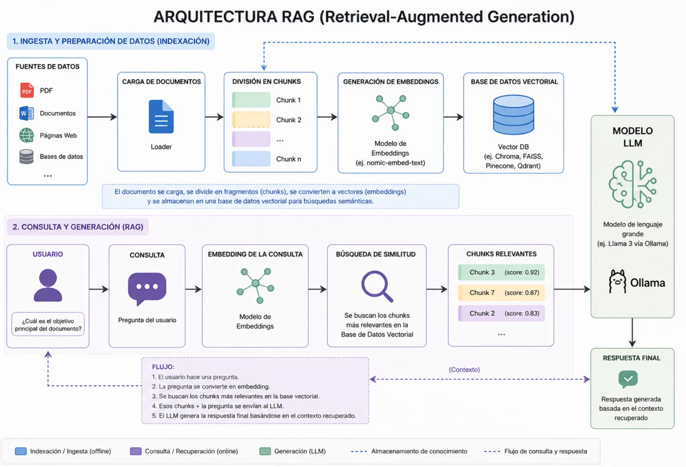

Fuente: [MetalCode — Programación IA](https://courses.metalcode.io/courses/take/programaci%C3%B3n-ia).

**Cómo leer la imagen:** la parte superior prepara e indexa los documentos; la inferior recupera chunks relevantes para cada consulta. El bloque verde representa al LLM y su respuesta. La pregunta y los textos recuperados forman parte del contexto: los fragmentos aportan datos y la pregunta indica qué hay que responder.

**En la preparación:**

- La **división en chunks** (*chunking*) consiste en separar el documento en fragmentos con sentido, como párrafos o secciones. Facilita localizar la explicación concreta sin enviar el manual entero. Conviene conservar títulos y evitar separar una regla de su excepción.
- Se calculan [embeddings](#6-embeddings-representar-con-números) para representar los fragmentos y se crea un **índice**, una estructura que permite buscarlos. También se guardan su texto y datos de origen, como documento, página y fecha. [Referencia: división de documentos](https://learn.microsoft.com/en-us/azure/search/vector-search-how-to-chunk-documents).

**Durante la consulta:**

- La pregunta se representa con el mismo modelo de embeddings, o uno compatible. Se compara con los vectores del índice para localizar contenido relacionado por significado.
- La aplicación selecciona los fragmentos útiles y envía **su texto**, junto con la pregunta y las instrucciones, al LLM. El modelo redacta una respuesta que puede citar esas fuentes.

Un **índice vectorial** permite buscar por cercanía entre vectores. Es una opción frecuente, pero RAG también puede usar palabras clave o combinar ambos métodos en una **búsqueda híbrida**. [Referencia: recuperación y generación](https://learn.microsoft.com/en-us/azure/search/retrieval-augmented-generation-overview).

### Ejemplo: consultar un manual de préstamo

Supongamos que el manual de un centro cultural contiene estas normas ficticias:

> **Manual, sección 4:** los instrumentos se prestan durante siete días. Se permite una renovación si nadie los ha reservado.

La pregunta es **«¿Puedo quedarme la guitarra una semana más?»**. La búsqueda puede relacionarla con «renovación» y «préstamo», aunque use palabras diferentes. Recupera esa sección y el LLM responde:

> Puedes solicitar una renovación si nadie ha reservado la guitarra. **Fuente: Manual, sección 4.**

El documento aporta la norma; el LLM la expresa como respuesta a la pregunta. Si se pregunta por una penalización que no aparece en los fragmentos recuperados, la respuesta adecuada es indicar que falta esa información.

### Qué aporta y qué límites tiene

RAG permite consultar fuentes recientes o internas **sin tener que reentrenar el LLM**. Para reflejar un cambio en el manual, se actualiza la fuente y su índice. El contenido recuperado ocupa parte de la [ventana de contexto](#3-contexto-la-información-disponible); los pesos del modelo no cambian por recibirlo.

La calidad depende tanto de **encontrar la información adecuada** como de **interpretarla correctamente**. Puede haber documentos desactualizados, fragmentos incompletos o errores en la respuesta. Una cita facilita comprobar lo dicho; por sí sola no demuestra que sea correcto. [Referencia: arquitectura y calidad de recuperación](https://learn.microsoft.com/en-us/azure/search/retrieval-augmented-generation-overview).

### Práctica en Python: documentos, embeddings y Chroma

El proyecto independiente [rag-python](rag-python/README.md) lleva este flujo a código comentado con LangChain y Ollama. Incluye carga de un TXT, división en fragmentos, embeddings, una base Chroma en memoria y otra persistente mediante `CHROMA_DIR`, además de consultas con los pasajes recuperados visibles.

**Comprueba lo aprendido**

1. El manual cambia el plazo de siete a diez días, pero el chat sigue diciendo siete. ¿Qué revisarías antes de plantear reentrenar el modelo?
2. El sistema encuentra el párrafo correcto, pero responde que siempre se puede renovar y omite la condición de las reservas. ¿El fallo está en la recuperación o en la generación?

<details>
<summary>Ver respuestas</summary>

1. Que la fuente y el índice estén actualizados, y qué fragmento se está enviando al LLM. Puede seguir recuperándose la versión antigua; no hace falta reentrenar para aportar la norma nueva.
2. En la generación o interpretación del contexto: la información necesaria sí fue recuperada, pero la respuesta dejó fuera una condición importante.

</details>

## 12. Historia: cómo llegamos hasta aquí

La historia combina varias líneas de trabajo. Esta cronología reúne los hitos de los conceptos anteriores:

| Fecha | Hito y aportación |
| --- | --- |
| **1906 y 1913** | Andréi Markov desarrolla sus trabajos sobre secuencias dependientes y después estudia relaciones entre vocales y consonantes en un texto. Son antecedentes de los modelos con memoria limitada. [Estudio histórico](https://www.its.caltech.edu/~matilde/TracesOfTheMouth.pdf). |
| **1943** | Warren S. McCulloch y Walter Pitts describen neuronas matemáticas y redes lógicas con conexiones fijas, un antecedente de las redes neuronales. [Artículo](https://home.csulb.edu/~cwallis/382/readings/482/mccolloch.logical.calculus.ideas.1943.pdf). |
| **1948** | Claude Shannon estudia aproximaciones estadísticas del lenguaje mediante secuencias. Los n-gramas se desarrollan y aplican durante las décadas posteriores. [Historia de los n-gramas](https://web.stanford.edu/~jurafsky/slp3/3.pdf). |
| **1950** | Alan Turing publica **Computing Machinery and Intelligence** y plantea el juego de imitación: evaluar si una conversación escrita de una máquina puede confundirse con la de una persona. La prueba evalúa comportamiento; no demuestra consciencia. [Artículo](https://courses.cs.umbc.edu/471/papers/turing.html). |
| **1955–1956** | John McCarthy introduce el término **inteligencia artificial** en la propuesta de Dartmouth de 1955, junto con Minsky, Rochester y Shannon. El encuentro de 1956 se considera el nacimiento formal del campo. [Propuesta](https://www-formal.stanford.edu/jmc/history/dartmouth/dartmouth.html) y [Dartmouth](https://ai.dartmouth.edu/founding-and-future-ai). |
| **1990** | Jeffrey Elman publica *Finding Structure in Time*, un trabajo de referencia sobre redes recurrentes. [Publicaciones del autor](https://jeffelman.ucsd.edu/research/publications/). |
| **1997** | Hochreiter y Schmidhuber presentan **LSTM** para facilitar el aprendizaje de relaciones lejanas en secuencias. [Artículo](https://doi.org/10.1162/neco.1997.9.8.1735). |
| **2003** | Bengio y colaboradores presentan un modelo neuronal de lenguaje que aprende representaciones de palabras junto con probabilidades. [Artículo](https://jmlr.csail.mit.edu/papers/v3/bengio03a). |
| **Década de 2010** | Se expanden los modelos neuronales de lenguaje. En 2014 aparecen **GRU** y un influyente trabajo de atención para traducción, presentado en 2015. [GRU](https://arxiv.org/abs/1406.1078) y [atención](https://arxiv.org/abs/1409.0473). |
| **2017** | Vaswani y colaboradores presentan **Attention Is All You Need** en NIPS 2017. Introducen el Transformer, que permite relacionar posiciones mediante atención y facilita el entrenamiento en paralelo. 🔝 [Artículo](https://arxiv.org/abs/1706.03762). |
| **2018** | Aparecen **GPT**, después llamado GPT-1, y **BERT**: dos formas de aprovechar el Transformer para tareas de lenguaje. BERT se publica en congreso en 2019. [GPT](https://openai.com/index/language-unsupervised/) y [BERT](https://arxiv.org/abs/1810.04805). |
| **2019–2020** | GPT-2 amplía la generación de texto; GPT-3 lleva la escala hasta **175.000 millones de parámetros** en su versión mayor. Esa cifra cuenta valores aprendidos, no tokens de contexto. [GPT-2](https://openai.com/index/better-language-models/) y [GPT-3](https://arxiv.org/abs/2005.14165). |
| **2020** | Patrick Lewis y colaboradores presentan **RAG**, combinando recuperación de pasajes y generación de lenguaje. [Artículo](https://arxiv.org/abs/2005.11401). |
| **2022** | Se investiga la combinación de lenguaje y acciones con **ReAct**. El **30 de noviembre** se lanza ChatGPT, inicialmente basado en GPT-3.5. [ReAct](https://arxiv.org/abs/2210.03629) y [ChatGPT](https://openai.com/index/chatgpt/). |
| **2023–2025** | GPT-4 documenta entrada de texto e imágenes. Se extienden las aplicaciones multimodales y el uso de herramientas en los años siguientes. [GPT-4](https://arxiv.org/abs/2303.08774) y [balance de 2025](https://developers.openai.com/blog/openai-for-developers-2025). |

**Comprueba lo aprendido**

1. ¿Qué distingue los hitos de Turing en 1950 y del Transformer en 2017?
2. ¿Los antecedentes matemáticos de los n-gramas son anteriores a la IA como campo formal?

<details>
<summary>Ver respuestas</summary>

1. Turing plantea una forma de evaluar el comportamiento conversacional; el Transformer aporta una arquitectura para procesar secuencias mediante atención.
2. Sí: los trabajos de Markov se remontan a comienzos del siglo XX; Dartmouth se celebró en 1956.

</details>

## 13. Práctica opcional en C#: aprender los puntos de un juego

Esta práctica requiere nociones de C#. Una sola neurona lineal aprende los puntos de una partida a partir de **monedas** y **gemas**.

Los ejemplos siguen la regla **puntos = 2 × monedas + 5 × gemas + 3**. El programa recibe esos ejemplos y ajusta dos pesos y un sesgo. Su función de predicción usa lo aprendido.

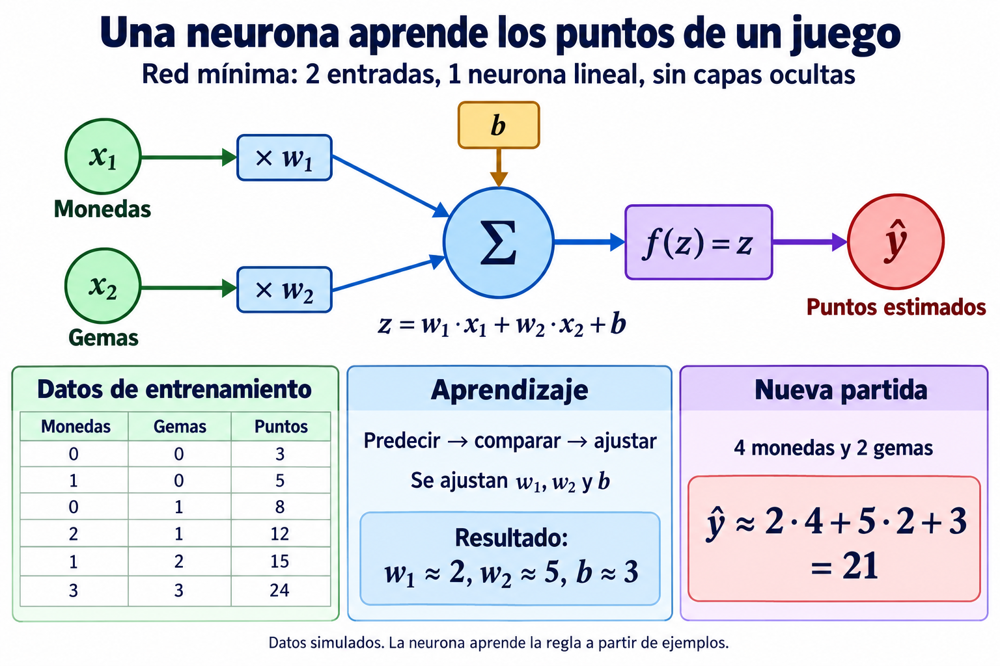

<details>
<summary>Ver el código C# comentado</summary>

```csharp
using System;

public class Program
{
    // Una neurona con dos entradas y activación lineal: f(z) = z.
    static double Predecir(double monedas, double gemas,
                           double w1, double w2, double sesgo)
    {
        return monedas * w1 + gemas * w2 + sesgo;
    }

    public static void Main()
    {
        // Cada fila contiene: monedas, gemas y puntos reales de la partida.
        double[,] datos =
        {
            { 0, 0,  3 },
            { 1, 0,  5 },
            { 0, 1,  8 },
            { 2, 1, 12 },
            { 1, 2, 15 },
            { 3, 3, 24 }
        };

        // Los valores que la neurona debe aprender empiezan en cero.
        double w1 = 0, w2 = 0, sesgo = 0;
        double tasa = 0.02; // Tamaño del paso de cada ajuste.
        int epocas = 6000;  // Número de pasadas por todos los datos.
        int cantidad = datos.GetLength(0);

        for (int epoca = 0; epoca < epocas; epoca++)
        {
            // Acumulamos gradientes antes de actualizar los parámetros.
            double gradW1 = 0, gradW2 = 0, gradSesgo = 0;

            for (int i = 0; i < cantidad; i++)
            {
                double x1 = datos[i, 0]; // Monedas de esta partida.
                double x2 = datos[i, 1]; // Gemas de esta partida.
                double y = datos[i, 2];  // Puntos que debería predecir.

                double prediccion = Predecir(x1, x2, w1, w2, sesgo);
                double error = prediccion - y;

                // Derivadas de la pérdida: L = suma(error²) / (2 * cantidad).
                gradW1 += error * x1;
                gradW2 += error * x2;
                gradSesgo += error;
            }

            // Descenso de gradiente: restamos el gradiente medio de cada parámetro.
            w1 -= tasa * gradW1 / cantidad;
            w2 -= tasa * gradW2 / cantidad;
            sesgo -= tasa * gradSesgo / cantidad;
        }

        // El entrenamiento aproxima w1 = 2, w2 = 5 y sesgo = 3.
        Console.WriteLine("w1 = {0:F4}, w2 = {1:F4}, sesgo = {2:F4}",
                          w1, w2, sesgo);

        // Esta combinación no aparece en los datos de entrenamiento.
        double puntos = Predecir(4, 2, w1, w2, sesgo);
        Console.WriteLine("4 monedas y 2 gemas: {0:F2} puntos", puntos);
    }
}
```

</details>

La red mínima equivale a una **regresión lineal**, un modelo que combina entradas mediante pesos y un término constante. No tiene capas ocultas.

El entrenamiento aproxima los pesos **2** y **5** y el sesgo **3**. Para la combinación nueva de 4 monedas y 2 gemas:

```text
4 × 2 + 2 × 5 + 3 = 21 puntos

w1 = 2,0000, w2 = 5,0000, sesgo = 3,0000
4 monedas y 2 gemas: 21,00 puntos
```

Cada época calcula el error sobre todos los ejemplos antes de actualizar parámetros. La pérdida usada es el promedio del error al cuadrado dividido entre dos; los gradientes indican cómo ajustar cada peso y el sesgo.

**Archivo ejecutable:** [NeuronaPuntosJuego.cs](ejemplos/NeuronaPuntosJuego.cs). Puede copiarse como `Program.cs` en un proyecto de consola C#; solo utiliza la biblioteca estándar. El separador decimal depende de la configuración regional. [Referencia: descenso de gradiente](https://developers.google.com/machine-learning/crash-course/linear-regression/gradient-descent).

**Comprueba lo aprendido**

1. Con los valores aprendidos, ¿cuántos puntos corresponden a 2 monedas y 4 gemas?
2. ¿Qué representa el sesgo 3 cuando no se recogen monedas ni gemas?

<details>
<summary>Ver respuestas</summary>

1. 2 × 2 + 4 × 5 + 3 = **27 puntos**. Puedes comprobarlo con `Predecir(2, 4, w1, w2, sesgo)`.
2. La puntuación base: **3 puntos**.

</details>

## 14. Práctica con Ollama: ejecutar modelos locales

**Ollama** es una herramienta para descargar y ejecutar modelos de IA en tu ordenador. Permite practicar la [inferencia](#10-inferencia-del-mensaje-a-la-respuesta) con un modelo ya entrenado.

Piensa en un reproductor y sus archivos: **Ollama es el programa que ejecuta; Gemma es una familia de modelos que puedes cargar**. Para trabajar en local necesitas descargar una variante compatible y disponer de recursos suficientes.

### Cómo leer el nombre de un modelo

```text
ollama run gemma4:e2b
│      │   │      └─ etiqueta de la variante elegida
│      │   └──────── familia y generación del modelo: Gemma 4
│      └──────────── acción: ejecutar
└─────────────────── programa: Ollama
```

Después de los dos puntos se indica la **etiqueta**, o *tag*. Conviene escribirla para elegir la variante concreta. [Referencia: catálogo de Gemma 4](https://ollama.com/library/gemma4).

La **B** procede del inglés *billion*: **mil millones de parámetros**. Los parámetros son los valores aprendidos que vimos en [redes neuronales](#5-redes-neuronales-aprender-ajustando); esta cifra expresa tamaño, no gigabytes de memoria ni tokens de contexto.

| Variante | Qué significa |
| --- | --- |
| **e2b** | Tamaño efectivo de unos 2.000 millones de parámetros. La **E** significa *effective*. |
| **e4b** | Tamaño efectivo de unos 4.000 millones de parámetros. |
| **12b** | Variante de unos 12.000 millones de parámetros. |
| **26b** | Modelo de mezcla de expertos: tiene unos 26.000 millones de parámetros totales y utiliza alrededor de 4.000 millones por token. |
| **31b** | Modelo denso de unos 31.000 millones de parámetros. |

En E2B y E4B, el tamaño **efectivo** no coincide con todos los parámetros almacenados: también hay componentes como los embeddings. En una **mezcla de expertos (MoE)**, distintos grupos de parámetros se activan según la entrada, como consultar a parte de un equipo de especialistas. Un modelo **denso** utiliza sus bloques de forma general, sin esa selección de expertos. [Referencia: variantes de Gemma 4](https://ai.google.dev/gemma/docs/core).

### Qué significan las etiquetas de capacidades

| Etiqueta | Qué indica |
| --- | --- |
| **vision** | Puede recibir imágenes para responder sobre ellas. |
| **audio** | Admite tareas con audio; hay que comprobar qué variante y aplicación las soportan. |
| **tools** | Puede solicitar llamadas a herramientas. La aplicación debe proporcionar esas herramientas y ejecutar las acciones. |
| **thinking** | Ofrece un modo de procesamiento adicional antes de la respuesta, según su configuración. |
| **cloud** | Hay variantes que se ejecutan en servidores remotos. Para ejecutar en tu equipo, elige una variante local como `gemma4:e2b`. |

Las etiquetas de la familia reúnen capacidades de sus variantes. Consulta la ficha concreta: no todas las variantes ni todas las interfaces ofrecen las mismas modalidades. [Referencias: catálogo de Ollama](https://ollama.com/library/gemma4) y [capacidades de Gemma](https://ai.google.dev/gemma/docs/core).

### Instalación y primera prueba en Windows

1. Descarga el instalador desde [Ollama para Windows](https://ollama.com/download/windows) y ejecútalo. Ollama queda disponible como aplicación y como comando de terminal.
2. Abre una ventana nueva de PowerShell y comprueba la instalación:

```powershell
ollama --version
```

3. Descarga y abre el modelo:

```powershell
ollama run gemma4:e2b
```

Si no está descargado, la primera ejecución lo obtiene de Internet. Cuando aparezca el indicador de conversación, escribe, por ejemplo:

```text
Explica en tres frases cómo se forma un arcoíris.
```

Para salir de la conversación, escribe **`/bye`**. Después puedes volver a ejecutarlo con el mismo comando. Un modelo local ya descargado puede generar respuestas sin conexión, siempre que la tarea no utilice servicios externos. [Referencias: instalación en Windows](https://docs.ollama.com/windows), [comandos](https://docs.ollama.com/cli) y [modo interactivo](https://github.com/ollama/ollama/blob/main/cmd/interactive.go).

### Comandos para el día a día

Estos comandos se escriben en PowerShell, fuera de la conversación con el modelo:

| Comando | Para qué sirve |
| --- | --- |
| `ollama pull gemma4:e2b` | Descargar el modelo sin iniciar una conversación. |
| `ollama run gemma4:e2b` | Ejecutar el modelo e iniciar una conversación. |
| `ollama list` | Ver los modelos descargados; `ollama ls` es equivalente. |
| `ollama show gemma4:e2b` | Consultar información del modelo. |
| `ollama ps` | Ver qué modelos están cargados en memoria. |
| `ollama stop gemma4:e2b` | Detener el modelo y liberarlo de memoria, conservando su descarga. |
| `ollama rm gemma4:e2b` | Eliminar la copia local del modelo. Para volver a usarlo habrá que descargarlo. |
| `ollama --help` | Consultar los comandos disponibles. |

La forma general de borrar es **`ollama rm <modelo>`**: sustituye `<modelo>` por el nombre y la etiqueta que aparecen en `ollama list`, sin escribir los signos `< >`. [Referencias: guía de comandos](https://docs.ollama.com/cli) y [definición de comandos y alias](https://github.com/ollama/ollama/blob/main/cmd/cmd.go).

**Disco y memoria son recursos distintos:** descargar guarda archivos; ejecutar carga datos en RAM o en la memoria de la tarjeta gráfica, llamada **VRAM**. El espacio de descarga no equivale a toda la memoria necesaria. La variante, la precisión numérica y el contexto utilizado influyen en el consumo. La **cuantización** reduce la precisión de los números para ahorrar recursos; una etiqueta como `Q4_K_M` identifica un formato de cuantización de la familia de 4 bits. [Referencias: requisitos de memoria](https://ai.google.dev/gemma/docs/core) y [ficha de E2B](https://ollama.com/library/gemma4:e2b).

### Ajustar la generación durante una conversación

Dentro de una conversación iniciada con `ollama run`, estos comandos cambian los ajustes de la sesión:

```text
/show parameters
/set parameter temperature 0.2
/set parameter top_k 20
/set parameter top_p 0.9
```

`/show parameters` permite consultar la configuración. En el ejemplo se favorecen elecciones más concentradas y se aplican los filtros de [temperatura, top-k y top-p](#temperatura-top-k-y-top-p). Los valores son didácticos; conviene partir de los recomendados para cada modelo y comparar resultados cambiando un ajuste cada vez.

Otros ajustes útiles son:

| Ajuste | Qué controla |
| --- | --- |
| **num_ctx** | Configura cuántos tokens se pueden usar como contexto, dentro de los límites del modelo y del equipo. |
| **num_predict** | Limita la cantidad de tokens generados. |
| **seed** | Fija el punto de partida del generador pseudoaleatorio para facilitar la reproducción bajo las mismas condiciones. |

Por ejemplo, `/set parameter num_predict 150` limita la generación a 150 tokens. Estos ajustes controlan la ejecución y no modifican los pesos aprendidos. [Referencias: parámetros de Ollama](https://docs.ollama.com/modelfile#valid-parameters-and-values) y [ajustes de sesión](https://github.com/ollama/ollama/blob/main/cmd/interactive.go).

### Configurar la ventana de contexto en Ollama

**`num_ctx` configura el tamaño de contexto que se utilizará**, dentro de la capacidad del modelo y los recursos disponibles. Para cambiarlo en una conversación de `ollama run`:

```text
/set parameter num_ctx 8192
```

El ejemplo configura **8.192 tokens**, no palabras. La ficha de Gemma 4 E2B declara una capacidad máxima de **128K tokens**: el máximo del modelo y el contexto configurado para una ejecución pueden ser distintos. Aumentar `num_ctx` exige memoria y no convierte por sí solo al modelo en uno entrenado para contextos mayores. [Referencias: ficha de E2B](https://ollama.com/library/gemma4:e2b) y [ajuste de contexto en la terminal](https://docs.ollama.com/faq#how-can-i-specify-the-context-window-size).

Una ventana pequeña deja menos espacio para instrucciones, historial y generación. La explicación de [gestión del contexto durante la inferencia](#gestionar-el-contexto-durante-la-inferencia) muestra qué puede ocurrir al llenarla y cuándo conviene empezar otra conversación.

Para comprobar el contexto asignado a los modelos cargados, ejecuta **`ollama ps`** en PowerShell y consulta la columna **`CONTEXT`**. Un valor mayor suele requerir más RAM o VRAM; las opciones predeterminadas dependen de la versión y la configuración. [Referencia: contexto y memoria](https://docs.ollama.com/context-length).

Para empezar de nuevo dentro del chat de la terminal, **`/clear`** limpia el historial conversacional de la sesión. Esto no entrena ni elimina el modelo. Conserva aparte un resumen de lo que quieras volver a aportar. [Referencia: comandos del chat](https://github.com/ollama/ollama/blob/main/cmd/interactive.go).

También puedes guardar `num_ctx` en el Modelfile del siguiente ejemplo, para reutilizar ese ajuste.

### Modelfile: guardar una personalización reutilizable

Un **Modelfile** es un archivo de texto que indica qué modelo utilizar, con qué ajustes y con qué instrucciones iniciales. Es como guardar una receta para no volver a configurar todo en cada sesión.

Ejemplo: un asistente que explica conceptos de biblioteca. Guarda lo siguiente como **`Modelfile-biblioteca.txt`**, en texto plano y con codificación UTF-8:

```text
# Modelo de partida.
FROM gemma4:e2b

# Ajustes de generación para este ejemplo.
PARAMETER temperature 0.2
PARAMETER top_k 20
PARAMETER top_p 0.9
PARAMETER num_ctx 8192

# Instrucciones que orientan las respuestas.
SYSTEM """
Eres un guía de biblioteca para personas que empiezan a leer.
Responde en español con palabras sencillas y un ejemplo cotidiano.
Usa un máximo de tres párrafos breves.
Si desconoces un dato, indícalo en lugar de inventarlo.
"""
```

**`FROM`** elige el modelo base; **`PARAMETER`** fija ajustes de ejecución; **`SYSTEM`** contiene instrucciones de comportamiento. El símbolo `#` introduce comentarios. Estas instrucciones orientan al modelo, pero no garantizan que siempre las cumpla. [Referencia: formato de Modelfile](https://docs.ollama.com/modelfile).

Desde la carpeta donde guardaste el archivo, ejecuta en PowerShell:

```powershell
ollama create guia-biblioteca -f .\Modelfile-biblioteca.txt
ollama show guia-biblioteca
ollama show --parameters guia-biblioteca
ollama show --modelfile guia-biblioteca
ollama run guia-biblioteca
```

El primer comando registra **`guia-biblioteca`** como modelo personalizado; **`-f`** indica el archivo de configuración. Los comandos `show` consultan la ficha, los ajustes y el Modelfile resultante. `run` abre la conversación. Crear esta configuración reutiliza los pesos del modelo base; no realiza un entrenamiento.

Prueba con: **«¿Qué diferencia hay entre una novela y un cuento?»**. Si editas el Modelfile, vuelve a ejecutar `ollama create` para actualizar el modelo personalizado. [Referencia: creación y uso](https://docs.ollama.com/modelfile#examples).

También puedes enviar una pregunta guardada en un archivo. En **PowerShell**, utiliza:

```powershell
Get-Content -Raw -Encoding UTF8 .\pregunta-biblioteca.txt | ollama run guia-biblioteca
```

`Get-Content` lee el texto y la barra `|` lo envía al modelo. El archivo de pregunta aporta contenido para esa ejecución; el Modelfile guarda la configuración reutilizable.

**Archivos de ejemplo:** [Modelfile-biblioteca.txt](ejemplos/Modelfile-biblioteca.txt) y [pregunta-biblioteca.txt](ejemplos/pregunta-biblioteca.txt). Si usas estos archivos desde la raíz del repositorio, antepone `ejemplos\` a sus rutas en los comandos.

### Proyecto práctico: chat mediante API REST

Además de usar la terminal, una aplicación puede enviar mensajes a Ollama mediante su **API REST**, una interfaz para intercambiar datos a través de peticiones web. El proyecto [chat-ollama](chat-ollama/README.md) muestra cómo hacerlo con HTML, CSS y JavaScript. Su guía explica la conexión, el envío del historial y el manejo de errores.

**Comprueba lo aprendido**

1. ¿Qué diferencia hay entre `ollama stop gemma4:e2b` y `ollama rm gemma4:e2b`?
2. ¿Qué instrucción del Modelfile elige el modelo base y cuál define su comportamiento?

<details>
<summary>Ver respuestas</summary>

1. `stop` libera el modelo de memoria y conserva su descarga; `rm` elimina la copia local.
2. `FROM` elige el modelo base y `SYSTEM` aporta las instrucciones de comportamiento.

</details>

## 15. Prompts: cómo pedir lo que necesitas

Un **prompt** es el mensaje con el que planteas una petición al modelo: puede incluir instrucciones, una pregunta, datos o un texto que continuar. Forma parte del [contexto utilizado durante la inferencia](#10-inferencia-del-mensaje-a-la-respuesta).

El **prompt engineering**, o diseño de prompts, consiste en redactar, probar y ajustar esas peticiones para obtener respuestas adecuadas al objetivo. Se parece a encargar un trabajo a alguien que acaba de llegar: necesita saber qué quieres y qué información debe tener en cuenta.

### Cinco elementos que pueden ayudar

| Elemento | Qué aclara |
| --- | --- |
| **Rol** | Desde qué enfoque debe responder: profesor, editor, guía… Orienta el tono y la perspectiva. |
| **Contexto** | Para quién es la respuesta, qué situación hay y qué información relevante aportas. |
| **Tarea** | Qué debe hacer exactamente: explicar, resumir, comparar, redactar… |
| **Reglas o restricciones** | Qué límites debe respetar: extensión, idioma, nivel de detalle o fuentes permitidas. |
| **Formato de salida** | Cómo quieres recibir el resultado: párrafos, lista, tabla, código… |

**No son requisitos obligatorios ni una lista cerrada.** Para una petición sencilla puede bastar «Traduce “Hasta mañana” al inglés». Añade estructura cuando ayude a reducir ambigüedades. También puedes aportar ejemplos de respuestas deseadas, documentos de referencia o criterios para valorar el resultado. [Referencias: claridad, contexto y ejemplos](https://platform.claude.com/docs/en/build-with-claude/prompt-engineering/claude-prompting-best-practices) y [diseño de prompts](https://ai.google.dev/gemini-api/docs/prompting-strategies).

### Ejemplo con los cinco elementos

```text
Rol: Actúa como profesor de ciencias de primaria.

Contexto: La explicación es para una niña de 10 años que está
aprendiendo de dónde viene la lluvia.

Tarea: Explica cómo funciona el ciclo del agua.

Reglas: Usa palabras sencillas y un máximo de 120 palabras.
Relaciona la explicación con un charco que se seca al sol.

Formato de salida: Un título breve y una lista de tres pasos.
```

Las etiquetas hacen visibles las partes; también podrías escribir la petición en un párrafo. Lo importante es que las indicaciones sean claras y compatibles entre sí.

**Cómo mejorarlo:** lee la respuesta y comprueba si cumple el objetivo. Si usa vocabulario demasiado difícil, concreta el ajuste: «Explica “evaporación” con una frase cotidiana». El proceso es **iterativo**: probar, revisar y ajustar. Un prompt más largo solo ayuda si aporta información útil. [Referencia: diseño y revisión de prompts](https://ai.google.dev/gemini-api/docs/prompting-strategies).

### Prompt preciso para crear una aplicación

Una petición como «crea una biblioteca personal» deja muchas decisiones abiertas. Un **prompt preciso** concreta el comportamiento, la organización del código y los **criterios de aceptación**: condiciones observables que permiten comprobar si el resultado cumple lo pedido.

<details>
<summary>Ejemplo completo: aplicación para organizar lecturas</summary>

```text
Rol y objetivo
Actúa como desarrollador frontend con experiencia en accesibilidad.
Crea una biblioteca personal para registrar libros y seguir su lectura.
Es un proyecto didáctico para una persona que está aprendiendo JavaScript.
La interfaz y los comentarios deben estar en español.

Tecnología y entrega
- Usa únicamente HTML, CSS y JavaScript vanilla, sin frameworks,
  dependencias, servicios externos ni proceso de compilación.
- Separa el código en index.html, styles.css y app.js.
- Entrega el contenido completo de cada archivo en un bloque identificado
  con su nombre; evita fragmentos incompletos o partes omitidas.
- Incluye instrucciones para abrirlo con un servidor HTTP local.

Modelo de datos y arquitectura
- Mantén la colección en un arreglo de objetos con estos campos:
  id, titulo, autor, paginasTotales y paginasLeidas.
- Cada libro debe tener un ID único y estable, conservado al editarlo.
- Separa las operaciones sobre los datos de la manipulación del DOM.
- Crea funciones diferenciadas para validar, detectar duplicados,
  añadir libros, actualizar el progreso, eliminar, calcular el resumen,
  aplicar filtros, renderizar, guardar y cargar los datos.
- Calcula el estado a partir de las páginas leídas; no lo guardes
  como otro campo que pueda contradecirlas:
  0 = pendiente; entre 1 y el total menos 1 = en lectura;
  igual al total = terminado.

Funcionalidades
- Formulario para añadir título, autor y número total de páginas.
  Un libro nuevo empieza con cero páginas leídas.
- Lista en tarjetas con título, autor, estado, páginas leídas/total
  y porcentaje de progreso redondeado al entero más cercano.
- Permite editar las páginas leídas y eliminar un libro individualmente.
- Buscador por título o autor y filtro por estado, combinables entre sí.
- Ordena por título usando el orden alfabético del español.
- Muestra un resumen de toda la colección, aunque haya filtros activos:
  número de libros, terminados y páginas leídas acumuladas.
- Distingue entre una biblioteca vacía y una búsqueda sin coincidencias.

Validaciones y casos límite
- Título y autor son obligatorios después de quitar espacios exteriores.
- Las páginas totales deben ser un entero mayor que cero.
- Las páginas leídas deben ser un entero entre cero y las páginas totales.
  Rechaza valores fuera del intervalo con un mensaje; no los ajustes
  silenciosamente ni modifiques el registro anterior.
- Considera duplicado un libro con el mismo título y autor, ignorando
  mayúsculas, espacios exteriores y espacios consecutivos repetidos.
  Permite un mismo título si el autor es distinto.
- Muestra los errores junto al campo correspondiente y conserva lo
  escrito para poder corregirlo.

Persistencia
- Guarda los datos en localStorage bajo la clave biblioteca-personal-v1,
  con la estructura { version: 1, libros: [...] }.
- Al cargar, valida el JSON, la versión, los campos y la unicidad de IDs.
- Si no hay datos guardados, empieza con una colección vacía.
- Maneja con try/catch tanto lectura y escritura como JSON.parse.
- Si los datos guardados son inválidos, muestra un aviso y empieza
  en memoria sin sobrescribir automáticamente el contenido al arrancar.
- Si guardar falla, conserva los cambios de la sesión y avisa de que
  podrían perderse al recargar. No muestres una confirmación de guardado.

Código e interfaz
- Usa addEventListener; evita eventos onclick dentro del HTML.
- Inserta los textos del usuario mediante textContent.
- Usa etiquetas label, botones con nombres claros y manejo por teclado.
  Los estados deben entenderse también mediante texto, sin depender del color.
- Diseño responsive desde 360 px, sin desplazamiento horizontal.
- Usa variables CSS, clases reutilizables y estados hover y focus visibles.
- Añade comentarios breves que expliquen las decisiones importantes.

Criterios de aceptación
1. Un libro de 120 páginas con 30 leídas muestra 25 % y «En lectura».
2. Intentar registrar 121 páginas leídas mantiene el valor anterior
   y muestra un error.
3. Repetir título y autor cambiando solo mayúsculas o espacios
   no crea otro libro.
4. Si el guardado funciona, recargar conserva los libros y su progreso.
5. Un fallo de localStorage permite seguir usando la sesión y muestra
   un aviso de que los cambios no se han guardado.

Explicación final
Explica cómo separaste estado, lógica de negocio y renderizado, cómo
detectas duplicados y cómo gestionas los errores de almacenamiento.
Incluye pasos para comprobar los criterios de aceptación manualmente;
indica cuáles has comprobado realmente y cuáles quedan pendientes.
```

</details>

La precisión está en reglas como **«el mismo título con otro autor se permite»** o **«121 páginas leídas no deben cambiar un libro de 120»**. Aclaran decisiones que «gestiona bien los duplicados» o «valida correctamente» dejan abiertas. Elige los requisitos que necesite tu proyecto: el ejemplo sirve como guía, no como plantilla obligatoria.

**Comprueba lo aprendido**

1. En el ejemplo del ciclo del agua, ¿qué parte indica a quién va dirigida la explicación y cuál establece cómo presentarla?
2. La biblioteca permite guardar 121 páginas leídas en un libro de 120. ¿Qué criterio de aceptación se incumple y qué debería ocurrir con el valor anterior?

<details>
<summary>Ver respuestas</summary>

1. El **contexto** indica la edad y la situación de la destinataria; el **formato de salida** pide un título y tres pasos.
2. Se incumple el criterio 2. Debe mostrarse un error y conservarse el valor anterior, sin guardar el dato inválido.

</details>

## 16. Vibe coding: crear software con lenguaje natural

El **vibe coding** consiste en crear software describiendo lo que quieres en lenguaje natural y pidiendo a una IA que genere y modifique el código. El trabajo avanza por iteraciones: das una instrucción, observas el resultado y solicitas ajustes.

En su sentido original, el término destaca trabajar guiándose por el resultado visible, con poca o ninguna revisión del código generado. **Comprender, revisar y validar ese código** permite usar la IA dentro de un proceso de desarrollo más controlado. [Referencia: alcance del término y usos](https://simonwillison.net/2025/Mar/19/vibe-coding/).

Por ejemplo: «Crea una página para organizar mis lecturas, con título, autor y estado». Después puedes pedir: «Añade un filtro para ver solo los libros pendientes». Es parecido a encargar una primera maqueta y afinarla al verla funcionar.

### Cuándo usarlo

Encaja especialmente en tareas **de bajo impacto, fáciles de comprobar y de rehacer**:

| Situación | Ejemplo |
| --- | --- |
| **Crear scripts para tareas sencillas** | Script en Python que recorre copias de archivos de texto y cuenta sus líneas. |
| **Cambiar el formato de un fichero** | Convertir una lista de objetos JSON a CSV, indicando las columnas, su orden y qué hacer si falta un campo. |
| **Crear funciones individuales** | Función que convierte minutos en horas y minutos, con entradas y resultados fáciles de comprobar. También puede servir para explorar un generador de contraseñas con requisitos concretos. |
| **Explorar una idea** | Prototipo de una agenda con datos ficticios para decidir cómo debería verse. |
| **Crear una herramienta personal sencilla** | Temporizador de estudio que funciona en el navegador. |
| **Aprender o experimentar** | Pequeño juego de preguntas sobre geografía. |

**Ejemplo de petición para un script:** «Convierte `catalogo.json`, que contiene una lista de objetos, en `catalogo.csv` con las columnas `codigo`, `nombre` y `categoria`, en ese orden. Usa UTF-8, deja vacíos los campos ausentes y conserva el JSON original. Si el archivo no contiene una lista de objetos, muestra un error claro».

**Funciones de contraseñas:** puedes pedir una longitud y condiciones concretas, como 20 caracteres con al menos una mayúscula, una minúscula, un dígito y un símbolo. Para uso real también importa cómo se eligen los caracteres: en Python se utiliza `secrets` para aleatoriedad criptográficamente segura. Cumplir la longitud y las categorías no basta para garantizar la seguridad de una implementación. [Referencia: generación de secretos en Python](https://docs.python.org/3/library/secrets.html).

Antes de ampliar el proyecto, valora qué ocurriría si fallara o expusiera información. Una maqueta con datos ficticios y una aplicación utilizada por clientes tienen consecuencias distintas. [Referencia: proyectos de bajo impacto](https://simonwillison.net/2025/Mar/19/vibe-coding/#when-is-it-ok-to-vibe-code).

### Prueba de concepto: planificar una semana de estudio

Una **prueba de concepto** o **PoC** (*Proof of Concept*) es una implementación acotada que permite comprobar una idea antes de invertir en una solución completa. En este caso queremos comprobar si organizar sesiones por día, con varios bloques y un resumen de minutos, resulta útil para planificar la semana.

<details>
<summary>Ejemplo de prompt completo para la prueba de concepto</summary>

```text
Crea una aplicación web llamada «Mi semana de estudio» utilizando solo
HTML, CSS y JavaScript vanilla. Es una prueba de concepto personal,
con datos ficticios y sin cuentas de usuario ni servidor de aplicación.

Entrega y organización
- Separa el código en index.html, styles.css y app.js.
- Entrega los tres archivos completos y las instrucciones para abrirlos
  mediante un servidor HTTP local.
- Mantén el estado en un arreglo de sesiones. Cada sesión tendrá ID,
  nombre, día de la semana y un arreglo de bloques.
- Cada bloque tendrá ID, materia, objetivo, duración en minutos y
  un indicador de completado.
- Separa las funciones que modifican los datos de las que renderizan
  la interfaz y de las que leen o guardan en localStorage.

Interfaz
- Muestra el título, un botón «Nueva sesión» y las sesiones agrupadas
  de lunes a domingo. Permite varias sesiones en el mismo día.
- Usa un diseño claro en tonos azul y crema, adaptable desde 360 px.
- En cada sesión muestra su nombre, los bloques y la duración total.
- En cada bloque muestra materia, objetivo, minutos y estado de completado.
- Incluye un resumen semanal: minutos planificados y minutos completados,
  calculados sobre todas las sesiones, aunque se filtre un día.
- Muestra mensajes distintos cuando no haya sesiones y cuando el día
  seleccionado no tenga ninguna.

Crear y editar sesiones
- Abre un modal con nombre de la sesión y selector de día.
- Permite añadir varios bloques con materia, objetivo y duración.
- Los botones «Añadir bloque», «Eliminar bloque», «Guardar» y «Cancelar»
  deben tener funciones claras y no enviar el formulario por accidente.
- Permite editar y eliminar sesiones existentes, y marcar sus bloques
  como completados desde la vista principal.
- Editar conserva los IDs y el estado de los bloques que ya existían.
- Cancelar o cerrar el modal descarta los cambios pendientes sin alterar
  la sesión guardada. Tras cerrar, devuelve el foco al control que lo abrió.

Reglas y validaciones
- Nombre, materia y objetivo son obligatorios tras quitar espacios exteriores.
- Cada duración debe ser un número entero entre 5 y 180 minutos.
- Cada sesión debe contener al menos un bloque para poder guardarse.
- No permitas dos sesiones con el mismo nombre en el mismo día,
  ignorando mayúsculas y espacios exteriores. Sí en días diferentes.
- Al editar, no consideres la propia sesión como un duplicado.
- Muestra errores junto a los campos y conserva lo escrito para corregirlo.

Persistencia y código
- Guarda y carga las sesiones con la clave semana-estudio-v1 de localStorage.
- Al cargar, valida la estructura, los campos y la unicidad de IDs.
- Si el contenido guardado está dañado, muestra un aviso e inicia una
  colección vacía en memoria; no lo sobrescribas automáticamente al arrancar.
- Maneja errores de lectura, JSON.parse y escritura con try/catch.
- Si falla el guardado, permite continuar en memoria y avisa de que
  los cambios de la sesión podrían perderse al recargar.
- Usa addEventListener y textContent para los textos del usuario.
- Añade labels, manejo por teclado y foco visible; no comuniques
  el estado de completado únicamente mediante colores.
- Usa variables CSS, clases reutilizables y comentarios breves.

Criterios para valorar el prototipo
1. Una sesión con bloques de 25 y 15 minutos muestra un total de 40.
2. Al completar el bloque de 25, el resumen contabiliza 25 minutos
   completados y mantiene 40 minutos planificados.
3. Introducir una duración de -10 impide guardar y muestra el error.
4. Cancelar una edición deja la sesión original sin cambios.
5. Si el almacenamiento funciona, recargar conserva los bloques completados.
6. Eliminar un bloque o una sesión actualiza sus totales y el resumen semanal.

Explica brevemente las decisiones sobre estado, edición y persistencia.
Incluye una guía de comprobación manual e indica qué has comprobado
realmente y qué queda pendiente.
```

</details>

El objetivo de esta PoC es comprobar el flujo de uso y las reglas principales. Que funcione con unos ejemplos permite decidir cómo continuar; convertirla en una aplicación compartida exigiría resolver necesidades adicionales, como usuarios, permisos y almacenamiento en servidor. La estructura del [prompt preciso](#prompt-preciso-para-crear-una-aplicación) ayuda a definir estos límites desde el principio.

### Cómo trabajar en cuatro pasos: de la idea a una web comprobada

Podemos construir la web **«Mi semana de estudio»** por etapas. Cada paso tiene un objetivo y una petición concreta; así resulta más fácil valorar los cambios y localizar errores.

#### 1. Definir qué quieres hacer

Describe para quién es la web, qué problema resuelve y qué debe permitir hacer. Acota la primera versión antes de pedir código.

> Quiero una web personal para organizar mis sesiones de estudio de lunes a domingo. Cada sesión tendrá nombre y varios bloques con materia, objetivo y minutos. Necesito crear sesiones, verlas por día y conservarlas al recargar. Antes de programar, resume el alcance y propone un plan breve. Esta primera versión no tendrá cuentas de usuario.

**Qué revisar:** que el plan refleje tus necesidades y que las reglas sean claras. Por ejemplo, permitir varias sesiones en un día y exigir duraciones entre 5 y 180 minutos.

#### 2. Concretar cómo construirla y crear una primera versión

Indica la tecnología, la organización del código y las funciones mínimas. Puedes utilizar el prompt completo de la PoC para precisar los requisitos.

> Implementa la primera versión con HTML, CSS y JavaScript vanilla, en index.html, styles.css y app.js. Mantén las sesiones en un arreglo y separa datos, renderizado y persistencia. Permite crear y eliminar sesiones con varios bloques, valida sus campos y guarda en localStorage con manejo de errores. Empieza con una interfaz sencilla y explica cómo abrir la web.

**Qué revisar:** que puedas completar el recorrido principal: crear una sesión, verla en su día y recuperarla al recargar. Guarda esta versión antes de ampliarla para poder comparar o recuperar cambios.

#### 3. Mejorar con peticiones pequeñas y observables

Usa la primera versión y señala una mejora concreta. Pide cambios acotados para poder relacionar cada modificación con su resultado.

> Añade un resumen semanal de minutos planificados y completados. Permite marcar cada bloque como completado y actualiza el resumen al hacerlo. Mantén los datos ya guardados y las funciones que funcionan. Explica qué archivos y funciones has modificado.

Después puedes pedir otra mejora, como adaptar las tarjetas a una pantalla de 360 px. Revisa cada cambio antes de acumular el siguiente.

#### 4. Hacer pruebas, comunicar fallos y volver a comprobar

Comprueba situaciones normales, errores y persistencia. Pide que se distinga lo comprobado realmente de lo que queda pendiente.

> Comprueba una sesión con bloques de 25 y 15 minutos: debe mostrar 40 minutos planificados y, al completar el primero, 25 completados. Verifica que una duración de -10 impide guardar, que eliminar actualiza el resumen y que recargar conserva los cambios cuando el almacenamiento funciona. Revisa también el uso con teclado y en móvil. Indica los pasos, el resultado esperado y el observado; si no puedes ejecutar alguna comprobación, déjala como pendiente.

Si encuentras un fallo, aporta **pasos para reproducirlo, resultado esperado y resultado observado**:

> Creo bloques de 25 y 15 minutos, completo el primero y elimino ese bloque. Espero que queden 15 minutos planificados y 0 completados, pero el resumen sigue mostrando 25 completados. Corrige el cálculo y vuelve a comprobar este caso y el recorrido de crear, guardar y recargar.

El proceso es un ciclo: **definir → construir → mejorar → comprobar**. Un fallo puede llevarte a aclarar una regla o corregir una implementación antes de seguir añadiendo funciones.

### Cuándo evitar un desarrollo sin revisión

En estos casos, aceptar el resultado solo porque «parece funcionar» deja riesgos importantes sin comprobar:

| Ámbito | Qué puede fallar |
| --- | --- |
| **Aplicaciones de alta seguridad** | Un error en el inicio de sesión o en los permisos puede dar acceso a otra persona. |
| **Sistemas financieros** | Un fallo en una transferencia, un saldo o un redondeo puede provocar pérdidas. |
| **Salud y equipos físicos** | Una decisión incorrecta puede afectar a una persona o al funcionamiento de una máquina. |
| **Datos sensibles y operaciones irreversibles** | Exposición de información personal, borrado de registros o cambios difíciles de recuperar. |

La IA puede ayudar a desarrollar estos sistemas, pero su entrega necesita revisión técnica, pruebas adecuadas y validación de las partes críticas. La autonomía del asistente requiere también controlar sus permisos y revisar los cambios. [Referencia: seguridad al desarrollar con agentes](https://code.visualstudio.com/docs/agents/run/security).

### Falta de determinismo: qué puede variar

Una misma petición puede producir **código distinto en ejecuciones diferentes**: otra estructura, nombres diferentes o una solución alternativa. Influyen el modelo, el contexto y la selección de tokens, como vimos en [temperatura, top-k y top-p](#temperatura-top-k-y-top-p).

Por ejemplo, «ordena esta lista de libros» puede generar una versión que distingue mayúsculas y otra que las ignora. Para concretar el comportamiento, puedes pedir: «Ordena por título, ignora mayúsculas y conserva los duplicados».

**La variabilidad de la generación y el determinismo del programa son cuestiones diferentes.** Una vez fijado el código, un programa determinista repite su resultado con las mismas entradas, estado y condiciones. Un programa que consulta un LLM o utiliza azar puede incorporar variabilidad durante su ejecución.

### Modo agente frente a Ask question

Los nombres y las capacidades dependen de la herramienta. La distinción habitual es:

| Modo | Qué hace | Ejemplo de petición |
| --- | --- | --- |
| **Ask / Ask question — preguntar** | Explica, analiza o propone código para que tú decidas cómo aplicarlo. Puede consultar el contexto disponible; normalmente no aplica cambios directamente. | «¿Por qué mi lista pierde los datos al recargar? Explícamelo antes de cambiar nada». |
| **Agent — agente** | Utiliza herramientas para trabajar sobre el proyecto: inspecciona archivos, los modifica y puede ejecutar comandos e iterar, según sus permisos. | «Añade almacenamiento local a la lista de lecturas y muestra los cambios realizados». |

**Ask** es útil para entender una decisión; **Agent**, para delegar una tarea concreta. El modo agente define la capacidad de actuar: puedes usarlo revisando cada cambio y manteniendo el control técnico del proyecto. [Referencias: preguntas en el IDE](https://docs.github.com/en/copilot/how-tos/copilot-in-your-ide/chat-with-copilot/chat-in-ide) y [modo agente](https://docs.github.com/en/copilot/how-tos/copilot-in-your-ide/use-copilot-agents/use-agent-mode).

### Buenas prácticas: planificar antes de ejecutar

Antes de delegar cambios, pide un **plan** con el alcance, los archivos afectados, las reglas que debe respetar y cómo comprobar el resultado. Revisarlo permite detectar decisiones incorrectas antes de que se conviertan en código. Algunas herramientas ofrecen un modo **Plan** para analizar y proponer pasos antes de pasar a la ejecución. [Referencia: planificación con agentes](https://docs.github.com/en/copilot/how-tos/copilot-in-your-ide/use-copilot-agents/use-plan-mode).

Trabajar **de forma incremental** consiste en completar y revisar una parte pequeña antes de continuar con la siguiente. Por ejemplo, crear primero el dominio y sus reglas; después, cuando existan sus especificaciones, los casos de uso y las conexiones externas. El plan marca el rumbo, pero el incremento actual delimita qué se implementa ahora.

**Analizar el impacto en todas las capas:** un cambio pequeño en una entidad o regla puede afectar a quienes la utilizan. Antes de editar, pide al agente que siga esas dependencias: dominio, casos de uso, API, objetos de transferencia de datos (**DTO**), almacenamiento e interfaz, según existan en el proyecto. También debe revisar la configuración, las pruebas y la documentación relacionadas.

Por ejemplo, si añades una capacidad máxima a una reserva, puede ser necesario validar el dato en el dominio, recibirlo en la API, guardarlo y mostrar el error en el formulario. Modificar solo el campo visible puede dejar el resto del recorrido incompatible.

Puedes incorporar esta instrucción al prompt:

```text
Antes de implementar, analiza el impacto del cambio en todas las capas
existentes y en los componentes que utilizan los datos o contratos afectados.
Identifica qué debe cambiar y actualízalo de forma coherente dentro del
alcance solicitado. Revisa validaciones, llamadas, formatos de entrada
y salida, persistencia, interfaz, configuración y documentación aplicables.
Si hay datos guardados que necesiten una migración, indícalo.
Comprueba el recorrido completo y las regresiones relevantes mediante
las verificaciones permitidas. Informa de lo comprobado y de lo pendiente.
Conserva el comportamiento no afectado; no crees capas futuras ni hagas
refactorizaciones ajenas a esta tarea.
```

El objetivo es **reducir regresiones**, es decir, evitar que el cambio estropee funciones que antes funcionaban. La revisión y las comprobaciones aportan evidencia; no garantizan la ausencia de cualquier fallo.

En una **arquitectura hexagonal**, las reglas del negocio se mantienen independientes de detalles como la interfaz o la base de datos. Así podemos empezar por el dominio sin construir todavía esos componentes externos. [Referencia: arquitectura hexagonal, puertos y adaptadores](https://alistair.cockburn.us/hexagonal-architecture).

<details>
<summary>Ejemplo incremental en .NET: dominio de una aplicación de talleres</summary>

**Primera petición: preparar el plan.**

```text
Vamos a desarrollar WorkshopPlanner de forma incremental.
El primer incremento será únicamente el componente de dominio.
Primero presenta un plan; todavía no crees ni modifiques archivos
ni ejecutes comandos que cambien el proyecto.

Contexto técnico
- C# y .NET 10; el SDK ya está instalado.
- Código, nombres y comentarios en inglés.
- Arquitectura hexagonal: el dominio no dependerá de interfaz,
  base de datos ni frameworks de persistencia.

Alcance del primer incremento
- Solución WorkshopPlanner.
- Biblioteca de clases WorkshopPlanner.Domain.
- Entidad Workshop en una carpeta Entities.
- Clase DomainException, derivada de Exception, en Exceptions.
- Utiliza DomainException para comunicar incumplimientos de las
  reglas de negocio a las capas que añadiremos más adelante.

Reglas de Workshop
- Tendrá Id, Title, Capacity y EnrolledCount.
- Id no puede estar vacío y Title no puede estar en blanco.
- Capacity debe ser un entero mayor que cero.
- EnrolledCount comienza en cero.
- El método Enroll incrementa las inscripciones si quedan plazas.
- Si el taller está completo, lanza DomainException y no cambia el contador.
- Evita que código externo modifique directamente el contador
  o deje la entidad en un estado que incumpla estas reglas.

En el plan incluye la estructura de archivos, los pasos y los criterios
para comprobar el incremento. Señala cualquier ambigüedad relevante.
No añadas API, interfaz, repositorios ni base de datos en esta etapa.
Los demás componentes tendrán sus propias especificaciones más adelante.
```

**Después de revisar el plan, una segunda petición concreta la ejecución:**

```text
Implementa únicamente el incremento de dominio descrito en el plan.
Avanza en este orden: solución y biblioteca, DomainException, entidad
y comprobación de las reglas.
Revisa los cambios existentes antes de editar y conserva lo ajeno a la tarea.
Al terminar, indica los archivos creados o modificados, las comprobaciones
realmente realizadas y cualquier punto pendiente.
Detente al completar este incremento, sin comenzar otros componentes.
```

**Qué revisar al cerrar el incremento:** la biblioteca compila, un taller con capacidad 2 acepta dos inscripciones y rechaza la tercera sin aumentar el contador, y el dominio permanece independiente de componentes externos. Compilar confirma que el código se puede construir; comprobar las reglas confirma su comportamiento.

</details>

Antes de continuar, conserva una versión revisada, por ejemplo mediante un commit de Git. Si aparece un error, corrige y vuelve a comprobar ese incremento antes de añadir nuevas capas. Este hábito aplica el ciclo de [definir, construir, mejorar y comprobar](#cómo-trabajar-en-cuatro-pasos-de-la-idea-a-una-web-comprobada) a tareas realizadas por un agente.

**Comprueba lo aprendido**

1. Pides dos veces una calculadora y recibes dos implementaciones distintas. ¿Significa que cada una dará resultados diferentes cada vez que sumes los mismos números?
2. Has pedido crear únicamente el dominio y el plan incluye una API y una base de datos. ¿Qué ajustarías antes de permitir que el agente ejecute los cambios?

<details>
<summary>Ver respuestas</summary>

1. No. Puede variar el código generado y, aun así, cada implementación ser determinista. También hay que comprobar que ambas calculan correctamente lo solicitado.
2. Reduciría el plan al incremento actual: biblioteca de dominio, entidad y reglas. La API y la base de datos quedan para etapas posteriores con sus propias especificaciones.

</details>

## 17. Instrucciones para agentes: /init y AGENTS.md

Un **archivo de instrucciones para agentes** recoge acuerdos del proyecto: cómo organizar el código, qué convenciones respetar y cómo trabajar. Es como una hoja de incorporación para alguien que se une al equipo. El agente puede cargarla como contexto para evitar que tengas que repetir esas reglas en cada petición.

### Qué hace /init

En **Codex CLI**, escribe `/init` dentro de la sesión interactiva del agente, situado en el directorio del proyecto. Genera un punto de partida para `AGENTS.md` a partir del contexto que obtiene del repositorio. Después revisa y ajusta las instrucciones: el archivo generado puede omitir acuerdos que solo tú conoces. [Referencias: comando /init](https://learn.chatgpt.com/docs/developer-commands?surface=cli#generate-agentsmd-with-init) y [preparación de instrucciones](https://developers.openai.com/cookbook/examples/codex/iterating-development-workflows-with-codex).

```text
/init
```

En **Claude Code**, `/init` genera un `CLAUDE.md` inicial; si ya existe, propone mejoras. El nombre del comando puede coincidir entre herramientas y producir archivos diferentes. Estos archivos aportan instrucciones al contexto; no reentrenan el modelo. [Referencia: inicialización de CLAUDE.md](https://code.claude.com/docs/en/memory#set-up-a-project-claudemd).

### Archivos según la herramienta

**Verificado el 8 de noviembre de 2026.** Los formatos los reconoce la herramienta que ejecuta el agente, no la familia del modelo por sí sola. Un mismo modelo usado desde dos aplicaciones puede recibir instrucciones de archivos distintos.

| Herramienta | Instrucciones del proyecto | Otros formatos y alcance |
| --- | --- | --- |
| **Codex CLI** | `AGENTS.md` | Admite instrucciones en directorios de su recorrido de trabajo y `AGENTS.override.md`, que se prefiere al `AGENTS.md` del mismo directorio. Las personales se ubican en el directorio de Codex, normalmente `~/.codex/AGENTS.md`. [Documentación](https://learn.chatgpt.com/docs/agent-configuration/agents-md). |
| **Claude Code** | `CLAUDE.md` o `.claude/CLAUDE.md` | Reglas por tema en `.claude/rules/*.md`, preferencias locales en `CLAUDE.local.md` y personales en `~/.claude/CLAUDE.md`. También admite `AGENTS.md` bajo las condiciones indicadas debajo. [Documentación](https://code.claude.com/docs/en/memory). |
| **GitHub Copilot** | `.github/copilot-instructions.md` | Reglas específicas en `.github/instructions/**/*.instructions.md` y archivos `AGENTS.md` en las funciones compatibles. La disponibilidad y el alcance dependen del cliente y de la función de Copilot. [Repositorio](https://docs.github.com/en/copilot/how-tos/configure-custom-instructions/add-repository-instructions) y [referencia de VS Code](https://code.visualstudio.com/docs/agents/reference/custom-instructions-reference). |
| **Cursor** | `AGENTS.md` o `.cursor/rules/*.mdc` | `AGENTS.md` puede estar en la raíz y en subdirectorios. Las reglas `.mdc` permiten configurar cuándo se aplican. También existen reglas personales y de equipo; `.cursorrules` es un formato heredado. [Documentación](https://prod.cursor.com/docs/rules) y [reglas heredadas](https://prod.cursor.com/help/customization/rules). |

**En Claude Code:** la lectura directa de `AGENTS.md` requiere la versión 2.1.277 o posterior. Por defecto se utiliza cuando no hay `CLAUDE.md` ni `CLAUDE.local.md` aplicables en el directorio de trabajo o sus antecesores; la configuración puede cambiar ese comportamiento. Para compartir instrucciones también se puede importar `@AGENTS.md` desde `CLAUDE.md`. [Referencia: compatibilidad y selección de archivos](https://code.claude.com/docs/en/memory#agentsmd).

Utiliza el nombre exacto **`AGENTS.md`**, incluidas las mayúsculas, para que funcione también en sistemas que las distinguen. Si mantienes varios formatos, evita copiar reglas contradictorias entre ellos.

### ¿Es mejor escribirlo en inglés para ahorrar tokens?

El inglés **puede** necesitar menos tokens para expresar algunas instrucciones, pero no es una garantía: depende del tokenizador, la redacción y el contenido. Para comparar dos versiones equivalentes hay que contarlas con el tokenizador del modelo utilizado. La recomendación práctica es mantener reglas breves, claras y sin duplicados. [Referencia: tokenizadores y recuento](https://developers.openai.com/cookbook/examples/how_to_count_tokens_with_tiktoken).

Puedes escribir las instrucciones en inglés y pedir por separado **código en inglés** y **explicaciones en español**. El idioma del archivo no determina automáticamente el de las respuestas.

### Important: convenciones y comprobación de lectura

El [AGENTS.md de este repositorio](AGENTS.md) está escrito en inglés y termina con `## Important`. Ese encabezado organiza el texto; no es una palabra especial que otorgue más prioridad a sus reglas.

El bloque incluye estas instrucciones:

```markdown
## Important

- Write new source code, identifiers and code comments in English.
  Keep study notes, user-facing explanations and interface text in Spanish.
- Once per conversation, after reading this file, acknowledge it with:
  "Leído, campeón."
- Ask one applied comprehension question with two or three choices.
  Use a quiz selector if available; otherwise show text choices and
  put the answer in a collapsible Markdown details block.
- Continue the requested work without waiting for the quiz answer.
  Do not repeat this introductory check on every turn.
```

La frase funciona como una **señal de seguimiento de una instrucción**, y la pregunta ayuda a repasar. Esa señal no demuestra por sí sola que el agente haya leído y aplicado todas las reglas: también hay que observar su trabajo. Un archivo Markdown no crea un selector interactivo por sí mismo; ese control depende de la interfaz. Un bloque `<details>` permite desplegar la respuesta en los visores que lo admiten.

Después de cambiar instrucciones, comprueba qué archivos carga la herramienta. En Codex, la cadena se construye al iniciar la ejecución o sesión; para verificar la carga automática de cambios, inicia una sesión nueva. Pedir que abra el archivo durante un chat permite consultarlo explícitamente, pero no verifica esa carga automática. [Referencia: descubrimiento y comprobación de instrucciones](https://learn.chatgpt.com/docs/agent-configuration/agents-md).

**Comprueba lo aprendido**

1. El agente responde «Leído, campeón», pero escribe código nuevo en español. ¿Qué puedes concluir de esa señal?
2. Cambias de aplicación manteniendo el mismo modelo. ¿Puedes asumir que cargará el mismo archivo de instrucciones?

<details>
<summary>Ver respuestas</summary>

1. Ha reproducido la frase, pero no ha seguido todas las reglas. Debes revisar qué instrucciones recibió y cómo las aplicó; el marcador no basta para validar el cumplimiento.
2. No. La aplicación y su configuración determinan los formatos, el alcance y la carga de las instrucciones. Hay que consultar la compatibilidad de esa herramienta.

</details>

## 18. Skills: procedimientos reutilizables con datos de entrada

Una **skill** es un conjunto reutilizable de instrucciones para realizar una tarea concreta. En su forma más sencilla, contiene un prompt guardado en un archivo de texto llamado **`SKILL.md`**. También puede incluir scripts, plantillas y documentación de apoyo.

Piensa en una receta: indica cuándo utilizarla, qué ingredientes necesita, qué pasos seguir y qué resultado preparar. Puedes repetir el procedimiento cambiando los datos de entrada. [Referencia: skills y recursos](https://developers.openai.com/plugins/concepts/skills).

### Formato de una skill

El formato abierto **Agent Skills** organiza cada skill en su propia carpeta:

```text
change-impact/
├── SKILL.md       ← instrucciones y metadatos obligatorios
├── references/    ← documentación opcional
├── scripts/       ← código opcional para ejecutar tareas
└── assets/        ← plantillas y recursos opcionales
```

`SKILL.md` comienza con una cabecera **YAML**, delimitada por dos líneas `---`, seguida de instrucciones en **Markdown**:

| Parte | Función |
| --- | --- |
| `name` | Identifica la skill. Para un ejemplo portable, usa minúsculas y guiones, y el mismo nombre que la carpeta. |
| `description` | Explica qué hace y cuándo debe utilizarse. Ayuda al agente a decidir si corresponde activarla. |
| Cuerpo Markdown | Describe entradas, pasos, límites y resultado esperado. Los títulos internos organizan las instrucciones. |

`name` y `description` son los campos requeridos por el estándar. Secciones como `## Inputs` o `## Output` son una forma de organizar el contenido, no campos especiales que validen los datos automáticamente. [Referencia: especificación Agent Skills](https://agentskills.io/specification).

### Ejemplo: analizar el impacto de un cambio

Esta skill convierte el [análisis de impacto entre capas](#buenas-prácticas-planificar-antes-de-ejecutar) en un procedimiento reutilizable. Recibe un cambio y el contexto del proyecto; devuelve un análisis y un plan, sin implementar nada.

<details>
<summary>Ver el contenido de change-impact/SKILL.md</summary>

```markdown
---
name: change-impact
description: Analyze the impact of a proposed software change across existing layers. Use when asked for an impact assessment before implementation, not when asked only to explain a term.
---

# Change impact analysis

## Inputs

- Required: the proposed change and its expected behavior.
- Required: the relevant project, files or architecture description.
- Optional: compatibility constraints and the allowed scope.
- Reuse information already present in the conversation or repository.
  Ask a focused question only if a missing detail blocks the analysis.

## Workflow

1. Read the applicable project instructions and relevant existing files.
2. Summarize the requested behavior and the current behavior.
3. Trace affected callers and contracts across existing layers:
   domain, application, API, persistence and interface, as applicable.
4. Identify changes to validation, data formats, stored data,
   configuration, documentation and relevant tests.
5. Identify compatibility risks and any required migration.
6. Propose small implementation steps and acceptance criteria.

## Boundaries

- This is an analysis task: do not modify files or execute changes.
- Stay within the requested scope; do not invent future components.
- Distinguish observed facts from assumptions and missing information.

## Output

Respond in Spanish with:
- A short summary of the change.
- A table: affected component, required adjustment, risk, verification.
- An incremental plan and any unresolved questions.
- Do not claim that proposed checks have already passed.
```

</details>

### Cómo crearla y activarla según la herramienta

**Verificado el 8 de noviembre de 2026.** Se crea la carpeta en una ubicación reconocida y se guarda dentro el `SKILL.md`. La ruta y la forma de invocarla dependen de la aplicación; compartir el formato no hace universales todos sus campos y comandos.

| Herramienta | Dónde crearla | Cómo solicitar su uso |
| --- | --- | --- |
| **Codex CLI / extensión IDE** | `.agents/skills/change-impact/SKILL.md` para el proyecto; `~/.agents/skills/change-impact/SKILL.md` para el usuario. También tiene creador integrado mediante `$skill-creator`. | `$change-impact` junto con la petición, o selección desde `/skills`. Puede elegirla automáticamente por su descripción. [Documentación](https://learn.chatgpt.com/docs/build-skills). |
| **GitHub Copilot** | Por ejemplo, `.github/skills/change-impact/SKILL.md`. También admite `.agents/skills/` y `.claude/skills/`; las personales pueden ir en `~/.copilot/skills/`. | En clientes compatibles, selección como comando `/change-impact` o activación por relevancia. En Copilot CLI puedes consultar `/skills list` y recargar con `/skills reload`. [Creación](https://docs.github.com/en/copilot/how-tos/copilot-on-github/customize-copilot/customize-cloud-agent/add-skills), [CLI](https://docs.github.com/en/copilot/how-tos/copilot-cli/customize-copilot/add-skills) y [VS Code](https://code.visualstudio.com/docs/agent-customization/agent-skills). |
| **Claude Code** | `.claude/skills/change-impact/SKILL.md` para el proyecto, o `~/.claude/skills/change-impact/SKILL.md` para el usuario local. | `/change-impact` con la petición, o selección automática según la descripción y su configuración. [Documentación](https://code.claude.com/docs/en/skills). |
| **Cursor** | `.cursor/skills/change-impact/SKILL.md` o `.agents/skills/change-impact/SKILL.md`. Para uso personal, `~/.cursor/skills/` o `~/.agents/skills/`. | Crear con `/create-skill` o manualmente; invocar desde `/` buscando el nombre, o dejar que el agente la seleccione cuando corresponda. [Documentación](https://cursor.com/docs/skills) y [creación](https://cursor.com/help/customization/skills). |
| **ChatGPT** | En la aplicación de escritorio, gestionar skills desde **Skills** y utilizar el creador integrado. Para distribuirlas entre productos y superficies compatibles, pueden empaquetarse en plugins. | Seleccionar la skill con `@` o permitir su selección por relevancia. Las skills independientes y las distribuidas mediante plugins tienen distinta disponibilidad según la superficie. [Creación y disponibilidad](https://learn.chatgpt.com/docs/build-skills) y [skills en plugins](https://developers.openai.com/plugins/concepts/skills). |

La ruta personal corresponde a la máquina donde se ejecuta el agente: guardarla en tu ordenador no implica que un agente remoto pueda verla. Comprueba que aparezca en el selector de la herramienta antes de intentar invocarla.

### Pasar datos de entrada

La misma skill sirve para cambios distintos. En Codex, una petición podría ser:

```text
$change-impact
Cambio: permitir modificar la capacidad de un taller.
Contexto: WorkshopPlanner; utiliza el código existente del proyecto.
Regla: la nueva capacidad no puede ser menor que el número de inscritos.
Alcance: analiza las capas existentes y propone un plan; no implementes.
```

**La skill aporta el procedimiento; la petición aporta los datos concretos.** El agente debe localizar dónde se controla la capacidad, qué componentes la utilizan y cómo comprobar la nueva regla. Si no tiene acceso al código ni una descripción suficiente, debe pedir el contexto necesario en lugar de inventarlo.

En Claude Code, el equivalente empieza por `/change-impact`. Además, esa herramienta permite insertar en el cuerpo de una skill **`$ARGUMENTS`**, que recibe el texto situado después del comando. Es una sustitución de Claude Code; no hay que asumir que funcione igual en todos los productos. [Referencia: argumentos de skills](https://code.claude.com/docs/en/skills#pass-arguments-to-skills).

### ¿Invocarla con un comando o añadirla a AGENTS.md?

| Necesidad | Lugar adecuado |
| --- | --- |
| **Acuerdo general:** «El código nuevo se escribe en inglés». | `AGENTS.md` o el archivo de instrucciones que utilice tu herramienta. |
| **Procedimiento concreto:** «Analiza el impacto de este cambio y entrega una tabla y un plan». | Una skill que se activa para esa tarea. |
| **Dato de esta ejecución:** «El cambio afecta a la capacidad de los talleres». | La petición que acompaña a la skill. |

No hace falta copiar el procedimiento completo en `AGENTS.md`. Puedes mantener allí una regla breve y conservar el detalle en la skill disponible para el agente. Mencionarla en ese archivo no la instala automáticamente: debe existir en una ubicación reconocida o estar distribuida mediante un mecanismo compatible. [Referencia: skills frente a instrucciones generales](https://docs.github.com/en/copilot/how-tos/copilot-on-github/customize-copilot/customize-cloud-agent/add-skills#skills-versus-custom-instructions).

Un comando como **`/hi`** sería una invocación propia de una herramienta que admita ese nombre y esa sintaxis; no es un comando universal. Para una regla breve que deba aplicarse habitualmente, el archivo de instrucciones suele ser suficiente. Para un procedimiento que solo necesitas a veces, una skill permite reutilizarlo sin repetirlo en cada prompt.

### Ejemplo de uso: pruebas al crear o modificar un endpoint

Una skill **`endpoint-tests`** puede aplicar siempre el mismo procedimiento para preparar pruebas, cambiando las rutas, los datos de entrada y las reglas de cada endpoint. Un **endpoint** es un punto de acceso a una API, como `POST /workshops` para crear un taller.

Hay dos niveles de comprobación que conviene distinguir:

| Tipo de prueba | Qué comprueba |
| --- | --- |
| **Unitaria** | La lógica de una acción, un handler o un caso de uso de forma aislada, sustituyendo sus dependencias cuando sea necesario. Por ejemplo, rechazar una capacidad inferior al número de inscritos. |
| **De integración HTTP** | La petición enviada a la aplicación: ruta, lectura del JSON, validación y respuesta HTTP. Permite detectar errores que no aparecen al llamar directamente a un método. |

Una prueba unitaria que pasa no demuestra por sí sola que la URL acepte la petición correctamente. [Referencias: pruebas unitarias de controladores](https://learn.microsoft.com/en-us/aspnet/core/mvc/controllers/testing?view=aspnetcore-10.0) e [integración en ASP.NET Core](https://learn.microsoft.com/en-us/aspnet/core/test/integration-tests?view=aspnetcore-10.0).

**Regla general y procedimiento:** para pedirlo cada vez que se cree o modifique un endpoint, puedes incluir este acuerdo en el archivo de instrucciones del proyecto:

```markdown
When creating or modifying an endpoint, use the endpoint-tests skill
to add or update unit tests for the affected behavior, with explicit
input data and expected results. Include relevant HTTP integration
coverage when the request or response contract changes.
Respect the user's restrictions on running tests and report pending checks.
```

La regla expresa cuándo debe hacerlo; la skill detalla cómo. Debe estar disponible para la herramienta, y su selección por un agente no equivale a un disparador de código garantizado. Si el equipo exige estas pruebas para integrar cambios, puede reforzarlo con verificaciones obligatorias en **CI**, la automatización que ejecuta comprobaciones sobre el proyecto.

<details>
<summary>Ejemplo de endpoint-tests/SKILL.md</summary>

```markdown
---
name: endpoint-tests
description: Create or update tests when an API endpoint is added or modified. Use the endpoint contract, sample inputs and business rules to cover successful operations, validation failures and relevant regressions.
---

# Endpoint tests

## Inputs

- HTTP method and route for each affected endpoint.
- Request and response contracts, including expected status codes.
- Business rules, valid and invalid input examples, and required initial data.
- Existing implementation, test framework and relevant test files.
- Reuse available project context; ask about missing requirements
  instead of inventing contracts or expected behavior.

## Workflow

1. Read the applicable project instructions and existing test conventions.
2. Trace the endpoint to its handler, application logic and domain rules.
3. List meaningful cases: successful creation or update, invalid input,
   missing resources and any relevant business-rule violation.
4. Add or update isolated unit tests using Arrange, Act and Assert:
   prepare inputs and dependencies, invoke the behavior, verify results.
5. For rejected updates, verify that existing data remains unchanged.
6. Add relevant HTTP integration tests when needed to verify routing,
   JSON binding, validation and response contracts.
7. Recheck affected callers and existing tests when shared contracts change.
8. Run the relevant checks only when permitted by the user and environment.

## Boundaries

- Follow the existing test framework and project architecture.
- Do not call production services or use production data.
- Use fixed fixtures and isolated test state; tests must not depend
  on execution order, random values or the current date unnecessarily.
- Do not change business rules just to make a test pass.
- Do not invent unrelated endpoints or features.

## Output

Respond in Spanish with the cases covered, files changed and checks
actually run. Identify any missing coverage or pending verification.
Write test names, identifiers and code comments in English.
```

</details>

**Ejemplo de invocación con datos de entrada en Codex:**

```text
$endpoint-tests
Contexto: API de talleres; utiliza la implementación y el proyecto
de pruebas existentes. Estamos añadiendo creación y modificación.

Contrato de este ejemplo:
- POST /workshops recibe title y capacity. Con datos válidos devuelve
  201 y el taller creado, con un ID nuevo.
- PUT /workshops/{id} recibe title y capacity. Devuelve 200 con el
  taller actualizado, conservando su ID y sus inscritos.
- Un título vacío o una capacidad no positiva producen 400.
- Modificar un ID inexistente produce 404.
- Reducir la capacidad por debajo de los inscritos produce 409
  y conserva los datos anteriores.

Datos válidos de creación:
{ "title": "Robótica", "capacity": 12 }

Estado inicial para las pruebas de modificación:
{ "id": 42, "title": "Robótica", "capacity": 12, "enrolledCount": 8 }

Datos válidos de modificación:
{ "title": "Robótica avanzada", "capacity": 10 }

Datos inválidos:
- Creación: { "title": "", "capacity": 0 }
- Modificación del taller 42: { "title": "Robótica", "capacity": 7 }

Actualiza las pruebas unitarias de la lógica afectada y cubre el contrato
HTTP con pruebas de integración relevantes. Indica cuáles se ejecutaron
y cuáles quedan pendientes.
```

Los códigos HTTP anteriores son **decisiones del contrato de este ejemplo**; en un proyecto real se utilizan los que establezca su API. Para cubrir bien las validaciones, prueba por separado el título vacío y la capacidad no positiva: una petición con ambos errores no demuestra que cada regla funcione de forma independiente.

| Caso | Preparación y entrada | Resultado que debe comprobarse |
| --- | --- | --- |
| **Creación válida** | Título «Robótica», capacidad 12. | Se crea un taller con esos valores y un ID válido; la prueba HTTP comprueba el 201. |
| **Título inválido** | Título vacío, capacidad 12. | Se rechaza sin crear ningún taller; la prueba HTTP comprueba el 400. |
| **Capacidad inválida** | Título válido, capacidad 0. | Se rechaza sin crear ningún taller; la prueba HTTP comprueba el 400. |
| **Modificación válida** | Taller 42 con 8 inscritos; nueva capacidad 10. | Cambian el título y la capacidad, se conservan el ID y los 8 inscritos; respuesta HTTP 200. |
| **Modificación rechazada** | Taller 42 con 8 inscritos; nueva capacidad 7. | Se rechaza y conserva el estado anterior; respuesta HTTP 409. |
| **Taller inexistente** | Modificar un ID que la preparación del caso garantiza que no existe. | No se crea ni modifica un taller; respuesta HTTP 404. |

La skill reutiliza el procedimiento; **los datos y las expectativas cambian por endpoint**. Por ejemplo, nombres de pruebas como `Create_WithValidData_AddsWorkshop` y `Update_WithCapacityBelowEnrollment_PreservesExistingState` explican qué comportamiento se pretende verificar.

### Skill como orquestador de procesos

Una skill puede describir **cómo coordinar un proceso**, incluyendo qué observar, qué herramientas utilizar y cómo elegir el siguiente paso. El agente interpreta esas instrucciones y actúa con las herramientas y permisos disponibles. El archivo `SKILL.md` aporta el procedimiento; la ejecución la realiza el agente. [Referencia: workflows alrededor de herramientas](https://developers.openai.com/plugins/concepts/skills).

En un diagnóstico, el siguiente paso depende de los resultados: **observar → plantear una hipótesis → comprobarla → decidir cómo continuar**. Si las decisiones están fijadas en código, hablamos de un flujo programado; si las dirige el modelo según lo observado, el proceso tiene un componente de decisión del agente. [Referencia: workflows y agentes](https://www.anthropic.com/research/building-effective-agents).

**Ejemplo:** marcas una tarea como completada, pero vuelve a aparecer pendiente. El agente debe localizar dónde se pierde el cambio: petición, lógica del servidor, persistencia o interfaz. Una respuesta HTTP correcta es una observación útil, pero no identifica por sí sola la causa.

<details>
<summary>Ejemplo de diagnose-task-status/SKILL.md</summary>

```markdown
---
name: diagnose-task-status
description: Diagnose why a task marked as completed appears pending again. Use when a task update seems successful but its state is not retained or displayed correctly. Select the next diagnostic step from observed evidence.
---

# Diagnose task status mismatch

## Inputs

- Reported symptom, expected behavior and steps to reproduce.
- Affected task or a safe fixture that can be created for diagnosis.
- Relevant project, API contract, environment and available logs.
- Reuse existing context. Ask only for missing information that blocks
  the investigation or safe reproduction.

## Establish the minimum flow

1. Read the project instructions and locate the actual update and read paths.
2. In an authorized local or test environment, use a task with completed=false.
3. Record its ID, send the update with completed=true and capture the
   request, response and relevant logs.
4. Read the SAME task from the API, then compare it with the interface.
5. Use only permitted tools and commands. If execution is unavailable,
   report static-analysis findings separately from unobserved behavior.

## Choose the next diagnostic step

- If the update returns an error:
  inspect the route, ID, request body, validation, authorization and logs.
  Do not attribute the failure to one layer from the status code alone.

- If the update succeeds but the API still reads completed=false:
  inspect request-to-entity mapping, business logic, awaited operations,
  persistence and transaction completion. Check that both requests use
  the same resource and environment, and consider cached responses.

- If the API reads completed=true but the interface shows pending:
  inspect response mapping, local state, cache and refresh behavior.
  Check whether an older response overwrites the newer state.

- If the API first reads true and later reads false:
  inspect subsequent writes, persistence configuration and process state.
  Correlate IDs and request order before assuming a concurrency problem.
  Do not restart services unless the task permits it.

- If the failure is intermittent:
  use isolated fixtures and correlate request IDs, timestamps and writes.
  Investigate shared state and service lifetimes only when evidence
  points there; do not change dependency injection registrations blindly.

## Iterate and stop

- After each check, record the observation and choose the next step
  that best distinguishes the remaining hypotheses.
- Start with at most three reproduction attempts. If they are
  inconclusive, report the missing evidence before expanding the scope.
- Conclude a root cause only when the evidence supports it.
- Do not modify application code or data outside the diagnostic fixtures.
  Propose a focused correction and a regression test for later implementation.

## Output

Respond in Spanish with:
- The minimum reproduction and actual observations.
- A confirmed cause with file and line when established, or clearly
  labeled hypotheses and the evidence still needed.
- The proposed correction, affected layers and verification case.
- Any execution limits or checks that could not be performed.
```

</details>

Una invocación con entradas concretas en Codex podría ser:

```text
$diagnose-task-status
Síntoma: al completar una tarea aparece como terminada, pero al recargar
vuelve a estar pendiente.
Contrato: PATCH /tasks/{id} recibe { "completed": true };
GET /tasks/{id} devuelve el estado actual.
Contexto: utiliza el proyecto existente y un entorno local de pruebas.
Alcance: diagnostica y propone una corrección; no modifiques el código.
```

**Por qué actúa como orquestador:** si la API ya devuelve el estado correcto, el agente pasa a investigar la interfaz; si devuelve el anterior, examina el recorrido de actualización y lectura. Coordina comprobaciones diferentes en función de la evidencia. La causa raíz puede estar en varias capas y necesita demostración; el plan de diagnóstico no debe confundir una hipótesis con un hecho.

### Idioma y uso del contexto

El inglés puede reducir tokens en algunos casos, pero sigue dependiendo de la redacción y del tokenizador, como vimos en [el idioma de los archivos de instrucciones](#es-mejor-escribirlo-en-inglés-para-ahorrar-tokens). Una skill breve y bien delimitada suele resultar más útil que una larga con instrucciones repetidas.

Las herramientas pueden cargar primero el nombre y la descripción, y consultar el cuerpo y los recursos cuando hacen falta. Esta **carga progresiva** ayuda a gestionar el contexto; el contenido cargado sigue consumiendo tokens. [Referencia: carga progresiva de skills](https://developers.openai.com/blog/skills-agents-sdk).

**Comprueba lo aprendido**

1. Quieres repetir el análisis para otra regla de negocio. ¿Debes reescribir la skill o cambiar la información que acompaña a su invocación?
2. Has escrito «usa change-impact» en `AGENTS.md`, pero la skill no aparece en la herramienta. ¿Qué revisarías?

<details>
<summary>Ver respuestas</summary>

1. Cambias los datos de entrada: el cambio solicitado, el contexto y las restricciones. El procedimiento de la skill puede mantenerse.
2. Que exista una carpeta con su `SKILL.md` en una ubicación admitida, que los metadatos sean válidos y que la herramienta la haya descubierto o recargado. Mencionarla en `AGENTS.md` no equivale a instalarla.

</details>

## 19. MCP: conectar la IA con datos y herramientas

**Model Context Protocol (MCP)** es un protocolo abierto que estandariza cómo una aplicación de IA se conecta con sistemas externos: archivos, bases de datos, servicios y herramientas.

Es parecido a un conector común: varias aplicaciones compatibles pueden comunicarse con un servicio mediante el mismo protocolo, en lugar de necesitar una integración completamente distinta para cada una. La compatibilidad concreta depende de las capacidades que soporten el cliente y el servidor. [Referencia: introducción a MCP](https://modelcontextprotocol.io/docs/getting-started/intro).

### Para qué sirve y cómo funciona

MCP permite aportar información actual y ejecutar operaciones disponibles en otros sistemas. Por ejemplo, preguntas **«¿Cuántas plazas quedan en el taller de cerámica?»** y la aplicación consulta una herramienta conectada al sistema de reservas para obtener el dato.

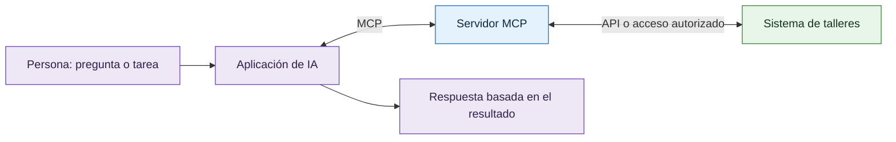

En ese recorrido intervienen tres componentes:

| Componente | Papel |
| --- | --- |
| **Host** | La aplicación de IA que coordina la interacción, el modelo y las conexiones. |
| **Cliente MCP** | La parte del host que se comunica con un servidor MCP. |
| **Servidor MCP** | El programa que expone datos y operaciones del sistema externo. Puede ejecutarse localmente o en otra máquina. |

La aplicación descubre las capacidades que ofrece el servidor. Cuando corresponde utilizar una herramienta, envía su nombre y argumentos, recibe el resultado y lo incorpora al trabajo del asistente. MCP define la comunicación; la aplicación decide cómo usar el modelo y gestionar ese contexto. [Referencia: arquitectura de MCP](https://modelcontextprotocol.io/docs/learn/architecture).

### Qué puede ofrecer un servidor

| Capacidad | Qué aporta | Ejemplo |
| --- | --- | --- |
| **Tools — herramientas** | Funciones que se pueden invocar con argumentos. Pueden consultar datos o realizar acciones. | Consultar plazas disponibles o crear una reserva. |
| **Resources — recursos** | Contenido que el cliente puede leer e incorporar como contexto. | El reglamento del centro cultural. |
| **Prompts — plantillas** | Mensajes reutilizables que el servidor pone a disposición del cliente. | Una plantilla para resumir las inscripciones de una semana. |

Un servidor puede implementar solo las capacidades que necesite. Un prompt servido por MCP es una plantilla; una [skill](#18-skills-procedimientos-reutilizables-con-datos-de-entrada) puede describir un procedimiento más amplio que utilice herramientas MCP. [Referencia: capacidades del servidor](https://modelcontextprotocol.io/docs/develop/build-server).

### Usos habituales

| Uso | Ejemplo de petición |
| --- | --- |
| **Consultar documentación y archivos** | «Busca el procedimiento vigente para solicitar material y resúmelo». |
| **Consultar datos internos** | «Obtén las plazas disponibles de los talleres del sábado». |
| **Trabajar con repositorios e incidencias** | «Lee esta incidencia y los archivos relacionados para proponer una corrección». |
| **Coordinar aplicaciones** | «Consulta mi agenda y encuentra una franja libre». |
| **Automatizar operaciones de un negocio** | «Registra esta solicitud en el sistema de mantenimiento». |

Estas tareas requieren servidores que ofrezcan esas capacidades y acceso autorizado a sus sistemas. La información recuperada se utiliza durante la interacción; conectar un servidor no reentrena el modelo. [Referencia: posibilidades de MCP](https://modelcontextprotocol.io/docs/getting-started/intro).

### Cuándo tiene sentido crear uno propio

Un servidor propio es útil cuando necesitas conectar **un sistema interno sin integración disponible**, ofrecer operaciones adaptadas a tu negocio o reutilizar esa conexión desde varias aplicaciones de IA compatibles.

Si ya tienes una API, el servidor MCP puede actuar como un **adaptador**: expone herramientas comprensibles para el agente y, por dentro, llama a esa API. La API sigue manteniendo sus reglas, validaciones y controles de acceso. Por ejemplo, `get_available_places(workshop_id)` puede consultar el servicio de talleres existente.

Antes de desarrollarlo, comprueba si ya hay una integración adecuada. Si solo necesitas una llamada desde un programa propio, usar directamente su API puede ser suficiente; el valor de MCP está en estandarizar la conexión con aplicaciones de IA.

### Cómo crear un servidor propio

1. **Elegir un caso pequeño.** Por ejemplo, consultar plazas, antes de añadir operaciones de reserva.
2. **Definir el contrato.** Nombre de la herramienta, descripción, argumentos, resultado y errores posibles.
3. **Implementarlo con un SDK.** El SDK gestiona los mensajes MCP; tu código resuelve la operación, consultando datos o llamando a servicios existentes.
4. **Conectarlo a una aplicación compatible.** Para un proceso local puede utilizarse **stdio**, comunicación mediante entrada y salida del proceso. Para un servicio remoto se utiliza habitualmente **Streamable HTTP**.
5. **Comprobarlo.** Verificar que el cliente descubre la herramienta, que recibe argumentos y devuelve resultados coherentes, y que rechaza entradas o accesos no permitidos. El **MCP Inspector** ayuda a inspeccionar y probar servidores. [Referencias: creación de servidores](https://modelcontextprotocol.io/docs/develop/build-server) y [SDK oficial de Python](https://github.com/modelcontextprotocol/python-sdk).

<details>
<summary>Ejemplo mínimo en Python: consultar plazas de un taller</summary>

Este ejemplo utiliza **Python 3.11 o posterior**, el **SDK oficial de MCP para Python 2.x** y datos ficticios en memoria. En un proyecto real, la función consultaría el sistema de talleres. En una carpeta independiente, prepara un entorno e instala el SDK:

```powershell
python -m venv .venv
.\.venv\Scripts\python.exe -m pip install "mcp[cli]>=2,<3"
```

Guarda lo siguiente como `server.py`:

```python
from mcp.server import MCPServer

mcp = MCPServer("Workshop availability")

# Demo data: a real implementation would query an existing service.
WORKSHOPS = {
    42: {"title": "Ceramics", "capacity": 12, "enrolled_count": 9}
}


@mcp.tool()
def get_available_places(workshop_id: int) -> dict:
    """Return available places for an existing workshop without changing it."""
    workshop = WORKSHOPS.get(workshop_id)
    if workshop is None:
        raise ValueError("Workshop not found")

    return {
        "workshop_id": workshop_id,
        "title": workshop["title"],
        "available_places": workshop["capacity"] - workshop["enrolled_count"],
    }


if __name__ == "__main__":
    mcp.run(transport="stdio")
```

**Qué hace cada parte:** `MCPServer` crea el servidor; `@mcp.tool()` publica la función como herramienta. El SDK utiliza el nombre, los tipos y la descripción de la función para definir cómo invocarla. La entrada `workshop_id=42` devuelve un resultado con **3 plazas disponibles**. [Referencia: inicio con el SDK](https://py.sdk.modelcontextprotocol.io/get-started/).

Para conectar este ejemplo a un cliente con soporte **stdio**, configura el ejecutable Python del entorno virtual como comando y la ruta absoluta de `server.py` como argumento. El nombre del archivo de configuración y su estructura dependen de la aplicación. El cliente lanza el proceso y se comunica con él; ejecutar el archivo por separado no conecta automáticamente un chat.

Con stdio, reserva la salida estándar para el protocolo: utiliza `logging` dirigido a la salida de errores para los registros, en lugar de añadir `print()` al servidor. [Referencia: registros en servidores MCP](https://modelcontextprotocol.io/docs/develop/build-server#logging-in-mcp-servers).

</details>

### Cómo encaja con un agente, una skill y RAG

En el ejemplo del centro cultural, **el agente** atiende la petición y coordina las acciones; **una skill** puede indicar cómo preparar un resumen de disponibilidad; **MCP** conecta con la herramienta que consulta las plazas. Si además se buscan fragmentos del reglamento para explicar una condición de reserva, esa recuperación puede formar parte de un flujo **RAG**.

Son piezas que pueden combinarse. El servidor implementa el acceso real a los datos y las operaciones; las instrucciones orientan cómo utilizarlos.

### Práctica con MCP y Ollama

En **Club de Barrio** puedes cambiar el dorsal de una jugadora desde un formulario de React o pedírselo a un agente. El recorrido muestra cómo la API comprueba el dorsal en ambos casos y cómo el chat utiliza el resultado de la herramienta para responder. [Abrir la guía del proyecto](equipo-futbol/README.md).

**Comprueba lo aprendido**

1. Ya existe una API de talleres y quieres utilizarla desde dos asistentes compatibles. ¿Qué aporta un servidor MCP propio y qué reglas debería seguir aplicando la API?
2. Has escrito una skill que dice «consulta las plazas», pero no hay ninguna herramienta conectada. ¿Puede la skill obtener por sí sola la disponibilidad actual?

<details>
<summary>Ver respuestas</summary>

1. Aporta una conexión estandarizada que expone herramientas para ambos clientes. La API conserva las reglas de negocio, validaciones y controles de acceso; MCP adapta su utilización desde las aplicaciones de IA.
2. No. Las instrucciones describen el procedimiento, pero hace falta acceso real a los datos mediante una herramienta, un servidor MCP u otra integración disponible.

</details>
