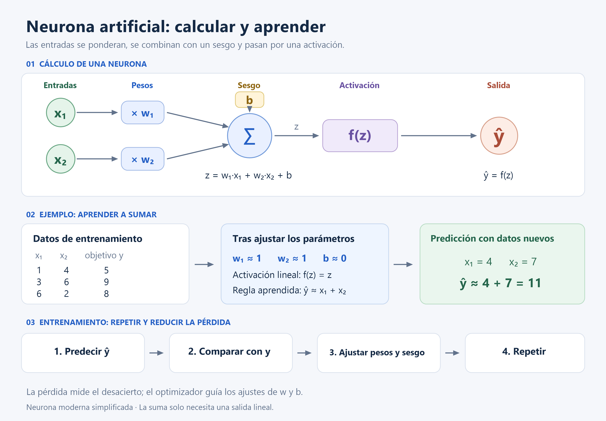
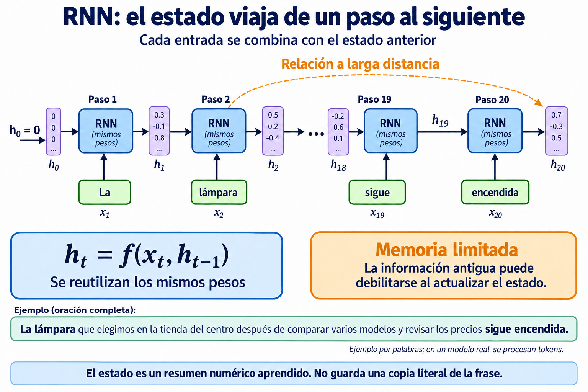
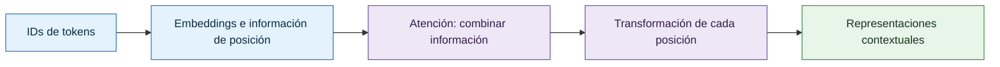
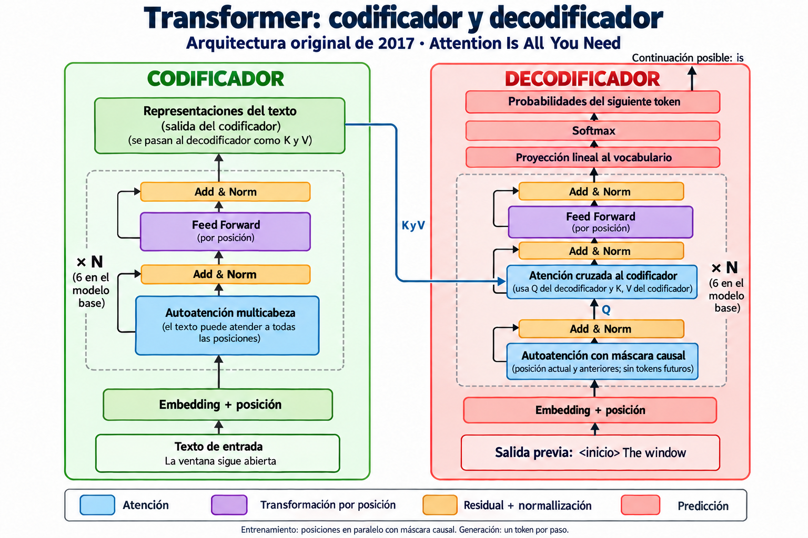
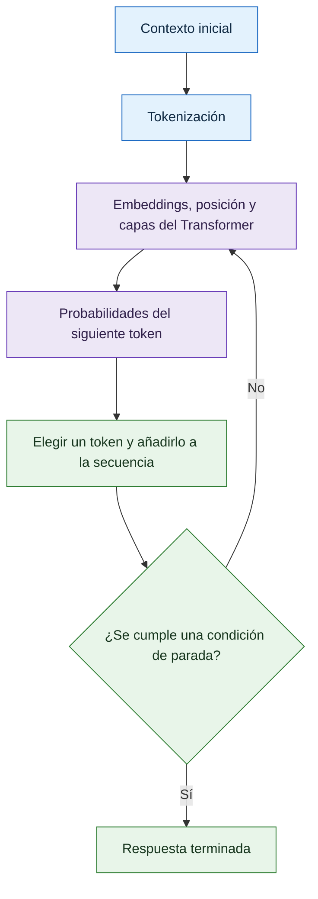
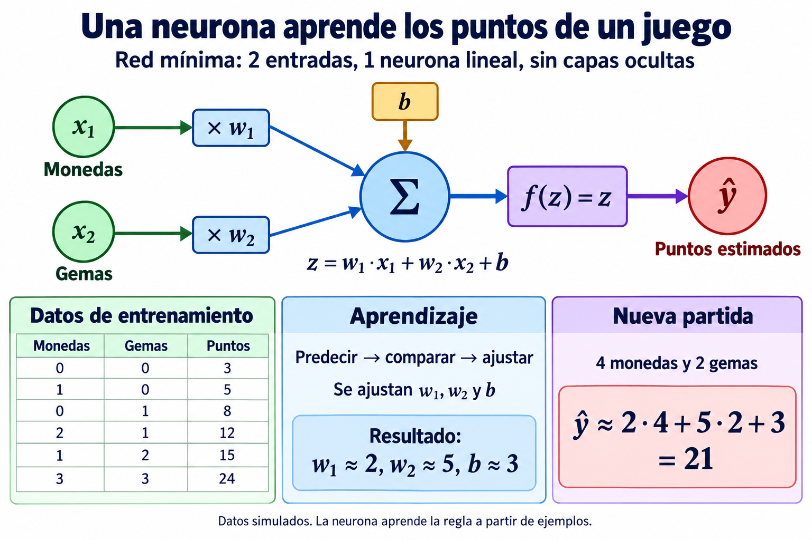

# Apuntes de inteligencia artificial

Una guía para entender cómo una máquina pasa del texto a una respuesta. El recorrido empieza por las piezas básicas y termina en los modelos de lenguaje actuales.

Lee los apartados en orden la primera vez. Para repasar, usa el índice y las preguntas de **Comprueba lo aprendido**. Las soluciones y los detalles técnicos están en bloques desplegables.

## Índice

1. [El mapa: IA, PLN y LLM](#1-el-mapa-ia-pln-y-llm)
2. [Tokens: dividir el texto en piezas](#2-tokens-dividir-el-texto-en-piezas)
3. [Contexto: la información disponible](#3-contexto-la-información-disponible)
4. [N-gramas: predecir contando](#4-n-gramas-predecir-contando)
5. [Redes neuronales: aprender ajustando](#5-redes-neuronales-aprender-ajustando)
6. [Embeddings: representar con números](#6-embeddings-representar-con-números)
7. [RNN: leer con una memoria que se actualiza](#7-rnn-leer-con-una-memoria-que-se-actualiza)
8. [Transformer: relacionar partes del texto](#8-transformer-relacionar-partes-del-texto)
9. [Entrenamiento: de la arquitectura al LLM](#9-entrenamiento-de-la-arquitectura-al-llm)
10. [Inferencia: del mensaje a la respuesta](#10-inferencia-del-mensaje-a-la-respuesta)
11. [Historia: cómo llegamos hasta aquí](#11-historia-cómo-llegamos-hasta-aquí)
12. [Práctica opcional en C#: aprender los puntos de un juego](#12-práctica-opcional-en-c-aprender-los-puntos-de-un-juego)

## 1. El mapa: IA, PLN y LLM

La **inteligencia artificial (IA)** es el campo que desarrolla sistemas capaces de realizar tareas como reconocer imágenes, interpretar mensajes o planificar acciones.

Dentro de ese campo, el **procesamiento del lenguaje natural (PLN, o NLP en inglés)** se ocupa del lenguaje humano. Incluye tareas de comprensión —detectar qué pide una persona— y de generación —redactar una respuesta—.

Un **modelo** es un sistema matemático que transforma entradas en resultados. Un **modelo de lenguaje de gran tamaño (LLM, Large Language Model)** aprende patrones a partir de grandes cantidades de texto. Puede servir para resumir, traducir o responder preguntas.

Piensa en una biblioteca: la IA sería todo el edificio; el PLN, la sección dedicada al lenguaje; y los LLM, una de las herramientas disponibles en esa sección. [Referencia: Stanford, PLN](https://hai.stanford.edu/ai-definitions/what-is-nlp).

Muchos LLM generativos producen texto mediante una tarea repetida: **estimar cuál podría ser la siguiente pieza del texto**. Estas piezas se llaman tokens y son el siguiente paso del recorrido. Que una continuación resulte probable no garantiza que sea cierta. [Referencia: GPT-3](https://arxiv.org/abs/2005.14165).

Dos conceptos relacionados:

| Concepto | Qué añade | Ejemplo |
| --- | --- | --- |
| **Multimodalidad** | Trabajar con varios tipos de información. | Recibir una imagen y describirla con texto. |
| **Agente basado en un LLM** | Combinar el modelo con herramientas y un proceso de varios pasos. | Consultar existencias, calcular necesidades y preparar una propuesta de compra. |

Las capacidades concretas dependen del sistema. [Referencias: GPT-4](https://arxiv.org/abs/2303.08774) y [ReAct](https://arxiv.org/abs/2210.03629).

**Comprueba lo aprendido**

1. ¿Un LLM es todo el campo de la IA o una herramienta dentro de él?
2. ¿Qué añade un agente al uso de un modelo de lenguaje?

<details>
<summary>Ver respuestas</summary>

1. Es una herramienta dentro de la IA, muy utilizada en PLN.
2. Herramientas y un proceso que permite encadenar acciones y utilizar sus resultados.

</details>

## 2. Tokens: dividir el texto en piezas

La **tokenización** divide el texto en unidades llamadas **tokens**. Un token puede ser una palabra, un fragmento, un signo o una secuencia que incluya espacios.

La analogía es una caja de piezas de construcción: unas piezas grandes representan fragmentos frecuentes; otras pequeñas permiten formar expresiones nuevas. Así se evita guardar cada palabra posible como una pieza distinta.

El **tokenizador** aplica las reglas de división y asigna a cada token un **identificador (ID)** de su vocabulario. Es como el número de una ficha de catálogo: identifica una entrada, pero su valor numérico no expresa significado.

Ejemplo con división e identificadores inventados:

```text
«Buenas tardes!» → [«Buenas», « tardes», «!»] → [48, 207, 9]
```

El espacio forma parte del segundo token. Otro tokenizador podría dividir la frase de otra manera. Los acentos, emojis y palabras frecuentes tampoco tienen un número universal de tokens. [Referencia: palabras y tokens](https://web.stanford.edu/~jurafsky/slp3/2.pdf).

**El proceso habitual** prepara el texto según sus reglas, delimita fragmentos, los segmenta, asigna IDs y, cuando corresponde, añade tokens especiales de inicio, fin o separación. La **decodificación** convierte los IDs de salida en texto. Algunas transformaciones previas, como pasar a minúsculas, pueden impedir recuperar exactamente el original. [Referencia: proceso de tokenización](https://huggingface.co/docs/tokenizers/pipeline).

| Método | Idea básica |
| --- | --- |
| **Palabras** | Una pieza por palabra, con reglas para puntuación. El vocabulario puede crecer mucho. |
| **Caracteres** | Piezas pequeñas, pero secuencias más largas. |
| **Bytes** | Usa unidades de codificación del texto. Un carácter puede ocupar varios bytes. |
| **BPE (Byte Pair Encoding)** | Aprende a unir pares frecuentes de piezas consecutivas. |
| **WordPiece** | Al segmentar, busca el fragmento conocido más largo desde cada posición. |
| **Unigram** | Utiliza probabilidades para elegir entre posibles divisiones. |

**SentencePiece** es una herramienta para crear y aplicar tokenizadores, incluidos BPE y Unigram. [Referencias: comparación de métodos](https://huggingface.co/docs/transformers/tokenizer_summary) y [SentencePiece](https://github.com/google/sentencepiece).

<details>
<summary>Ejemplo paso a paso: cómo aprende BPE</summary>

Con los textos «pato», «pato» y «patos», una secuencia posible de fusiones es:

```text
p | a | t | o → pa | t | o → pat | o → pato
p | a | t | o | s → pa | t | o | s → pat | o | s → pato | s
```

Hay pares empatados en frecuencia; esta es una posible elección de desempates. El ejemplo omite espacios y marcas de final de palabra.

Las fusiones se aprenden al preparar el tokenizador. Después se aplican a los textos nuevos. [Referencia: BPE](https://huggingface.co/learn/llm-course/chapter6/5).

</details>

Se tokenizan tanto los datos de entrenamiento como los mensajes que recibe el modelo. Debe utilizarse un tokenizador compatible con él. La tokenización permite representar texto; corregir faltas de ortografía es otra tarea.

**Comprueba lo aprendido**

1. Si una frase tiene diez palabras, ¿tendrá necesariamente diez tokens?
2. ¿El token con ID 900 tiene más significado que el token con ID 20?

<details>
<summary>Ver respuestas</summary>

1. No: depende del tokenizador, los fragmentos, los espacios y la puntuación.
2. No: los números solo identifican entradas del vocabulario.

</details>

## 3. Contexto: la información disponible

El **contexto** es la información que el modelo puede consultar para interpretar un mensaje o continuar un texto.

> El barco avanzó al desplegar la **vela**.
>
> Durante el apagón encendimos una **vela**.

Las palabras que rodean a «vela» ayudan a distinguir sus usos. El significado depende de la situación, como cuando una persona necesita escuchar una conversación completa para entender una frase.

En un asistente, el contexto puede incluir instrucciones, mensajes anteriores, documentos aportados y texto ya generado. La **ventana de contexto** limita cuántos tokens puede manejar en ese contexto.

Imagínala como una mesa de trabajo: caben ciertos documentos y notas. Una mesa mayor permite tener más material a mano, pero no garantiza que se aproveche cada detalle. [Referencia: Stanford, ventana de contexto](https://hai.stanford.edu/ai-definitions/what-is-a-context-window).

Conviene distinguir **entrenamiento**, que ajusta lo aprendido por el modelo, de **inferencia**, que consiste en usarlo. Es parecido a estudiar antes de un examen frente a resolverlo con apuntes sobre la mesa. Aportar un documento durante una conversación normalmente cambia el contexto, sin actualizar por ello los parámetros del modelo. Veremos esos parámetros en [redes neuronales](#5-redes-neuronales-aprender-ajustando). [Referencia: GPT-3](https://arxiv.org/abs/2005.14165).

**Comprueba lo aprendido**

1. ¿Qué palabras permiten distinguir los dos sentidos de «vela»?
2. ¿Adjuntar un documento a una conversación equivale por sí solo a entrenar el modelo?

<details>
<summary>Ver respuestas</summary>

1. «Barco» y «desplegar» orientan hacia navegación; «apagón» y «encendimos», hacia iluminación.
2. No: normalmente aporta contexto para esa interacción.

</details>

## 4. N-gramas: predecir contando

Un **n-grama** es una secuencia de *n* tokens consecutivos. Un modelo de n-gramas predice el siguiente token mirando los **n − 1 anteriores** y contando continuaciones en sus ejemplos.

Se parece a un autocompletado que consulta una libreta: «Después de este fragmento, ¿qué apareció más veces?». En este apartado tratamos cada palabra como un token y omitimos la puntuación.

| Modelo | Secuencia de ejemplo | Contexto usado para predecir |
| --- | --- | --- |
| **Unigrama** | «brisa» | Ninguno. |
| **Bigrama** | «brisa suave» | Una palabra anterior. |
| **Trigrama** | «brisa suave mueve» | Dos palabras anteriores. |

En «La brisa suave mueve las hojas», los bigramas son «La brisa», «brisa suave», «suave mueve», «mueve las» y «las hojas»: se solapan al avanzar una posición.

Supongamos estos datos de entrenamiento:

> La brisa suave mueve las hojas.
>
> La brisa suave mueve las cortinas.
>
> La brisa suave refresca el patio.
>
> Una voz suave transmite calma.

| Modelo y contexto | Continuaciones observadas |
| --- | --- |
| Bigrama: «suave» | «mueve»: 2/4 = 50 %; «refresca»: 25 %; «transmite»: 25 %. |
| Trigrama: «brisa suave» | «mueve»: 2/3 ≈ 66,7 %; «refresca»: 1/3 ≈ 33,3 %. |
| Trigrama: «voz suave» | «transmite»: 1/1 = 100 %. |

El trigrama dispone de una pista adicional y distingue «brisa suave» de «voz suave». Estos porcentajes describen únicamente los ejemplos disponibles.

Esta limitación del historial está relacionada con la **suposición de Markov**: aproximar lo que ocurrirá usando un pasado reducido. Un bigrama usa una dependencia de primer orden; un trigrama, de segundo orden.

La llamada **«amnesia»** aparece cuando una pista queda fuera de esa ventana:

> Clara vive en Toledo y mañana regresará a…
>
> Clara vive en Cuenca y mañana regresará a…

Un trigrama solo ve «regresará a» y asigna las mismas probabilidades en ambos casos. Conserva sus estadísticas aprendidas, pero no utiliza directamente la ciudad lejana.

Aumentar *n* amplía el historial, aunque exige observar muchas más combinaciones. El **suavizado** reserva probabilidad para continuaciones no vistas, en vez de tratarlas automáticamente como imposibles. [Referencia: modelos de n-gramas](https://web.stanford.edu/~jurafsky/slp3/3.pdf).

**Comprueba lo aprendido**

1. Escribe los trigramas de «El tren llega temprano».
2. ¿Cuántos tokens anteriores consulta un modelo de 4-gramas?

<details>
<summary>Ver respuestas</summary>

1. «El tren llega» y «tren llega temprano».
2. Tres: en general, n − 1.

</details>

## 5. Redes neuronales: aprender ajustando

Una **red neuronal** conecta unidades matemáticas llamadas **neuronas artificiales**. Su inspiración biológica es simplificada: reciben señales, las combinan y producen una salida.

Piensa en una mesa de mezclas: cada control modifica cuánto contribuye una señal al resultado. En una neurona, esos controles son los **pesos**; también existe un **sesgo**, que desplaza el resultado de partida. Pesos y sesgos son **parámetros**, valores que pueden ajustarse al entrenar.



Para dos entradas, el cálculo es:

**suma = entrada₁ × peso₁ + entrada₂ × peso₂ + sesgo**

La **función de activación** transforma esa suma antes de entregarla como salida. Por ejemplo, ReLU conserva los valores positivos y convierte los negativos en cero. Estas transformaciones permiten que varias capas aprendan relaciones complejas.

Para aprender a sumar basta una salida lineal, que deja la suma tal cual. Con pesos 1 y 1 y sesgo 0, las entradas 4 y 7 producen 11. [Referencia: neuronas y activaciones](https://developers.google.com/machine-learning/crash-course/neural-networks/nodes-hidden-layers).

**Aprender** consiste en predecir, medir el desacierto y ajustar los parámetros. La medida del desacierto se llama **pérdida**. El **optimizador** decide ajustes para reducirla, como afinar los controles de la mesa de mezclas después de escuchar el resultado.

La **tasa de aprendizaje** controla el tamaño de cada ajuste: pasos excesivos pueden desestabilizar el aprendizaje; pasos muy pequeños lo hacen lento. El ciclo completo se desarrolla en [entrenamiento de un LLM](#9-entrenamiento-de-la-arquitectura-al-llm). [Referencia: descenso de gradiente](https://developers.google.com/machine-learning/crash-course/linear-regression/gradient-descent).

Al conectar muchas neuronas aparecen **capas**: entrada, capas intermedias u **ocultas**, y salida. «Ocultas» significa internas al cálculo. El **aprendizaje profundo** utiliza redes con múltiples capas de procesamiento.

**Comprueba lo aprendido**

1. Con entradas 2 y 3, pesos 4 y 1, sesgo 2 y salida lineal, ¿qué resultado se obtiene?
2. Durante el entrenamiento, ¿se ajustan las entradas de los ejemplos o los parámetros de la red?

<details>
<summary>Ver respuestas</summary>

1. 2 × 4 + 3 × 1 + 2 = **13**.
2. Los parámetros. Los ejemplos proporcionan los datos con los que aprender.

</details>

## 6. Embeddings: representar con números

Los IDs de tokens identifican piezas de texto. Para procesarlas, una red usa **embeddings**: listas de números llamadas **vectores**. Cada número es una componente o **dimensión** del vector.

La analogía es un mapa: el ID identifica un lugar y el vector aporta unas coordenadas. El entrenamiento puede situar cerca elementos con usos relacionados. La **semántica** se refiere al significado; esas relaciones numéricas pueden reflejar semejanzas semánticas.

Ejemplo inventado, suponiendo un token por palabra:

| Token | ID | Vector de tres dimensiones |
| --- | --- | --- |
| violín | 314 | [0,80; 0,20; 0,10] |
| guitarra | 572 | [0,75; 0,25; 0,12] |
| bicicleta | 901 | [−0,30; 0,60; 0,80] |

La **tabla de embeddings** guarda una fila por token. Su ID permite recuperar esa fila. Los valores se aprenden; cada columna no equivale necesariamente a una propiedad comprensible como «tamaño» o «ser vivo». [Referencias: espacio de embeddings](https://developers.google.com/machine-learning/crash-course/embeddings/embedding-space) y [consulta por ID](https://docs.pytorch.org/docs/stable/generated/torch.nn.Embedding.html).

**Imagen mental:** un mapa con «violín» y «guitarra» próximos y «bicicleta» más alejada. Los ejes representan coordenadas aprendidas, sin etiquetas semánticas fijas. Es una simplificación de un espacio que puede tener muchas más dimensiones.

Para comparar vectores se puede medir su distancia o la semejanza de su dirección. La **similitud del coseno** compara direcciones y va de −1 a 1. Con los números de la tabla, violín–guitarra da aproximadamente **0,997**; violín–bicicleta, **−0,046**. Son valores ilustrativos, no probabilidades. Solo deben compararse vectores de espacios compatibles. [Referencia: medidas de similitud](https://www.sbert.net/docs/sentence_transformer/usage/semantic_textual_similarity.html).

Hay dos momentos distintos:

| Momento | Qué sucede |
| --- | --- |
| **Consulta inicial** | Con parámetros fijos, el mismo ID recupera el mismo vector de la tabla. |
| **Procesamiento del contexto** | Las capas calculan nuevas representaciones según la posición y la información disponible. |

Estas representaciones internas se llaman **estados ocultos** (*hidden states*). En el ejemplo de [«vela»](#3-contexto-la-información-disponible), un mismo token puede partir del mismo vector y terminar con representaciones distintas para navegación e iluminación.

La tabla suele inicializarse aleatoriamente al entrenar desde cero y se ajusta con el [ciclo de aprendizaje](#9-entrenamiento-de-la-arquitectura-al-llm); también puede reutilizarse una tabla ya entrenada. Durante el uso habitual cambian los estados calculados para cada texto, mientras los parámetros permanecen fijos. [Referencia: aprendizaje y contextualización de embeddings](https://developers.google.com/machine-learning/crash-course/embeddings/obtaining-embeddings).

También hay modelos que representan frases o documentos mediante un vector. Permiten, por ejemplo, encontrar «Reparación de neumáticos de bicicleta» al buscar «arreglar una rueda pinchada»: es **búsqueda semántica**.

**Comprueba lo aprendido**

1. ¿Qué diferencia hay entre el ID de un token y su embedding?
2. ¿Un mismo token debe tener el mismo estado contextual en cualquier frase?

<details>
<summary>Ver respuestas</summary>

1. El ID identifica una entrada; el embedding es la lista de valores que utiliza la red.
2. No: la representación contextual depende de la información que lo acompaña.

</details>

## 7. RNN: leer con una memoria que se actualiza

Una **red neuronal recurrente (RNN, Recurrent Neural Network)** procesa datos **secuenciales**, en los que el orden importa: una frase, una grabación o las mediciones de un sensor.

Imagina que lees una historia y reescribes una nota breve después de cada palabra. La RNN hace algo parecido con un estado interno numérico:

1. Recibe la entrada actual.
2. La combina con el estado anterior.
3. Calcula un estado nuevo.
4. Lo pasa al siguiente paso.

Los pesos se reutilizan durante la lectura; lo que va cambiando es el estado. [Referencia: funcionamiento de una RNN](https://d2l.ai/chapter_recurrent-neural-networks/rnn.html).



El diagrama omite pasos intermedios y usa valores ilustrativos. En la frase:

> La lámpara que elegimos en la tienda del centro después de comparar varios modelos y revisar los precios sigue encendida.

La información sobre **«lámpara»** debe conservarse hasta **«encendida»**. Cada palabra cuenta como un paso en este ejemplo.

La **memoria de corto plazo** describe la tendencia de una RNN básica a conservar mejor lo reciente. Su nota tiene un tamaño fijo: al actualizarla repetidamente, puede perder detalles antiguos. Esa dificultad suele llamarse «amnesia».

Durante el entrenamiento, la señal que indica qué ajustar también puede debilitarse al recorrer muchos pasos: es el **desvanecimiento del gradiente**, parecido a un mensaje que llega cada vez más tenue. En otros casos crece demasiado: son los **gradientes explosivos**. No existe una cantidad universal de palabras tras la que la red olvide. [Referencia: aprendizaje a través del tiempo](https://d2l.ai/chapter_recurrent-neural-networks/bptt.html).

**LSTM** (*Long Short-Term Memory*) y **GRU** (*Gated Recurrent Unit*) son variantes que incorporan **compuertas**: controles aprendidos que regulan qué conservar, actualizar o descartar. Ayudan a mantener información durante más pasos, aunque siguen teniendo límites. [Referencias: LSTM](https://d2l.ai/chapter_recurrent-modern/lstm.html) y [GRU](https://d2l.ai/chapter_recurrent-modern/gru.html).

La pregunta siguiente es: **¿y si el modelo pudiera consultar directamente una parte anterior, en vez de depender solo de una nota que se transmite paso a paso?**

**Comprueba lo aprendido**

1. ¿Qué dos elementos combina una RNN en cada paso?
2. ¿Por qué puede costarle relacionar «lámpara» con «encendida»?

<details>
<summary>Ver respuestas</summary>

1. La entrada actual y el estado anterior.
2. La información debe mantenerse a través de muchos pasos; puede debilitarse y resultar difícil aprender a conservarla.

</details>

## 8. Transformer: relacionar partes del texto

Un **Transformer** es una forma de organizar una red neuronal, es decir, una **arquitectura**. Su mecanismo principal, la **atención**, combina información de distintas posiciones del texto.

La analogía es leer con un subrayador: al interpretar una palabra, puedes volver a las partes relevantes. El modelo calcula pesos de atención para decidir cuánto aporta cada posición permitida.

> La ventana que instalamos junto al balcón tras comparar varios modelos sigue **abierta**.

Para representar «abierta», resulta útil relacionarla con «ventana». La **autoatención** consulta elementos de la misma secuencia. Varias **cabezas de atención** realizan cálculos distintos y combinan sus resultados; sus funciones se aprenden, sin asignar de antemano una cabeza a la gramática y otra al significado.

El recorrido básico es:



La información de posición permite distinguir el orden: «Ana llamó a Luis» y «Luis llamó a Ana» contienen las mismas palabras, pero cuentan cosas diferentes. Las transformaciones se repiten en varias capas. [Referencias: Transformer original](https://arxiv.org/abs/1706.03762) y [posición](https://d2l.ai/chapter_attention-mechanisms-and-transformers/self-attention-and-positional-encoding.html).

| Variante | Función habitual | Ejemplo |
| --- | --- | --- |
| **Codificador** | Construye representaciones consultando ambos lados del texto. | BERT. |
| **Decodificador causal** | Predice la continuación usando las posiciones permitidas hasta ese momento. | GPT. |
| **Codificador y decodificador** | Uno representa la entrada; el otro genera una salida consultándola. | Transformer original, aplicado a traducción. |

La **máscara causal** impide mirar tokens futuros durante la predicción. En el entrenamiento pueden calcularse muchas posiciones en paralelo con esa restricción; al generar de forma **autorregresiva**, se añade un token cada vez y se usa para continuar. [Referencias: Transformer](https://arxiv.org/abs/1706.03762), [BERT](https://arxiv.org/abs/1810.04805) y [GPT](https://openai.com/index/language-unsupervised/).

<details>
<summary>Ampliación visual: leer el diagrama del Transformer original</summary>



Se lee **de abajo arriba**. El codificador recibe «La ventana sigue abierta». El decodificador, con «The window» ya disponible, puede proponer «is» como continuación.

| Bloque | Qué hace |
| --- | --- |
| **Embedding + posición** | Prepara las representaciones y la información de orden. |
| **Autoatención multicabeza** | Combina información dentro de una secuencia. |
| **Atención enmascarada** | Excluye posiciones futuras. |
| **Atención cruzada** | Permite que el decodificador consulte la salida del codificador. |
| **Feed Forward** | Transforma cada posición con una pequeña red neuronal. |
| **Add & Norm** | Suma una entrada con su transformación y normaliza valores para facilitar el procesamiento. |
| **Proyección lineal y softmax** | Calcula puntuaciones para los tokens del vocabulario y las convierte en probabilidades que suman 1. |

Los bloques se repiten: seis capas en cada pila del modelo base original, con parámetros propios por capa. En su entrenamiento, la salida objetivo se desplaza una posición para que cada paso aprenda a predecir el siguiente token.

Para calcular atención se obtienen tres vectores:

- **Q — consulta:** qué se busca.
- **K — clave:** con qué se compara la consulta.
- **V — valor:** información que se combinará.

Como al buscar en un catálogo, la consulta se compara con las claves y determina qué información recuperar. Matemáticamente, se puntúan las coincidencias Q–K, se normalizan y se combinan los V con esos pesos. Son representaciones aprendidas, no etiquetas escritas por una persona.

En autoatención proceden de la misma secuencia; en atención cruzada, Q viene del decodificador y K y V del codificador. [Referencias: artículo original](https://proceedings.neurips.cc/paper_files/paper/2017/file/3f5ee243547dee91fbd053c1c4a845aa-Paper.pdf) y [cálculo de atención](https://d2l.ai/chapter_attention-mechanisms-and-transformers/attention-scoring-functions.html).

</details>

La atención facilita conectar posiciones lejanas, pero el modelo sigue limitado por su [ventana de contexto](#3-contexto-la-información-disponible) y por su capacidad para aprovecharla.

**Comprueba lo aprendido**

1. ¿Qué permite conectar «ventana» con «abierta» sin transmitir toda la información palabra a palabra?
2. ¿Por qué un decodificador causal no puede consultar la respuesta futura durante el entrenamiento?

<details>
<summary>Ver respuestas</summary>

1. La atención entre posiciones.
2. Porque debe aprender a predecir con la información disponible antes de esa respuesta; la máscara bloquea el acceso al futuro.

</details>

## 9. Entrenamiento: de la arquitectura al LLM

El Transformer describe la organización de la red. El **entrenamiento** ajusta sus parámetros para que aprenda a trabajar con lenguaje. Es como pasar del diseño de un instrumento a un instrumento afinado mediante práctica.

**Arquitectura + tokenizador + datos + entrenamiento → modelo de lenguaje entrenado.**

En muchos LLM conversacionales, el recorrido es el siguiente. Las fases concretas varían y la evaluación acompaña a todo el proceso.

| Fase | Qué ocurre | Analogía |
| --- | --- | --- |
| **1. Preparar datos** | Reunir un **corpus** —conjunto de textos—, filtrar contenido, limpiar y reducir duplicados. Separar datos de entrenamiento, validación y prueba. | Elegir material de estudio y reservar ejercicios para comprobar el aprendizaje. |
| **2. Configurar** | Tokenizar los datos, organizarlos en lotes y definir las capas y tamaños del modelo. Inicializar parámetros o recuperar los de un modelo existente. | Preparar el material y el equipo. |
| **3. Preentrenar** | Aprender patrones generales. En un modelo causal, el propio texto proporciona el siguiente token que se debe predecir. | Practicar con muchos ejercicios cuya solución ya está disponible. |
| **4. Ajustar con instrucciones (SFT)** | Continuar el entrenamiento con ejemplos de instrucciones y respuestas deseadas. | Practicar cómo resolver tareas concretas. |
| **5. Ajustar según preferencias** | Utilizar comparaciones de respuestas para favorecer comportamientos elegidos. | Recibir comentarios sobre qué respuesta es más útil o fiel. |
| **6. Evaluar y revisar** | Medir capacidades, errores, invenciones, sesgos, seguridad y rendimiento; revisar datos o ajustes cuando haga falta. | Examinarse con ejercicios nuevos y revisar los fallos. |

La **validación** orienta decisiones durante el desarrollo; las **pruebas** permiten valorar el resultado final con datos reservados. [Referencias: preparación de datos, FineWeb](https://arxiv.org/abs/2406.17557), [preentrenamiento](https://huggingface.co/learn/llm-course/chapter7/6) y [SFT](https://huggingface.co/learn/llm-course/chapter11/3).

El núcleo del preentrenamiento se repite:

```text
Lote de tokens → embeddings → predicción → pérdida
                                ↑            ↓
                         nuevo cálculo ← ajuste de parámetros
```

Por ejemplo, en «Al amanecer sale el sol», el contexto «Al amanecer sale el» permite practicar la predicción de «sol». Se usa una palabra completa para simplificar; el objetivo real se define por tokens.

La **retropropagación** calcula cómo influye cada parámetro entrenable en la pérdida. Esa información forma los **gradientes**, que el optimizador utiliza para ajustar parámetros, incluidos los embeddings entrenables. Se parece a averiguar qué controles conviene mover y cuánto para reducir un error.

Un **lote** es un grupo de ejemplos; un **paso** aplica una actualización; una **época** recorre una vez el conjunto de entrenamiento. [Referencia: optimización por lotes](https://d2l.ai/chapter_optimization/minibatch-sgd.html).

<details>
<summary>Ampliación: instrucciones, RLHF y DPO</summary>

**SFT** significa *Supervised Fine-Tuning*, o ajuste fino supervisado. Un ejemplo puede ser:

> **Instrucción:** Resume: «El barco salió del puerto y llegó a la isla».
>
> **Respuesta deseada:** El barco llegó a la isla.

Para ajustar preferencias, se puede comparar esa respuesta con otra que invente un día de llegada. Las evaluaciones se convierten en datos para favorecer respuestas más fieles.

- **RLHF**, aprendizaje por refuerzo con retroalimentación humana: en un enfoque habitual, primero se aprende un modelo que puntúa respuestas y luego se utiliza esa señal para ajustar el modelo de lenguaje.
- **DPO**, optimización directa de preferencias: utiliza pares de respuestas preferidas y descartadas sin entrenar un modelo de recompensa separado.

Son enfoques posibles del **posentrenamiento**, las etapas posteriores al preentrenamiento. No forman una receta obligatoria e idéntica para todos los modelos. [Referencias: InstructGPT](https://arxiv.org/abs/2203.02155) y [DPO](https://arxiv.org/abs/2305.18290).

</details>

Tras entrenar, llega la [inferencia](#10-inferencia-del-mensaje-a-la-respuesta): usar lo aprendido para responder. La siguiente sección explica cómo se construye cada continuación.

**Comprueba lo aprendido**

1. ¿Por qué conviene evaluar con ejemplos distintos de los utilizados para ajustar parámetros?
2. ¿Qué diferencia hay entre preentrenamiento y ajuste con instrucciones?

<details>
<summary>Ver respuestas</summary>

1. Para comprobar si el modelo aplica lo aprendido a casos nuevos, en vez de limitarse a reproducir ejemplos conocidos.
2. El preentrenamiento aprende patrones generales; el ajuste con instrucciones orienta el modelo mediante ejemplos de tareas y respuestas.

</details>

## 10. Inferencia: del mensaje a la respuesta

La **inferencia** es el uso de un modelo ya entrenado. Para generar texto, un LLM causal calcula posibles continuaciones, elige un token y vuelve a continuar con él.

Es como escribir con un autocompletado que se actualiza después de cada elección. La respuesta se construye paso a paso; el contexto va creciendo y los parámetros habitualmente permanecen fijos.

### El recorrido paso a paso

| Paso | Qué ocurre |
| --- | --- |
| **1. Preparar el contexto** | Se reúne el **prompt** —instrucción, pregunta o texto inicial— junto con las instrucciones y el historial disponibles. |
| **2. Tokenizar** | El [tokenizador](#2-tokens-dividir-el-texto-en-piezas) convierte ese texto en IDs de tokens compatibles con el modelo. |
| **3. Consultar embeddings** | Cada ID recupera su vector de la [tabla aprendida](#6-embeddings-representar-con-números). |
| **4. Incorporar posición** | Se introduce información sobre el orden de los tokens mediante el mecanismo de la arquitectura. |
| **5. Procesar las capas** | Las representaciones recorren las capas del [Transformer](#8-transformer-relacionar-partes-del-texto). Los pasos 6 y 7 ocurren dentro de ellas. |
| **6. Aplicar autoatención causal** | Cada posición combina información de sí misma y de posiciones anteriores permitidas. La máscara impide consultar tokens futuros. |
| **7. Transformar las representaciones** | La atención y las demás operaciones de las capas producen estados ocultos contextuales. El estado final de la última posición disponible se utiliza para predecir la continuación. |
| **8. Calcular posibilidades** | Una capa de salida convierte ese estado en puntuaciones para el vocabulario, llamadas **logits**. Softmax permite convertirlas en probabilidades. |
| **9. Elegir y añadir un token** | La regla de selección escoge un ID y lo incorpora a la secuencia. |
| **10. Continuar o terminar** | Se calcula la siguiente continuación hasta alcanzar una señal de fin, un límite de tokens u otra condición de parada. |

Las operaciones internas se desarrollan en el [diagrama del Transformer](#8-transformer-relacionar-partes-del-texto). La decodificación de los IDs permite mostrar texto; puede hacerse progresivamente mientras llega la respuesta. [Referencias: generación de texto](https://huggingface.co/docs/transformers/llm_tutorial) y [arquitectura original](https://arxiv.org/abs/1706.03762).



### Ejemplo: completar una frase

Texto inicial: **«Marta guardó las llaves en»**. Para simplificar, cada palabra y signo de puntuación cuenta como un token; la segmentación real puede ser distinta.

Una distribución inventada para el siguiente token sería:

| Continuación | Probabilidad |
| --- | --- |
| el | 50 % |
| la | 25 % |
| su | 15 % |
| Otras opciones, agrupadas | 10 % |

Hay dos formas sencillas de elegir:

- **Selección determinista:** escoger el token más probable; aquí, «el».
- **Muestreo:** sortear según las probabilidades, como sacar una papeleta de una bolsa. Puede salir una opción diferente de «el».

**Probabilístico** describe las posibilidades calculadas; **aleatorio** describe una forma de elegir. Un modelo probabilístico puede utilizar una selección determinista. [Referencia: estrategias de selección](https://huggingface.co/docs/transformers/generation_strategies).

Una continuación posible sería:

```text
Marta guardó las llaves en        → el
Marta guardó las llaves en el     → cajón
Marta guardó las llaves en el cajón → .
Marta guardó las llaves en el cajón. → [fin]
```

En cada fila se calculan nuevas probabilidades con el contexto ampliado. **[fin]** representa aquí una señal especial de terminación; el punto por sí solo no obliga a detenerse. Elegir una continuación probable tampoco garantiza que lo escrito sea cierto.

<details>
<summary>Ampliación: cómo se evita recalcular todo</summary>

La primera lectura del prompt suele llamarse **prefill**. Después llega la **generación incremental** o *decoding*: se producen nuevos tokens sucesivamente.

Para acelerar ese ciclo, una **caché KV** conserva las claves y los valores de atención de los tokens ya procesados. Es como guardar resultados intermedios de una cuenta para reutilizarlos. Así, cada nuevo paso puede aprovechar el trabajo anterior y procesar la nueva entrada sin recalcular todas las representaciones previas. Esta memoria de cálculo no implica entrenar el modelo. [Referencia: caché de atención](https://huggingface.co/docs/transformers/cache_explanation).

</details>

<details>
<summary>Ampliación: determinismo, azar y semillas</summary>

En programación, un proceso es **determinista** si repite el resultado con las mismas entradas, estado y condiciones. Sumar 8 y 5 siempre da 13; barajar tarjetas incorpora azar.

Muchos programas usan **pseudoaleatoriedad**: algoritmos que generan secuencias con apariencia aleatoria. Una **semilla** fija el punto de partida. Es como escoger dónde empezar a leer una lista muy larga: reiniciar el mismo generador con la misma semilla permite repetir la secuencia bajo las mismas condiciones; las llamadas sucesivas no tienen por qué dar el mismo número. [Referencia: generadores y semillas](https://docs.python.org/3/library/random.html).

Repetir exactamente una respuesta de un LLM depende también del modelo, el contexto, la configuración y las condiciones de ejecución.

</details>

**Comprueba lo aprendido**

1. ¿Qué ocurre con el token elegido antes de predecir el siguiente?
2. ¿Qué puede detener la generación además de un token especial de fin?

<details>
<summary>Ver respuestas</summary>

1. Se añade a la secuencia: tras elegir «el», se continúa a partir de «Marta guardó las llaves en el» y del resto del contexto disponible.
2. Un límite de tokens u otra condición de parada configurada. Un punto por sí solo no obliga a terminar.

</details>

## 11. Historia: cómo llegamos hasta aquí

La historia combina varias líneas de trabajo. Esta cronología reúne los hitos de los conceptos anteriores:

| Fecha | Hito y aportación |
| --- | --- |
| **1906 y 1913** | Andréi Markov desarrolla sus trabajos sobre secuencias dependientes y después estudia relaciones entre vocales y consonantes en un texto. Son antecedentes de los modelos con memoria limitada. [Estudio histórico](https://www.its.caltech.edu/~matilde/TracesOfTheMouth.pdf). |
| **1943** | Warren S. McCulloch y Walter Pitts describen neuronas matemáticas y redes lógicas con conexiones fijas, un antecedente de las redes neuronales. [Artículo](https://home.csulb.edu/~cwallis/382/readings/482/mccolloch.logical.calculus.ideas.1943.pdf). |
| **1948** | Claude Shannon estudia aproximaciones estadísticas del lenguaje mediante secuencias. Los n-gramas se desarrollan y aplican durante las décadas posteriores. [Historia de los n-gramas](https://web.stanford.edu/~jurafsky/slp3/3.pdf). |
| **1950** | Alan Turing publica **Computing Machinery and Intelligence** y plantea el juego de imitación: evaluar si una conversación escrita de una máquina puede confundirse con la de una persona. La prueba evalúa comportamiento; no demuestra consciencia. [Artículo](https://courses.cs.umbc.edu/471/papers/turing.html). |
| **1955–1956** | John McCarthy introduce el término **inteligencia artificial** en la propuesta de Dartmouth de 1955, junto con Minsky, Rochester y Shannon. El encuentro de 1956 se considera el nacimiento formal del campo. [Propuesta](https://www-formal.stanford.edu/jmc/history/dartmouth/dartmouth.html) y [Dartmouth](https://ai.dartmouth.edu/founding-and-future-ai). |
| **1990** | Jeffrey Elman publica *Finding Structure in Time*, un trabajo de referencia sobre redes recurrentes. [Publicaciones del autor](https://jeffelman.ucsd.edu/research/publications/). |
| **1997** | Hochreiter y Schmidhuber presentan **LSTM** para facilitar el aprendizaje de relaciones lejanas en secuencias. [Artículo](https://doi.org/10.1162/neco.1997.9.8.1735). |
| **2003** | Bengio y colaboradores presentan un modelo neuronal de lenguaje que aprende representaciones de palabras junto con probabilidades. [Artículo](https://jmlr.csail.mit.edu/papers/v3/bengio03a). |
| **Década de 2010** | Se expanden los modelos neuronales de lenguaje. En 2014 aparecen **GRU** y un influyente trabajo de atención para traducción, presentado en 2015. [GRU](https://arxiv.org/abs/1406.1078) y [atención](https://arxiv.org/abs/1409.0473). |
| **2017** | Vaswani y colaboradores presentan **Attention Is All You Need** en NIPS 2017. Introducen el Transformer, que permite relacionar posiciones mediante atención y facilita el entrenamiento en paralelo. [Artículo](https://arxiv.org/abs/1706.03762). |
| **2018** | Aparecen **GPT**, después llamado GPT-1, y **BERT**: dos formas de aprovechar el Transformer para tareas de lenguaje. BERT se publica en congreso en 2019. [GPT](https://openai.com/index/language-unsupervised/) y [BERT](https://arxiv.org/abs/1810.04805). |
| **2019–2020** | GPT-2 amplía la generación de texto; GPT-3 lleva la escala hasta **175.000 millones de parámetros** en su versión mayor. Esa cifra cuenta valores aprendidos, no tokens de contexto. [GPT-2](https://openai.com/index/better-language-models/) y [GPT-3](https://arxiv.org/abs/2005.14165). |
| **2022** | Se investiga la combinación de lenguaje y acciones con **ReAct**. El **30 de noviembre** se lanza ChatGPT, inicialmente basado en GPT-3.5. [ReAct](https://arxiv.org/abs/2210.03629) y [ChatGPT](https://openai.com/index/chatgpt/). |
| **2023–2025** | GPT-4 documenta entrada de texto e imágenes. Se extienden las aplicaciones multimodales y el uso de herramientas en los años siguientes. [GPT-4](https://arxiv.org/abs/2303.08774) y [balance de 2025](https://developers.openai.com/blog/openai-for-developers-2025). |

**Comprueba lo aprendido**

1. ¿Qué distingue los hitos de Turing en 1950 y del Transformer en 2017?
2. ¿Los antecedentes matemáticos de los n-gramas son anteriores a la IA como campo formal?

<details>
<summary>Ver respuestas</summary>

1. Turing plantea una forma de evaluar el comportamiento conversacional; el Transformer aporta una arquitectura para procesar secuencias mediante atención.
2. Sí: los trabajos de Markov se remontan a comienzos del siglo XX; Dartmouth se celebró en 1956.

</details>

## 12. Práctica opcional en C#: aprender los puntos de un juego

Esta práctica requiere nociones de C#. Una sola neurona lineal aprende los puntos de una partida a partir de **monedas** y **gemas**.

Los ejemplos siguen la regla **puntos = 2 × monedas + 5 × gemas + 3**. El programa recibe esos ejemplos y ajusta dos pesos y un sesgo. Su función de predicción usa lo aprendido.



<details>
<summary>Ver el código C# comentado</summary>

```csharp
using System;

public class Program
{
    // Una neurona con dos entradas y activación lineal: f(z) = z.
    static double Predecir(double monedas, double gemas,
                           double w1, double w2, double sesgo)
    {
        return monedas * w1 + gemas * w2 + sesgo;
    }

    public static void Main()
    {
        // Cada fila contiene: monedas, gemas y puntos reales de la partida.
        double[,] datos =
        {
            { 0, 0,  3 },
            { 1, 0,  5 },
            { 0, 1,  8 },
            { 2, 1, 12 },
            { 1, 2, 15 },
            { 3, 3, 24 }
        };

        // Los valores que la neurona debe aprender empiezan en cero.
        double w1 = 0, w2 = 0, sesgo = 0;
        double tasa = 0.02; // Tamaño del paso de cada ajuste.
        int epocas = 6000;  // Número de pasadas por todos los datos.
        int cantidad = datos.GetLength(0);

        for (int epoca = 0; epoca < epocas; epoca++)
        {
            // Acumulamos gradientes antes de actualizar los parámetros.
            double gradW1 = 0, gradW2 = 0, gradSesgo = 0;

            for (int i = 0; i < cantidad; i++)
            {
                double x1 = datos[i, 0]; // Monedas de esta partida.
                double x2 = datos[i, 1]; // Gemas de esta partida.
                double y = datos[i, 2];  // Puntos que debería predecir.

                double prediccion = Predecir(x1, x2, w1, w2, sesgo);
                double error = prediccion - y;

                // Derivadas de la pérdida: L = suma(error²) / (2 * cantidad).
                gradW1 += error * x1;
                gradW2 += error * x2;
                gradSesgo += error;
            }

            // Descenso de gradiente: restamos el gradiente medio de cada parámetro.
            w1 -= tasa * gradW1 / cantidad;
            w2 -= tasa * gradW2 / cantidad;
            sesgo -= tasa * gradSesgo / cantidad;
        }

        // El entrenamiento aproxima w1 = 2, w2 = 5 y sesgo = 3.
        Console.WriteLine("w1 = {0:F4}, w2 = {1:F4}, sesgo = {2:F4}",
                          w1, w2, sesgo);

        // Esta combinación no aparece en los datos de entrenamiento.
        double puntos = Predecir(4, 2, w1, w2, sesgo);
        Console.WriteLine("4 monedas y 2 gemas: {0:F2} puntos", puntos);
    }
}
```

</details>

La red mínima equivale a una **regresión lineal**, un modelo que combina entradas mediante pesos y un término constante. No tiene capas ocultas.

El entrenamiento aproxima los pesos **2** y **5** y el sesgo **3**. Para la combinación nueva de 4 monedas y 2 gemas:

```text
4 × 2 + 2 × 5 + 3 = 21 puntos

w1 = 2,0000, w2 = 5,0000, sesgo = 3,0000
4 monedas y 2 gemas: 21,00 puntos
```

Cada época calcula el error sobre todos los ejemplos antes de actualizar parámetros. La pérdida usada es el promedio del error al cuadrado dividido entre dos; los gradientes indican cómo ajustar cada peso y el sesgo.

**Archivo ejecutable:** [NeuronaPuntosJuego.cs](ejemplos/NeuronaPuntosJuego.cs). Puede copiarse como `Program.cs` en un proyecto de consola C#; solo utiliza la biblioteca estándar. El separador decimal depende de la configuración regional. [Referencia: descenso de gradiente](https://developers.google.com/machine-learning/crash-course/linear-regression/gradient-descent).

**Comprueba lo aprendido**

1. Con los valores aprendidos, ¿cuántos puntos corresponden a 2 monedas y 4 gemas?
2. ¿Qué representa el sesgo 3 cuando no se recogen monedas ni gemas?

<details>
<summary>Ver respuestas</summary>

1. 2 × 2 + 4 × 5 + 3 = **27 puntos**. Puedes comprobarlo con `Predecir(2, 4, w1, w2, sesgo)`.
2. La puntuación base: **3 puntos**.

</details>
