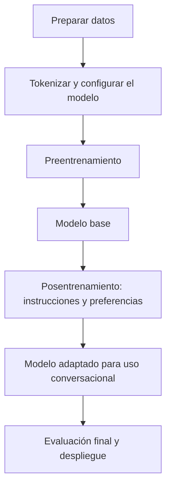

# Apuntes de inteligencia artificial

Notas breves y organizadas para repasar los conceptos de inteligencia artificial (IA).

## Índice

- [1. Orígenes y fechas clave](#1-orígenes-y-fechas-clave)
- [2. Modelos de lenguaje de gran tamaño (LLM): historia y evolución](#2-modelos-de-lenguaje-de-gran-tamaño-llm-historia-y-evolución)
- [3. PLN: procesamiento del lenguaje natural](#3-pln-procesamiento-del-lenguaje-natural)
- [4. Modelo de n-gramas](#4-modelo-de-n-gramas)
- [5. Contexto](#5-contexto)
- [6. Tokens y tokenización](#6-tokens-y-tokenización)
- [7. Determinismo y aleatoriedad](#7-determinismo-y-aleatoriedad)
- [8. Redes neuronales](#8-redes-neuronales)
- [9. Ejemplo en C#: puntos de un juego](#9-ejemplo-en-c-puntos-de-un-juego)
- [10. Redes neuronales recurrentes (RNN)](#10-redes-neuronales-recurrentes-rnn)
- [11. Transformer: historia y funcionamiento](#11-transformer-historia-y-funcionamiento)
- [12. Ciclo de entrenamiento de un LLM](#12-ciclo-de-entrenamiento-de-un-llm)
- [13. Embeddings: representación y contexto](#13-embeddings-representación-y-contexto)

## 1. Orígenes y fechas clave

### 1943: McCulloch y Pitts

**Warren S. McCulloch y Walter Pitts** publican un modelo matemático de neuronas inspirado en el sistema nervioso. Su trabajo es un antecedente fundamental de las redes neuronales artificiales.

Fuente: [A Logical Calculus of the Ideas Immanent in Nervous Activity (1943)](https://home.csulb.edu/~cwallis/382/readings/482/mccolloch.logical.calculus.ideas.1943.pdf).

### 1950: Alan Turing y el test de Turing

En su artículo *Computing Machinery and Intelligence*, Alan Turing planteó el «juego de imitación»: evaluar si una máquina puede mantener una conversación escrita que un evaluador confunda con la de una persona.

**Qué evalúa:** el comportamiento conversacional de la máquina. Superar esta prueba no demuestra por sí solo consciencia o comprensión humana.

Fuente: [Artículo original de Turing (1950)](https://courses.cs.umbc.edu/471/papers/turing.html).

### 1955: el término «inteligencia artificial»

**John McCarthy** introdujo el término en la propuesta del encuentro de Dartmouth, junto con Marvin Minsky, Nathaniel Rochester y Claude Shannon.

Fuente: [Propuesta original de Dartmouth (1955)](https://www-formal.stanford.edu/jmc/history/dartmouth/dartmouth.html).

### 1956: nacimiento formal de la IA como campo de investigación

El encuentro de Dartmouth, celebrado en el verano de 1956, se considera el nacimiento formal de la IA como campo de investigación, aunque existían trabajos anteriores.

**Para recordar:** 1950 → Turing; 1955 → aparece el término; 1956 → encuentro de Dartmouth.

Fuente: [Dartmouth: los orígenes de la IA](https://ai.dartmouth.edu/founding-and-future-ai).

## 2. Modelos de lenguaje de gran tamaño (LLM): historia y evolución

### Qué es un LLM

**LLM** significa *Large Language Model*: **modelo de lenguaje de gran tamaño**. Es una red neuronal entrenada con grandes cantidades de texto para aprender patrones del lenguaje y realizar tareas como resumir, traducir, responder preguntas o generar contenido.

Muchos LLM actuales utilizan la arquitectura **Transformer**. Los modelos generativos de la familia GPT producen texto prediciendo el siguiente token a partir del contexto disponible.

Los **parámetros** son los valores numéricos internos que se ajustan durante el entrenamiento. El número de parámetros describe parte del tamaño del modelo; los tokens miden las unidades de texto que procesa.

Fuentes: [Stanford: introducción a la IA](https://uit.stanford.edu/service/techtraining/ai-demystified/introduction) y [GPT-3: modelo autorregresivo y parámetros](https://arxiv.org/abs/2005.14165).

### Cronología

| Fecha | Hito | Aportación |
| --- | --- | --- |
| **1943** | McCulloch y Pitts presentan un modelo lógico de neuronas. | Establecen un antecedente de las redes neuronales artificiales. [Artículo](https://home.csulb.edu/~cwallis/382/readings/482/mccolloch.logical.calculus.ideas.1943.pdf). |
| **1950** | Alan Turing publica *Computing Machinery and Intelligence*. | Plantea el juego de imitación, antecedente conceptual para evaluar el comportamiento inteligente de las máquinas. [Artículo](https://courses.cs.umbc.edu/471/papers/turing.html). |
| **Décadas de 1950–1990** | Desarrollo y uso de modelos estadísticos de lenguaje, incluidos los n-gramas. | Estiman probabilidades de secuencias; desde los años setenta adquieren especial relevancia en reconocimiento del habla. Sus antecedentes matemáticos se remontan a Markov y Shannon. [Historia de los n-gramas](https://web.stanford.edu/~jurafsky/slp3/3.pdf#page=21). |
| **2003** | Yoshua Bengio y colaboradores publican *A Neural Probabilistic Language Model*. | Aprenden representaciones numéricas de palabras y probabilidades mediante una red neuronal, facilitando la generalización a secuencias nuevas. [Artículo](https://jmlr.csail.mit.edu/papers/v3/bengio03a). |
| **Década de 2010** | Avance del aprendizaje profundo y los modelos neuronales de lenguaje. | Las redes recurrentes y otras técnicas mejoran el procesamiento de secuencias y preparan el desarrollo de modelos más generales. [Stanford](https://nlp.stanford.edu/~manning/dissertations/AbigailSeeThesis-augmented.pdf). |
| **2017** | Vaswani y colaboradores presentan *Attention Is All You Need* en NIPS 2017. | Introducen el Transformer, basado en mecanismos de atención, con resultados destacados en traducción automática. [Artículo](https://proceedings.neurips.cc/paper_files/paper/2017/file/3f5ee243547dee91fbd053c1c4a845aa-Paper.pdf). |
| **2018** | OpenAI presenta **GPT**, posteriormente conocido como **GPT-1**. | Combina el preentrenamiento generativo con la adaptación a tareas de lenguaje. [Publicación](https://openai.com/index/language-unsupervised/). |
| **2018** | Google presenta **BERT**. | Utiliza contexto a izquierda y derecha para aprender representaciones del lenguaje y mejorar tareas de comprensión. El artículo aparece en 2018 y se publica en NAACL en 2019. [Artículo](https://arxiv.org/abs/1810.04805). |
| **2019** | OpenAI presenta **GPT-2**. | Amplía la escala del modelo y mejora la generación de texto; su versión mayor tiene aproximadamente 1.500 millones de parámetros. [Publicación](https://openai.com/index/better-language-models/). |
| **2020** | Se publica **GPT-3**. | Su versión mayor tiene **175.000 millones de parámetros** y muestra la capacidad de realizar distintas tareas con instrucciones y ejemplos en el contexto, sin ajustar los parámetros para cada tarea. [Artículo](https://arxiv.org/abs/2005.14165). |
| **30 de noviembre de 2022** | Lanzamiento de **ChatGPT**. | Facilita el uso conversacional de modelos de lenguaje; su versión inicial está basada en la serie GPT-3.5. [Anuncio](https://openai.com/index/chatgpt/). |
| **2023** | Se presenta **GPT-4**. | Su informe técnico describe un modelo capaz de recibir texto e imágenes y generar texto. [Informe](https://arxiv.org/abs/2303.08774). |
| **2024–2025** | Expansión de sistemas multimodales y aplicaciones con herramientas. | Se extienden los flujos de trabajo con texto, imágenes, audio y vídeo, y los sistemas que realizan tareas de varios pasos. [Balance de 2025](https://developers.openai.com/blog/openai-for-developers-2025). |

### Artículos fundamentales

**Computing Machinery and Intelligence — Alan M. Turing (1950)**

- **Publicación:** revista *Mind*, volumen 59, número 236, páginas 433–460.
- **Idea principal:** estudiar la inteligencia de las máquinas mediante su comportamiento en una conversación escrita.
- **Relevancia:** antecedente del debate sobre inteligencia artificial y evaluación de sistemas conversacionales.
- **Lectura:** [texto completo](https://courses.cs.umbc.edu/471/papers/turing.html).

**Attention Is All You Need — Ashish Vaswani y colaboradores (2017)**

- **Publicación:** *Advances in Neural Information Processing Systems 30*, NIPS 2017.
- **Idea principal:** presentar el **Transformer**, una arquitectura que utiliza atención para relacionar los elementos de una secuencia.
- **Atención:** permite ponderar la información de otros tokens del contexto al calcular la representación de un token.
- **Relevancia:** facilita el entrenamiento en paralelo y sirve de base para familias posteriores como GPT y BERT. En la generación autorregresiva, el texto se sigue produciendo token a token.
- **Lectura:** [PDF del artículo](https://proceedings.neurips.cc/paper_files/paper/2017/file/3f5ee243547dee91fbd053c1c4a845aa-Paper.pdf).

### Multimodalidad y agentes

Un **modelo multimodal** puede trabajar con varias modalidades de información, como texto e imágenes. Las modalidades admitidas dependen del modelo y de la aplicación.

Un **agente basado en un LLM** combina el modelo con herramientas y un proceso de varios pasos: recibe un objetivo, decide acciones y utiliza los resultados para continuar. Por ejemplo, puede consultar un inventario, calcular necesidades de material y preparar una propuesta de compra.

Los sistemas que combinan modelos de lenguaje con acciones ya se investigaban en **2022**, como muestra el trabajo **ReAct**. Su desarrollo se amplía durante los años siguientes.

Fuentes: [GPT-4 y multimodalidad](https://arxiv.org/abs/2303.08774), [ReAct (2022)](https://arxiv.org/abs/2210.03629) y [evolución de herramientas y modalidades en 2025](https://developers.openai.com/blog/openai-for-developers-2025).

## 3. PLN: procesamiento del lenguaje natural

El **PLN**, conocido en inglés como **NLP** (*Natural Language Processing*), es el área de la IA dedicada a procesar, interpretar y generar lenguaje humano.

Sus tareas se agrupan en dos grandes áreas:

| Grupo de tareas | Objetivo | Ejemplo |
| --- | --- | --- |
| **Comprensión** | Interpretar la información o la intención de un mensaje. | Identificar qué pide una persona o si una opinión es positiva. |
| **Generación** | Producir lenguaje. | Redactar una respuesta, un resumen o una descripción. |

**Relación entre conceptos:** la IA es el campo general; el PLN se centra en el lenguaje; los LLM son una de las herramientas empleadas en ese campo.

Fuente: [Stanford HAI: qué es el PLN](https://hai.stanford.edu/ai-definitions/what-is-nlp).

## 4. Modelo de n-gramas

### Origen: cadenas de Markov

Las **cadenas de Markov**, desarrolladas por el matemático **Andréi Markov**, son una de las bases matemáticas de los modelos de n-gramas.

| Año | Aportación |
| --- | --- |
| **1906** | Markov inicia sus trabajos sobre secuencias de sucesos dependientes, origen de las cadenas que llevan su nombre. |
| **1913** | Analiza 20.000 letras de *Eugenio Oneguin*, de Aleksandr Pushkin, y estudia las probabilidades de vocales y consonantes a partir de las letras anteriores. |
| **1948** | Claude Shannon aplica aproximaciones de n-gramas al estudio estadístico del inglés. |

Las bases del modelado de secuencias con memoria limitada tienen **más de un siglo de historia** y son anteriores al nacimiento formal de la IA en 1956.

Fuentes: [David Link: los trabajos de Markov sobre el lenguaje](https://www.its.caltech.edu/~matilde/TracesOfTheMouth.pdf) y [Jurafsky y Martin: historia de los n-gramas](https://web.stanford.edu/~jurafsky/slp3/3.pdf#page=21).

### Suposición de Markov

En una cadena de Markov de primer orden, la probabilidad del siguiente estado depende del estado actual. Los modelos de n-gramas aplican esta idea al lenguaje: aproximan la probabilidad del siguiente token utilizando un historial corto.

| Modelo | Historial utilizado | Orden de dependencia |
| --- | --- | --- |
| **Bigrama** | 1 token anterior | Primer orden |
| **Trigrama** | 2 tokens anteriores | Segundo orden |
| **N-grama** | n − 1 tokens anteriores | Orden n − 1 |

### Definición

Un **n-grama** es una secuencia de *n* tokens consecutivos. En los siguientes ejemplos, cada palabra se trata como un token y se omite la puntuación.

Un **modelo de n-gramas** estima el siguiente token a partir de los **n − 1 tokens anteriores**, utilizando frecuencias del conjunto de entrenamiento.

| Modelo | Tokens por secuencia | Contexto para predecir | Ejemplo de secuencia |
| --- | --- | --- | --- |
| **Unigrama** | 1 | Ninguno | «brisa» |
| **Bigrama** | 2 | 1 token anterior | «brisa suave» |
| **Trigrama** | 3 | 2 tokens anteriores | «brisa suave mueve» |

### Secuencias consecutivas

Frase: **«La brisa suave mueve las hojas»**.

- **Bigramas:** «La brisa», «brisa suave», «suave mueve», «mueve las», «las hojas».
- **Trigramas:** «La brisa suave», «brisa suave mueve», «suave mueve las», «mueve las hojas».

Las secuencias se desplazan una posición cada vez y se solapan.

### Predicción con bigramas y trigramas

Conjunto de entrenamiento:

> La brisa suave mueve las hojas.
>
> La brisa suave mueve las cortinas.
>
> La brisa suave refresca el patio.
>
> Una voz suave transmite calma.

Las probabilidades se calculan dividiendo las apariciones de cada continuación entre las apariciones del contexto:

| Modelo | Contexto | Siguiente palabra | Frecuencia | Probabilidad |
| --- | --- | --- | --- | --- |
| Bigrama | «suave» | «mueve» | 2 de 4 | 50 % |
| Bigrama | «suave» | «refresca» | 1 de 4 | 25 % |
| Bigrama | «suave» | «transmite» | 1 de 4 | 25 % |
| Trigrama | «brisa suave» | «mueve» | 2 de 3 | ≈ 66,7 % |
| Trigrama | «brisa suave» | «refresca» | 1 de 3 | ≈ 33,3 % |
| Trigrama | «voz suave» | «transmite» | 1 de 1 | 100 % |

El trigrama distingue entre «brisa suave» y «voz suave». El bigrama solo considera «suave». Las probabilidades describen este conjunto de entrenamiento.

### Limitaciones

El contexto reducido dificulta recoger relaciones entre palabras alejadas. Al aumentar *n*, se necesitan más datos para observar las posibles combinaciones. Las secuencias no observadas requieren técnicas como el **suavizado**, que evita asignarles automáticamente una probabilidad de cero.

Fuente: [Jurafsky y Martin: modelos de lenguaje de n-gramas](https://web.stanford.edu/~jurafsky/slp3/3.pdf).

### «Amnesia» y memoria limitada

La **«amnesia»** es una forma intuitiva de describir la memoria limitada de un modelo de n-gramas: los tokens que quedan fuera de sus últimas **n − 1 posiciones** dejan de intervenir directamente en la predicción.

Ejemplo con un modelo de trigramas que trata cada palabra como un token:

> Clara vive en Toledo y mañana regresará a…
>
> Clara vive en Cuenca y mañana regresará a…

En ambos casos, el contexto utilizado para predecir es **«regresará a»**. El modelo asigna la misma distribución de probabilidades a la continuación, aunque la ciudad mencionada antes sea diferente.

La «amnesia» afecta al historial utilizado durante la predicción. Las estadísticas aprendidas durante el entrenamiento se conservan.

Consecuencias:

- Dificultad para mantener un tema o recordar datos mencionados varias frases antes.
- Posibles contradicciones en textos largos, aunque las secuencias cercanas resulten plausibles.
- Aumentar *n* amplía el contexto, pero exige más datos y combinaciones de tokens.

Fuente: [Jurafsky y Martin: suposición de Markov y contexto limitado](https://web.stanford.edu/~jurafsky/slp3/3.pdf#page=3).

## 5. Contexto

El **contexto** es la información que el modelo tiene disponible para interpretar una entrada o predecir la continuación de un texto.

Ejemplo: **«Se sentó en el banco»** puede referirse a un asiento; **«Ingresó dinero en el banco»**, a una entidad financiera. Las palabras que acompañan a «banco» ayudan a interpretar su significado.

- En un **bigrama**, el contexto de predicción es el token anterior.
- En un **trigrama**, son los dos tokens anteriores.
- En un **LLM generativo**, puede incluir instrucciones, mensajes anteriores, documentos aportados y texto ya generado, dentro de sus límites.

### Ventana de contexto

Es la cantidad máxima de tokens que el modelo puede considerar en una operación. Más contexto permite aportar más información, aunque no garantiza que el modelo utilice todos los detalles correctamente.

El contexto es información disponible durante el uso del modelo; el entrenamiento es el proceso previo en el que aprende patrones y ajusta sus parámetros.

Fuentes: [Stanford HAI: ventana de contexto](https://hai.stanford.edu/ai-definitions/what-is-a-context-window) y [Stanford: cómo funcionan los modelos de lenguaje](https://guides.library.stanford.edu/ai_research/understanding_ai).

## 6. Tokens y tokenización

### Qué es

La **tokenización** transforma el texto en una secuencia de unidades llamadas **tokens**, representadas mediante **identificadores numéricos**. El componente que aplica estas reglas es el **tokenizador**.

Un token puede representar una palabra, parte de una palabra, puntuación, espacios u otras secuencias. La división depende del vocabulario y las reglas del tokenizador.

```text
Texto → fragmentos o tokens → identificadores → embeddings → modelo
```

El **identificador** selecciona una entrada del vocabulario; el **embedding** es el vector numérico asociado que utiliza la red neuronal.

Fuente: [Jurafsky y Martin: palabras y tokens](https://web.stanford.edu/~jurafsky/slp3/2.pdf).

### Objetivos

- **Mantener un vocabulario manejable:** reutilizar fragmentos para representar muchas palabras.
- **Representar texto nuevo:** descomponer palabras poco frecuentes o variantes ortográficas.
- **Equilibrar eficiencia:** combinar un vocabulario de tamaño razonable con secuencias que no sean excesivamente largas.

Los métodos por subpalabras ofrecen un compromiso entre usar palabras completas y dividir todo en caracteres. La tokenización representa el texto recibido; la corrección ortográfica es una tarea independiente.

Fuente: [Hugging Face: métodos de tokenización](https://huggingface.co/docs/transformers/tokenizer_summary).

### Proceso de tokenización

| Paso | Qué ocurre |
| --- | --- |
| **1. Normalización, si está configurada** | Aplica reglas al texto, como normalización Unicode o conversión a minúsculas. Las reglas dependen del tokenizador. |
| **2. Pretokenización** | Delimita segmentos iniciales, por ejemplo mediante espacios o puntuación. |
| **3. Segmentación** | Aplica el método elegido, como BPE, WordPiece o Unigram. |
| **4. Codificación** | Asigna a cada token su identificador dentro del vocabulario. |
| **5. Posprocesamiento** | Añade, cuando corresponde, tokens especiales de inicio, fin, separación o control. |

La **decodificación** convierte los identificadores de salida en texto. La reconstrucción depende de las reglas del tokenizador y de las transformaciones aplicadas al texto.

Fuente: [Hugging Face: proceso de tokenización](https://huggingface.co/docs/tokenizers/pipeline).

### Principales métodos

| Método | Cómo trabaja | Característica |
| --- | --- | --- |
| **Por palabras** | Separa palabras completas, normalmente con reglas adicionales para la puntuación. | Puede requerir un vocabulario muy grande y encontrar palabras desconocidas. |
| **Por caracteres** | Trata cada carácter como una unidad. | Vocabulario pequeño, pero secuencias más largas. |
| **Por bytes** | Representa el texto a partir de sus bytes, habitualmente con codificación UTF-8. | Puede cubrir cualquier texto codificable; un carácter puede ocupar varios bytes. |
| **BPE — Byte Pair Encoding** | Aprende fusiones de pares frecuentes de unidades consecutivas. | Produce fragmentos frecuentes; existen variantes que parten de caracteres o de bytes. |
| **WordPiece** | Segmenta usando subpalabras del vocabulario, seleccionando el fragmento conocido más largo desde cada punto. | Se utiliza en BERT; el marcador «##» suele indicar continuación de palabra. |
| **Unigram** | Aprende probabilidades de fragmentos y elige una segmentación según ese modelo. | Permite evaluar distintas formas de dividir una misma palabra. |

Fuentes: [comparación de métodos](https://huggingface.co/docs/transformers/tokenizer_summary), [BPE](https://huggingface.co/learn/llm-course/chapter6/5), [WordPiece](https://huggingface.co/learn/llm-course/chapter6/6) y [Unigram](https://huggingface.co/learn/llm-course/chapter6/7).

**SentencePiece** es una herramienta que permite entrenar y aplicar tokenizadores, incluidos BPE y Unigram, directamente sobre texto. Puede representar los espacios explícitamente y trabajar con idiomas que no separan las palabras mediante espacios.

Fuente: [SentencePiece: documentación del proyecto](https://github.com/google/sentencepiece).

### Ejemplo de aprendizaje con BPE

Corpus simplificado: **«pato», «pato», «patos»**. Se trabaja dentro de cada palabra, sin representar espacios ni marcadores de final.

1. **Inicio:** se separan los caracteres: «p | a | t | o» y «p | a | t | o | s».
2. **Primera fusión:** «p» + «a» → «pa».
3. **Segunda fusión:** «pa» + «t» → «pat».
4. **Tercera fusión:** «pat» + «o» → «pato».

Con estas fusiones, «pato» queda como un token y «patos» como **«pato | s»**. En este corpus hay pares empatados en frecuencia; se ha elegido una secuencia posible de desempates.

Las fusiones se aprenden al entrenar el tokenizador. Al procesar un texto nuevo, se aplican las reglas ya aprendidas.

Fuente: [Hugging Face: aprendizaje y aplicación de BPE](https://huggingface.co/learn/llm-course/chapter6/5).

### Ejemplo: de fragmentos a identificadores

Con un **vocabulario inventado** para ilustrar la conversión:

| Token | Identificador |
| --- | --- |
| «Buenas» | 48 |
| « tardes» — incluye un espacio inicial | 207 |
| «!» | 9 |

```text
«Buenas tardes!» → [«Buenas», « tardes», «!»] → [48, 207, 9]
```

Cada tipo de token tiene un identificador dentro de ese vocabulario. Las apariciones del mismo token comparten identificador. Otro tokenizador puede dividir la frase de otra manera y asignar otros números.

El número es una referencia al vocabulario; su magnitud no indica importancia ni significado.

### Espacios, símbolos y tokens especiales

Los espacios, tabulaciones y saltos de línea también pueden quedar representados, de forma independiente o unidos a otros fragmentos. Los acentos, emojis y símbolos pueden necesitar varios tokens.

Los **tokens especiales** marcan elementos como el final del texto, separadores o roles en una conversación. Su uso concreto forma parte de la configuración del modelo.

Fuentes: [proceso y posprocesamiento](https://huggingface.co/docs/tokenizers/pipeline) y [SentencePiece: representación de espacios](https://github.com/google/sentencepiece).

### Cuándo se utiliza

- **Al preparar el entrenamiento:** se codifican los datos con el tokenizador elegido.
- **Al usar el modelo:** se codifican el mensaje, el historial y otros textos aportados como contexto.
- **Al generar:** el modelo produce identificadores de tokens, que se decodifican para mostrar texto.

Entrenar el tokenizador aprende su vocabulario y sus reglas. Entrenar el LLM ajusta los parámetros de la red neuronal. El modelo se utiliza con un tokenizador compatible con su entrenamiento.

**Un token no equivale siempre a una palabra.** El número de tokens depende del texto, el idioma y el tokenizador; influye en el uso de la ventana de contexto y en el coste de procesar la secuencia.

Fuente: [Hugging Face: métodos y uso de tokenizadores](https://huggingface.co/docs/transformers/tokenizer_summary).

## 7. Determinismo y aleatoriedad

### Determinismo

Un proceso es **determinista** cuando produce el mismo resultado si se repite con las mismas entradas, el mismo estado inicial y las mismas condiciones de ejecución.

Ejemplo: una función que suma dos números devuelve siempre **13** cuando recibe **8 y 5**.

Las condiciones incluyen los datos externos que utiliza el programa: hora, archivos, respuestas de servicios o estado de una base de datos.

### Aleatoriedad

Un proceso incorpora **aleatoriedad** cuando utiliza una fuente de azar para elegir entre resultados posibles. Al repetirlo, el resultado puede cambiar, aunque también puede coincidir.

Ejemplo: un programa selecciona al azar una tarjeta entre «roja», «azul» y «verde». Si las tres tienen la misma probabilidad, cada una tiene **1/3** de posibilidades en cada selección independiente.

| Aspecto | Proceso determinista | Proceso con aleatoriedad |
| --- | --- | --- |
| Resultado | Se repite bajo las mismas condiciones. | Puede variar entre ejecuciones. |
| Ejemplo | Ordenar una lista de números. | Barajar una lista de tarjetas. |
| Uso habitual | Cálculos y transformaciones reproducibles. | Simulaciones, sorteos y exploración de alternativas. |

### Pseudoaleatoriedad y semilla

Muchos programas utilizan **generadores pseudoaleatorios**: algoritmos deterministas que producen secuencias con apariencia aleatoria.

La **semilla** (*seed*) inicializa el generador. Con el mismo generador, la misma semilla y la misma secuencia de llamadas, se puede reproducir la secuencia bajo las mismas condiciones de implementación.

Fijar la semilla una vez no hace que todas las selecciones sean iguales: cada llamada avanza el estado del generador. Reiniciarlo con la misma semilla permite repetir la secuencia.

También existen fuentes de aleatoriedad basadas en fenómenos físicos y fuentes proporcionadas por el sistema operativo.

Fuente: [Python: generadores pseudoaleatorios y semillas](https://docs.python.org/3/library/random.html).

### Relación con los modelos de lenguaje

Un modelo puede asignar probabilidades a varios tokens y utilizar diferentes reglas para elegir el siguiente.

Ejemplo: después de **«El excursionista lleva una»**, un modelo asigna estas probabilidades:

| Continuación | Probabilidad |
| --- | --- |
| «mochila» | 60 % |
| «linterna» | 30 % |
| «cantimplora» | 10 % |

- **Selección determinista:** elegir siempre el token más probable; en este caso, «mochila». Los empates requieren una regla fija.
- **Muestreo aleatorio:** seleccionar según las probabilidades. «Mochila» tiene más posibilidades, pero también pueden salir las otras opciones.

**Probabilístico** describe cómo se representan las posibilidades; **aleatorio** describe cómo se realiza la selección. Un modelo probabilístico puede utilizar una regla de selección determinista.

En un LLM, repetir una respuesta exactamente también depende del modelo, el contexto, la configuración y las condiciones de ejecución.

Fuente: [Jurafsky y Martin: probabilidades y muestreo en modelos de lenguaje](https://web.stanford.edu/~jurafsky/slp3/3.pdf).

## 8. Redes neuronales

### Origen e inspiración biológica

Las **redes neuronales artificiales** son modelos matemáticos formados por unidades conectadas, llamadas **neuronas artificiales**. Se inspiran de forma simplificada en cómo las neuronas del sistema nervioso animal reciben señales y transmiten una respuesta.

En **1943**, **Warren S. McCulloch y Walter Pitts** publicaron *A Logical Calculus of the Ideas Immanent in Nervous Activity*. Describieron neuronas idealizadas con activación de tipo «todo o nada» y redes capaces de representar operaciones lógicas.

El modelo de 1943 utilizaba conexiones fijas. Las redes modernas incorporan parámetros ajustables mediante entrenamiento.

Fuente: [McCulloch y Pitts: artículo original (1943)](https://home.csulb.edu/~cwallis/382/readings/482/mccolloch.logical.calculus.ideas.1943.pdf).

### Cómo funciona una neurona artificial


La neurona combina sus entradas y aplica una función de activación:

**z = w₁·x₁ + w₂·x₂ + … + wₙ·xₙ + b**

**ŷ = f(z)**

| Elemento | Función |
| --- | --- |
| **Entradas (x)** | Datos numéricos recibidos por la neurona. |
| **Pesos (w)** | Multiplican cada entrada y determinan su contribución a la suma. Pueden ser positivos, negativos o cero. |
| **Sesgo (b)** | Desplaza el resultado de la suma, incluso cuando las entradas son cero. |
| **Suma ponderada (z)** | Combina los productos de entradas y pesos con el sesgo. |
| **Activación (f)** | Transforma la suma. Por ejemplo, ReLU devuelve el mayor valor entre 0 y z. |
| **Salida (ŷ)** | Predicción o señal transmitida a otras neuronas. |

Las activaciones no lineales permiten aprender relaciones complejas. Para una suma basta una activación lineal: **f(z) = z**.

Fuente: [Google: neuronas, capas y funciones de activación](https://developers.google.com/machine-learning/crash-course/neural-networks/nodes-hidden-layers).

### Ejemplo: aprender a sumar

Una neurona recibe dos números y aprende a predecir su suma:

| x₁ | x₂ | Objetivo (y) |
| --- | --- | --- |
| 1 | 4 | 5 |
| 3 | 6 | 9 |
| 6 | 2 | 8 |

Con activación lineal, una solución es **w₁ = 1**, **w₂ = 1** y **b = 0**. El entrenamiento puede aproximarse a esos valores.

Para una entrada nueva, **x₁ = 4** y **x₂ = 7**, la predicción será aproximadamente:

**ŷ ≈ 1·4 + 1·7 + 0 = 11**.

### Entrenamiento

1. **Predecir:** calcular la salida con los parámetros actuales.
2. **Medir la pérdida:** comparar la predicción **ŷ** con el objetivo **y**. Por ejemplo, utilizar el error cuadrático **(ŷ − y)²**.
3. **Ajustar:** modificar pesos y sesgo para reducir la pérdida, mediante un optimizador como el descenso de gradiente.
4. **Repetir:** procesar ejemplos durante varias pasadas por los datos y evaluar el resultado con datos nuevos.

La **tasa de aprendizaje** controla el tamaño de los ajustes. Una tasa excesiva puede desestabilizar el entrenamiento; una demasiado pequeña puede hacerlo lento.

Fuente: [Google: descenso de gradiente y ajuste de parámetros](https://developers.google.com/machine-learning/crash-course/linear-regression/gradient-descent).

### De una neurona a una red

En una red de tipo *feedforward*, las neuronas se organizan en **capa de entrada**, **capas ocultas** y **capa de salida**. Cada capa transforma la información que recibe de la anterior.

Una red con varias capas ocultas es un ejemplo de **aprendizaje profundo**. Los LLM utilizan redes neuronales de gran escala.

Fuente: [Google: organización en capas](https://developers.google.com/machine-learning/crash-course/neural-networks/nodes-hidden-layers).

## 9. Ejemplo en C#: puntos de un juego

Una red mínima con **dos entradas y una neurona lineal**, sin capas ocultas, aprende a estimar los puntos de una partida. Equivale a un modelo de regresión lineal.

- **Entradas:** monedas y gemas recogidas.
- **Salida:** puntos estimados.
- **Parámetros aprendidos:** dos pesos y un sesgo.
- **Datos:** ejemplos simulados con la regla **puntos = 2·monedas + 5·gemas + 3**. La función de predicción utiliza los parámetros aprendidos.


```csharp
using System;

public class Program
{
    // Una neurona con dos entradas y activación lineal: f(z) = z.
    static double Predecir(double monedas, double gemas,
                           double w1, double w2, double sesgo)
    {
        return monedas * w1 + gemas * w2 + sesgo;
    }

    public static void Main()
    {
        // Cada fila contiene: monedas, gemas y puntos reales de la partida.
        double[,] datos =
        {
            { 0, 0,  3 },
            { 1, 0,  5 },
            { 0, 1,  8 },
            { 2, 1, 12 },
            { 1, 2, 15 },
            { 3, 3, 24 }
        };

        // Los valores que la neurona debe aprender empiezan en cero.
        double w1 = 0, w2 = 0, sesgo = 0;
        double tasa = 0.02; // Tamaño del paso de cada ajuste.
        int epocas = 6000;  // Número de pasadas por todos los datos.
        int cantidad = datos.GetLength(0);

        for (int epoca = 0; epoca < epocas; epoca++)
        {
            // Acumulamos gradientes antes de actualizar los parámetros.
            double gradW1 = 0, gradW2 = 0, gradSesgo = 0;

            for (int i = 0; i < cantidad; i++)
            {
                double x1 = datos[i, 0]; // Monedas de esta partida.
                double x2 = datos[i, 1]; // Gemas de esta partida.
                double y = datos[i, 2];  // Puntos que debería predecir.

                double prediccion = Predecir(x1, x2, w1, w2, sesgo);
                double error = prediccion - y;

                // Derivadas de la pérdida: L = suma(error²) / (2 * cantidad).
                gradW1 += error * x1;
                gradW2 += error * x2;
                gradSesgo += error;
            }

            // Descenso de gradiente: restamos el gradiente medio de cada parámetro.
            w1 -= tasa * gradW1 / cantidad;
            w2 -= tasa * gradW2 / cantidad;
            sesgo -= tasa * gradSesgo / cantidad;
        }

        // El entrenamiento aproxima w1 = 2, w2 = 5 y sesgo = 3.
        Console.WriteLine("w1 = {0:F4}, w2 = {1:F4}, sesgo = {2:F4}",
                          w1, w2, sesgo);

        // Esta combinación no aparece en los datos de entrenamiento.
        double puntos = Predecir(4, 2, w1, w2, sesgo);
        Console.WriteLine("4 monedas y 2 gemas: {0:F2} puntos", puntos);
    }
}
```

### Resultado

```text
w1 = 2,0000, w2 = 5,0000, sesgo = 3,0000
4 monedas y 2 gemas: 21,00 puntos
```

El entrenamiento aproxima los pesos **2** y **5** y el sesgo **3**. La combinación de **4 monedas y 2 gemas** se utiliza después del entrenamiento.

El gradiente se calcula a partir de la pérdida **L = suma((predicción − objetivo)²) / (2·cantidad)**. Cada época utiliza todos los ejemplos antes de actualizar los parámetros.

**Código ejecutable:** [NeuronaPuntosJuego.cs](ejemplos/NeuronaPuntosJuego.cs). Puede copiarse en el archivo Program.cs de un proyecto de consola C#; utiliza únicamente la biblioteca estándar.

Fuente conceptual: [Google: descenso de gradiente](https://developers.google.com/machine-learning/crash-course/linear-regression/gradient-descent).

## 10. Redes neuronales recurrentes (RNN)


El esquema omite pasos intermedios y utiliza valores de estado ilustrativos.

### Hitos históricos

| Año | Aportación |
| --- | --- |
| **1990** | Jeffrey L. Elman publica *Finding Structure in Time*, un trabajo de referencia sobre redes recurrentes con estado interno. [Publicación del autor](https://jeffelman.ucsd.edu/research/publications/). |
| **1997** | Sepp Hochreiter y Jürgen Schmidhuber presentan **LSTM**, diseñada para facilitar el aprendizaje de dependencias lejanas. [Artículo](https://doi.org/10.1162/neco.1997.9.8.1735). |
| **2014** | Kyunghyun Cho y colaboradores presentan una unidad recurrente con compuertas, conocida como **GRU**, en un modelo codificador-decodificador. [Artículo](https://arxiv.org/abs/1406.1078). |

### Datos secuenciales

Una **red neuronal recurrente**, o **RNN** (*Recurrent Neural Network*), procesa datos en los que **el orden importa**: texto, audio o mediciones de un sensor a lo largo del tiempo.

En cada paso combina la entrada actual con un **estado oculto o interno** procedente del paso anterior. Este estado es un vector numérico que resume información de la secuencia.

### Funcionamiento paso a paso

1. **Recibe la entrada actual:** por ejemplo, la representación numérica de una palabra o token.
2. **La combina con el estado anterior:** incorpora información de los pasos previos.
3. **Calcula un nuevo estado:** actualiza el resumen de la secuencia.
4. **Avanza a la siguiente entrada:** transmite el nuevo estado al siguiente paso.

**hₜ = f(xₜ, hₜ₋₁)**

- **xₜ:** entrada actual.
- **hₜ₋₁:** estado anterior.
- **hₜ:** nuevo estado.

El estado inicial **h₀** suele establecerse en ceros. La red reutiliza los mismos pesos en todos los pasos; durante la lectura cambia el estado.

En un modelo de lenguaje, el estado también permite calcular probabilidades para el siguiente token.

Fuente: [Dive into Deep Learning: redes neuronales recurrentes](https://d2l.ai/chapter_recurrent-neural-networks/rnn.html).

### Ejemplo: una relación entre palabras alejadas

> La lámpara que elegimos en la tienda del centro después de comparar varios modelos y revisar los precios sigue encendida.

Cada palabra se considera un paso en este ejemplo. La relación principal que interesa conservar es **«lámpara → encendida»**, aunque aparezcan otras palabras entre ambas.

| Entrada o tramo | Información relevante para interpretar la frase |
| --- | --- |
| «La» | Comienza un grupo nominal femenino singular. |
| «lámpara» | Aparece el objeto principal al que se referirá el final. |
| «que elegimos en la tienda del centro» | Se añade información sobre la elección de la lámpara. |
| «después de comparar varios modelos y revisar los precios» | Se incorporan detalles y sustantivos en plural; la referencia principal sigue siendo «lámpara». |
| «sigue» | Se introduce el estado actual del objeto. |
| «encendida» | El adjetivo se relaciona con «lámpara», en femenino singular. |

La capacidad de conservar estas relaciones en el estado interno depende del entrenamiento.

### Memoria de corto plazo y «amnesia»

La RNN básica suele conservar mejor la información **reciente**. El estado tiene un tamaño fijo y se actualiza con cada entrada; la información antigua puede debilitarse o quedar sobrescrita.

Esta dificultad para mantener **dependencias a largo plazo** se describe de forma intuitiva como «amnesia». En el ejemplo, la red podría perder la relación con «lámpara» después de procesar los detalles intermedios.

Durante el entrenamiento aparece además el **desvanecimiento del gradiente**: la señal que permite ajustar los pesos puede hacerse muy pequeña al propagarse a través de muchos pasos. Así resulta difícil aprender qué información lejana debe conservarse. También pueden aparecer **gradientes explosivos**, con valores excesivamente grandes.

La dificultad depende de la distancia entre los elementos relevantes, la tarea y el entrenamiento; no existe un número universal de palabras a partir del cual la red olvide.

| Modelo | Información anterior utilizada para predecir |
| --- | --- |
| **N-grama** | Los últimos n − 1 tokens, mediante una ventana fija. |
| **RNN básica** | Un estado que puede transportar información de pasos más lejanos, con dificultades para conservarla en secuencias largas. |

Fuente: [Dive into Deep Learning: propagación hacia atrás en el tiempo y problemas del gradiente](https://d2l.ai/chapter_recurrent-neural-networks/bptt.html).

### LSTM y GRU

**LSTM** (*Long Short-Term Memory*) y **GRU** (*Gated Recurrent Unit*) son variantes de las RNN que utilizan **compuertas** para regular qué información se conserva, se actualiza o se descarta.

Facilitan mantener información durante más pasos, aunque su memoria también tiene limitaciones.

Fuentes: [LSTM](https://d2l.ai/chapter_recurrent-modern/lstm.html) y [GRU](https://d2l.ai/chapter_recurrent-modern/gru.html).

## 11. Transformer: historia y funcionamiento

### Qué es

Un **Transformer** es una arquitectura de red neuronal que utiliza **atención** para combinar información de distintas posiciones de una secuencia. La arquitectura original tiene un **codificador** que representa el texto de entrada y un **decodificador** que produce la salida.

### Historia

| Fecha | Hito |
| --- | --- |
| **2014–2015** | Bahdanau, Cho y Bengio proponen atención para traducción con redes recurrentes. El artículo se difunde en 2014 y se presenta en ICLR 2015. Permite consultar partes relevantes de la entrada al producir cada palabra de la traducción. [Artículo](https://arxiv.org/abs/1409.0473). |
| **2017** | Vaswani y colaboradores presentan **Attention Is All You Need**, publicado inicialmente en junio y presentado en NIPS 2017. Introducen el Transformer con atención y redes por posición, sin recurrencia. [Artículo](https://arxiv.org/abs/1706.03762). |
| **2018** | **GPT** desarrolla la línea de modelos generativos basados en el decodificador; **BERT** desarrolla representaciones bidireccionales basadas en el codificador. [GPT](https://openai.com/index/language-unsupervised/) y [BERT](https://arxiv.org/abs/1810.04805). |
| **2020** | **GPT-3** muestra el potencial de ampliar la escala de los modelos generativos basados en Transformer. [Artículo](https://arxiv.org/abs/2005.14165). |

### Arquitectura original: lectura del diagrama


El recorrido se lee **de abajo arriba**. Los colores identifican las operaciones: **azul**, atención; **violeta**, transformación por posición; **amarillo**, conexión residual y normalización; **rojo**, predicción.

| Bloque | Función |
| --- | --- |
| **Input / Output Embedding** | Convierte identificadores de tokens en vectores. |
| **Positional Encoding** | Incorpora información sobre el orden de las posiciones. |
| **Multi-Head Attention del codificador** | Relaciona cada posición con las posiciones válidas de la entrada. |
| **Masked Multi-Head Attention** | Autoatención del decodificador con máscara causal: permite la posición actual y las anteriores. |
| **Atención cruzada** | El decodificador consulta las representaciones producidas por el codificador. |
| **Add & Norm** | Suma la entrada de una subcapa a su resultado y aplica normalización de capa. |
| **Feed Forward** | Transforma el vector de cada posición mediante una red con activación no lineal. |
| **Linear** | Proyecta la representación a una puntuación por token del vocabulario. |
| **Softmax** | Convierte esas puntuaciones en probabilidades que suman 1. |

Las flechas que rodean bloques representan **conexiones residuales**. La marca **× N** indica capas apiladas: el modelo base original utiliza **6 capas en cada pila**, con parámetros propios por capa.

Fuente: [Dive into Deep Learning: arquitectura Transformer](https://d2l.ai/chapter_attention-mechanisms-and-transformers/transformer.html).

### Entrada del decodificador

Durante el entrenamiento, recibe el texto objetivo **desplazado una posición**: un marcador de inicio seguido de los tokens anteriores. La máscara causal impide utilizar tokens futuros para predecir el siguiente.

En el ejemplo del diagrama:

- **Entrada del codificador:** «La ventana sigue abierta».
- **Salida ya disponible:** «The window».
- **Continuación posible:** «is», seguida más adelante de «open».

Durante la generación, el decodificador reutiliza los tokens que ya ha producido y añade uno nuevo en cada paso.

Fuente: [Vaswani y colaboradores: Transformer original](https://proceedings.neurips.cc/paper_files/paper/2017/file/3f5ee243547dee91fbd053c1c4a845aa-Paper.pdf).

### Ejemplo: de los tokens a la atención

> La ventana que instalamos junto al balcón tras comparar varios modelos sigue abierta.

La relación que interesa identificar es **«ventana → abierta»**, aunque las palabras estén separadas por otros detalles.

**1. Tokenización**

Una división didáctica por palabras y puntuación sería:

```text
La | ventana | que | instalamos | junto | al | balcón | tras |
comparar | varios | modelos | sigue | abierta | .
```

La división real depende del tokenizador; una palabra puede ocupar varios tokens.

Fuente: [Jurafsky y Martin: palabras y tokens](https://web.stanford.edu/~jurafsky/slp3/2.pdf).

**2. Embeddings**

Cada token se asocia a un vector aprendido. Para visualizar el concepto, estos valores son **inventados y reducidos a tres dimensiones**:

| Token | Vector ilustrativo |
| --- | --- |
| «ventana» | [0,2; −0,4; 0,7] |
| «balcón» | [0,3; −0,1; 0,6] |
| «abierta» | [−0,5; 0,8; 0,1] |

Las dimensiones son características aprendidas cuyo significado suele estar distribuido entre muchas coordenadas. A través de las capas, la representación de un token se transforma según su contexto.

Fuente: [Google: aprendizaje de embeddings](https://developers.google.com/machine-learning/crash-course/embeddings/obtaining-embeddings).

**3. Posición**

Se incorpora información sobre dónde aparece cada token. En el Transformer original se añaden vectores posicionales basados en senos y cosenos a los embeddings.

Fuente: [Dive into Deep Learning: autoatención e información de posición](https://d2l.ai/chapter_attention-mechanisms-and-transformers/self-attention-and-positional-encoding.html).

**4. Autoatención: Q, K y V**

Cada posición produce tres proyecciones aprendidas:

| Proyección | Papel |
| --- | --- |
| **Q — Query, consulta** | Se compara con las claves para calcular relevancias. |
| **K — Key, clave** | Permite calcular la compatibilidad con cada consulta. |
| **V — Value, valor** | Aporta la información que se combinará según esas relevancias. |

El mecanismo calcula puntuaciones entre **Q y K**, las escala y normaliza con softmax, y utiliza los pesos resultantes para combinar los **V**.

En la autoatención, Q, K y V proceden de la misma secuencia. En la atención cruzada, Q procede del decodificador y K y V del codificador.

Fuente: [Dive into Deep Learning: cálculo de la atención](https://d2l.ai/chapter_attention-mechanisms-and-transformers/attention-scoring-functions.html).

Para la posición de «abierta» en el **codificador**, una distribución ilustrativa de una cabeza podría ser:

| Posición atendida | Peso ilustrativo |
| --- | --- |
| «ventana» | 0,65 |
| «sigue» | 0,20 |
| «balcón» | 0,05 |
| Resto de posiciones, agrupadas | 0,10 |

Los pesos suman **1**. Son valores inventados para mostrar una combinación ponderada; los valores reales dependen de la capa, la cabeza, el contexto y el entrenamiento.

**5. Atención multicabeza**

Varias cabezas calculan atención con proyecciones diferentes. Sus resultados se concatenan y se combinan mediante otra proyección. Esto permite aprender relaciones diversas en paralelo; la función de cada cabeza surge del entrenamiento.

Fuente: [Dive into Deep Learning: atención multicabeza](https://d2l.ai/chapter_attention-mechanisms-and-transformers/multihead-attention.html).

### Paralelismo y contexto

- **Entrenamiento:** se pueden calcular varias posiciones en paralelo dentro de cada capa. En el decodificador, la máscara mantiene la restricción causal.
- **Generación autorregresiva:** cada token nuevo depende de los anteriores y se produce paso a paso.
- **Relaciones lejanas:** la atención puede conectar directamente posiciones distantes dentro del contexto disponible. La ventana de contexto y la capacidad de usar la información siguen teniendo límites.

Fuente: [Vaswani y colaboradores: atención y procesamiento de secuencias](https://arxiv.org/abs/1706.03762).

### Familias de Transformer

| Variante | Organización | Ejemplo |
| --- | --- | --- |
| **Solo codificador** | Produce representaciones con contexto bidireccional. | BERT. |
| **Solo decodificador** | Genera texto con atención causal. | GPT. |
| **Codificador-decodificador** | Representa una entrada y genera una salida que la consulta. | Transformer original de traducción. |

La atención cruzada entre ambas pilas pertenece a la arquitectura codificador-decodificador.

Fuentes: [Transformer original](https://arxiv.org/abs/1706.03762), [BERT](https://arxiv.org/abs/1810.04805) y [GPT](https://openai.com/index/language-unsupervised/).

## 12. Ciclo de entrenamiento de un LLM

### De Transformer a LLM

El **Transformer** define la arquitectura: capas, atención y operaciones que procesan los datos. El entrenamiento ajusta sus parámetros para obtener un **modelo de lenguaje con capacidades aprendidas**.

**Arquitectura Transformer + tokenizador + datos + entrenamiento → LLM entrenado**.

En los modelos generativos causales, el objetivo habitual del preentrenamiento es **predecir el siguiente token**. Después pueden añadirse etapas para seguir instrucciones y adaptar el comportamiento del modelo.

Fuente: [GPT-3: preentrenamiento y modelado autorregresivo](https://arxiv.org/abs/2005.14165).

### Vista general



El recorrido concreto varía entre proyectos. La evaluación acompaña a todas las fases; el ajuste por instrucciones y preferencias forma parte de muchos modelos conversacionales.

### 1. Recolección y preparación de datos

Se reúne un **corpus**, es decir, un conjunto de textos: documentos, libros, páginas web, código u otras fuentes seleccionadas para el objetivo del modelo.

La preparación incluye:

- **Filtrar:** seleccionar contenido pertinente y con calidad suficiente.
- **Limpiar:** retirar texto corrupto, formatos inútiles y otros elementos que dificulten el aprendizaje.
- **Deduplicar:** reducir copias repetidas que podrían dominar el entrenamiento.
- **Separar conjuntos:** entrenamiento para ajustar parámetros, validación para orientar decisiones de desarrollo y prueba para la evaluación final. Se controla el solapamiento entre ellos.

**Resultado:** datos preparados para entrenar y conjuntos reservados para evaluar.

Fuente: [FineWeb: selección, filtrado y deduplicación de datos](https://arxiv.org/abs/2406.17557).

### 2. Tokenización y configuración del modelo

El **tokenizador** convierte el texto en identificadores numéricos. Los tokens se organizan en secuencias y lotes de entrenamiento.

Se configura el Transformer: tamaño del vocabulario, dimensiones de los embeddings, número de capas y otros parámetros de diseño. Si se entrena desde cero, se inicializan los pesos; si se continúa un modelo existente, se reutilizan sus parámetros.

**Resultado:** un modelo configurado y lotes de tokens listos para procesar.

Fuente: [Hugging Face: entrenamiento de un modelo causal desde cero](https://huggingface.co/learn/llm-course/chapter7/6).

### 3. Preentrenamiento: el ciclo que se repite

El modelo aprende patrones generales mediante un objetivo **autosupervisado**: el propio texto proporciona los tokens que debe predecir.

| Paso del ciclo | Qué ocurre |
| --- | --- |
| **Embeddings y posición** | Los identificadores se convierten en vectores y se incorpora información de posición. |
| **Predicción** | El Transformer calcula probabilidades para el siguiente token usando el contexto permitido. |
| **Cálculo de pérdida** | Se compara la distribución predicha con el token objetivo mediante una función como la entropía cruzada. |
| **Retropropagación** | Se calculan los gradientes: cómo influye cada parámetro entrenable en la pérdida. |
| **Actualización de parámetros** | Un optimizador utiliza los gradientes para ajustar los pesos, incluidos los embeddings entrenables. |
| **Nuevo lote** | Se repite el ciclo con más datos y se comprueba periódicamente la evolución del modelo. |

La repetición se organiza en **pasos de entrenamiento y lotes**; una **época** es una pasada por el conjunto de entrenamiento.

Fuentes: [Hugging Face: objetivo causal y ciclo de entrenamiento](https://huggingface.co/learn/llm-course/chapter7/6) y [Dive into Deep Learning: optimización por lotes](https://d2l.ai/chapter_optimization/minibatch-sgd.html).

**Ejemplo:** en «Al amanecer sale el sol», el contexto «Al amanecer sale el» permite entrenar la predicción de «sol». Se usa la palabra completa para simplificar; el objetivo real se define por tokens.

Si el modelo asigna poca probabilidad al token objetivo, la pérdida es mayor. Los ajustes buscan mejorar sus predicciones sobre muchos ejemplos.

**Resultado:** un **modelo base** capaz de modelar y continuar texto.

### 4. Ajuste fino supervisado: SFT

El **ajuste fino supervisado**, o **SFT** (*Supervised Fine-Tuning*), continúa el entrenamiento con ejemplos de instrucciones y respuestas deseadas.

Puede orientar el modelo hacia tareas, estilos de respuesta o formatos de conversación.

**Ejemplo de entrenamiento:**

> **Instrucción:** Resume: «El barco salió del puerto y llegó a la isla».
>
> **Respuesta deseada:** El barco llegó a la isla.

**Resultado:** un modelo adaptado para responder a instrucciones.

Fuente: [Hugging Face: ajuste fino supervisado](https://huggingface.co/learn/llm-course/chapter11/3).

### 5. Ajuste según preferencias

Se comparan posibles respuestas para favorecer comportamientos deseados: utilidad, claridad, fidelidad a la información y seguimiento de instrucciones.

Las personas pueden redactar demostraciones, puntuar respuestas o elegir entre alternativas. Esas evaluaciones se convierten en datos de entrenamiento.

| Método | Cómo utiliza las preferencias |
| --- | --- |
| **RLHF** (*Reinforcement Learning from Human Feedback*) | En un enfoque habitual, se entrena un modelo de recompensa a partir de comparaciones y se ajusta el modelo de lenguaje mediante aprendizaje por refuerzo. |
| **DPO** (*Direct Preference Optimization*) | Ajusta directamente el modelo con pares de respuestas preferidas y descartadas, sin entrenar un modelo de recompensa separado. |

Por ejemplo, para el resumen del barco se puede preferir una respuesta fiel frente a otra que añada un día de llegada que el texto no menciona.

**Resultado:** un modelo cuyo comportamiento se aproxima mejor a los criterios elegidos. Estas técnicas pueden utilizarse como alternativas dentro del posentrenamiento.

Fuentes: [InstructGPT: aprendizaje con evaluaciones humanas](https://arxiv.org/abs/2203.02155) y [DPO: optimización directa de preferencias](https://arxiv.org/abs/2305.18290).

### 6. Evaluación y revisión

Se combinan pruebas automáticas, tareas prácticas y evaluaciones humanas para medir:

- **Capacidades:** comprensión, generación, razonamiento y seguimiento de instrucciones.
- **Fiabilidad:** errores, información inventada y comportamiento ante preguntas ambiguas.
- **Seguridad y sesgos:** respuestas problemáticas y diferencias de comportamiento entre casos.
- **Rendimiento:** velocidad y recursos necesarios para utilizar el modelo.

Los resultados pueden motivar cambios en los datos o nuevos ajustes. Las pruebas de validación también se realizan durante el entrenamiento para detectar problemas y comparar versiones.

Fuentes: [GPT-4: evaluación de capacidades y limitaciones](https://arxiv.org/abs/2303.08774) y [Hugging Face: validación durante el entrenamiento](https://huggingface.co/learn/llm-course/chapter7/6).

### Entrenamiento e inferencia

| Etapa | Qué ocurre con los parámetros |
| --- | --- |
| **Entrenamiento** | Se ajustan mediante un proceso de optimización. |
| **Inferencia o uso** | Habitualmente permanecen fijos mientras el modelo genera una respuesta con el contexto disponible. |

Una conversación aporta contexto a la inferencia. Incorporar después esas interacciones a un entrenamiento requiere un proceso adicional.

Fuente: [GPT-3: uso de instrucciones y ejemplos sin actualizar parámetros](https://arxiv.org/abs/2005.14165).

## 13. Embeddings: representación y contexto

### Qué es un embedding

Un **embedding** es un **vector de números** que representa un elemento en un espacio matemático. En lenguaje, estas representaciones pueden capturar patrones de uso y relaciones semánticas o sintácticas.

La **semántica** se refiere al significado. Por ejemplo, «violín» puede relacionarse con música, cuerdas, instrumentos y conciertos. Durante el aprendizaje, esas relaciones pueden reflejarse en la geometría de los vectores.

Un vector tiene **d dimensiones**, es decir, d componentes numéricos. La información se distribuye entre muchas coordenadas; cada dimensión es una característica aprendida cuya interpretación suele ser poco intuitiva.

Fuente: [Google: espacio de embeddings](https://developers.google.com/machine-learning/crash-course/embeddings/embedding-space).

### Del texto al vector

```text
Texto → tokens → identificadores → tabla de embeddings
      → vectores e información de posición → capas del Transformer
      → representaciones contextuales
```

La capa de embeddings contiene una **matriz E** con una fila por token del vocabulario y d columnas. El identificador de un token permite recuperar su fila.

Ejemplo con **identificadores y valores inventados**:

| Token | ID | Embedding inicial ilustrativo |
| --- | --- | --- |
| «violín» | 314 | [0,80; 0,20; 0,10] |
| «guitarra» | 572 | [0,75; 0,25; 0,12] |
| «bicicleta» | 901 | [−0,30; 0,60; 0,80] |

Se supone un token por palabra para simplificar. El **ID** identifica una fila; el **vector** contiene los valores que procesa la red. Si una palabra se divide en varios tokens, cada uno recupera su propio vector.

Fuente: [PyTorch: capa Embedding y consulta de vectores por índice](https://docs.pytorch.org/docs/stable/generated/torch.nn.Embedding.html).

### Cómo se aprenden durante el entrenamiento

1. **Inicialización:** al entrenar desde cero, los valores de la tabla suelen comenzar con una inicialización aleatoria. También pueden reutilizarse embeddings preentrenados.
2. **Predicción:** el modelo utiliza esos vectores para resolver su tarea, por ejemplo predecir tokens.
3. **Cálculo de pérdida y gradientes:** se determina cómo ajustar los parámetros para mejorar las predicciones.
4. **Actualización:** el optimizador modifica los embeddings entrenables junto con otros pesos de la red.

El objetivo de entrenamiento y los datos determinan las relaciones aprendidas. En algunos ajustes, la tabla puede mantenerse congelada.

Fuentes: [Google: aprendizaje de embeddings](https://developers.google.com/machine-learning/crash-course/embeddings/obtaining-embeddings) y [PyTorch: parámetros de la capa Embedding](https://docs.pytorch.org/docs/stable/generated/torch.nn.Embedding.html).

### Similitud y espacio multidimensional

Los vectores funcionan como coordenadas. Para compararlos se utilizan medidas como la **similitud del coseno**, que compara su orientación, o la **distancia euclídea**, que mide su separación.

Con los vectores ilustrativos anteriores:

| Comparación | Similitud del coseno aproximada |
| --- | --- |
| «violín» y «guitarra» | **0,997** |
| «violín» y «bicicleta» | **−0,046** |

En este ejemplo, los dos instrumentos tienen orientaciones más parecidas. Son valores didácticos, no resultados de un modelo real.

El coseno toma valores entre **−1 y 1**; es una medida de semejanza, no una probabilidad. Las comparaciones se realizan entre vectores de un mismo espacio compatible.

Fuente: [Sentence Transformers: métricas de similitud](https://www.sbert.net/docs/sentence_transformer/usage/semantic_textual_similarity.html).

### Embedding estático y representación contextual

| Representación | De qué depende |
| --- | --- |
| **Embedding estático de palabra** | Asocia un vector a cada palabra de su vocabulario, como en word2vec. |
| **Embedding inicial de token en un Transformer** | Con parámetros fijos, el mismo ID recupera la misma fila de la tabla. |
| **Representación contextual o estado oculto** | Depende del token, la posición, la capa y el contexto que el modelo puede consultar. |

Las capas de atención y las transformaciones posteriores producen **estados ocultos** (*hidden states*): vectores internos que incorporan información del contexto. En un Transformer hay representaciones por posición y por capa.

Fuente: [BERT: representaciones contextuales mediante Transformer](https://arxiv.org/abs/1810.04805).

### Ejemplo: «vela» según el contexto

> El barco avanzó al desplegar la **vela**.
>
> Durante el apagón encendimos una **vela**.

Suponiendo que «vela» corresponde al mismo token en ambos casos:

| Paso | Contexto náutico | Contexto de iluminación |
| --- | --- | --- |
| **Consulta inicial** | Recupera el embedding del token «vela». | Recupera el mismo embedding del token «vela». |
| **Procesamiento** | Incorpora información de «barco» y «desplegar». | Incorpora información de «apagón» y «encendimos». |
| **Estado contextual** | Representa el uso relacionado con la navegación. | Representa el uso relacionado con una fuente de luz. |

La representación contextual puede diferenciar ambos usos. En un modelo causal se construye con el contexto permitido por la máscara, incluido el texto anterior.

Fuentes: [Google: embeddings contextuales](https://developers.google.com/machine-learning/crash-course/embeddings/obtaining-embeddings) y [BERT](https://arxiv.org/abs/1810.04805).

### Qué ocurre durante la inferencia

1. Se tokeniza el texto y se obtienen sus IDs.
2. Se consultan los vectores de la tabla aprendida.
3. Se incorpora información de posición y se procesan las capas del Transformer.
4. Se calculan estados contextuales y, en un modelo generativo, probabilidades para continuar el texto.

Habitualmente, **los parámetros permanecen fijos**. Lo que cambia entre mensajes son las representaciones calculadas para cada entrada; contextualizar un token durante el uso no modifica por sí mismo su fila en la tabla.

Fuente: [Google: transformación de embeddings en representaciones contextuales](https://developers.google.com/machine-learning/crash-course/embeddings/obtaining-embeddings).

### Embeddings de frases y documentos

También existen modelos que producen un vector para una frase o un fragmento completo. Se utilizan en **búsqueda semántica, agrupación y comparación de textos**.

Por ejemplo, una búsqueda como «arreglar una rueda pinchada» puede recuperar un documento titulado «Reparación de neumáticos de bicicleta» aunque no comparta exactamente las mismas palabras.

La representación de un texto completo requiere un método o modelo diseñado para obtener ese vector.

Fuente: [Sentence Transformers: representaciones de textos y similitud semántica](https://www.sbert.net/docs/sentence_transformer/usage/semantic_textual_similarity.html).
