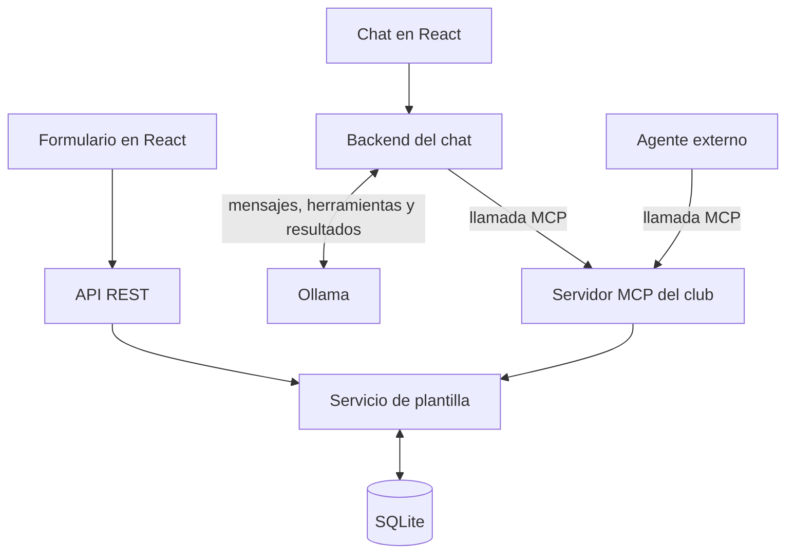

# Club de Barrio

Gestiona la plantilla de un equipo de fútbol desde el navegador o pídele al asistente que trabaje con ella. Prueba con **«¿Qué dorsal lleva Lucía Vega?»**. La respuesta se puede contrastar con la ficha que usa el cuerpo técnico.

## Abrir la aplicación en Windows

Necesitas el **SDK de .NET 10** y **Node.js 24 LTS** con npm. Para usar el asistente también necesitas **Ollama** y un modelo con soporte de herramientas. Los comandos siguientes parten de la carpeta `equipo-futbol`. [Descargar .NET](https://dotnet.microsoft.com/download/dotnet/10.0) · [Descargar Node.js](https://nodejs.org/en/download) · [Ollama para Windows](https://ollama.com/download/windows).

1. En una primera terminal PowerShell, inicia la API. La primera ejecución crea la base de datos con ocho jugadoras y cuatro integrantes del cuerpo técnico.

   ```powershell
   dotnet run --project .\api\ClubDeBarrio.Api.csproj
   ```

2. En una segunda terminal, instala las dependencias de la web e inicia React. Abre [Club de Barrio](http://127.0.0.1:5173). Ya puedes buscar, filtrar, dar de alta, editar y dar de baja. La API también permite [consultar la plantilla en JSON](http://127.0.0.1:5080/api/players).

   ```powershell
   cd web
   npm.cmd ci
   npm.cmd run dev
   ```

3. Para usar el chat, abre Ollama y descarga el modelo una vez. Si lo ejecutas como servicio de terminal, `ollama serve` lo inicia. Con la aplicación de escritorio abierta normalmente ya hay un servicio escuchando. [Modelo qwen3:4b](https://ollama.com/library/qwen3:4b).

   ```powershell
   ollama pull qwen3:4b
   ```

La web conserva las fichas en `api/data/club.db` aunque cierres el navegador o reinicies la API. La edad se calcula a partir de la fecha de nacimiento. El historial del chat dura mientras esté abierta esa pestaña. Si solo quieres compilar la web, ejecuta `npm.cmd run build` desde `web`.

## Del mensaje a la ficha



1. **Consultar.** Escribe «Busca a Lucía Vega y dime su dorsal». El backend ofrece a Ollama las herramientas que descubre en el servidor MCP. El modelo puede proponer una búsqueda y el backend la ejecuta. La ficha inicial de Lucía tiene el **11**.
2. **Actuar.** Escribe «Cambia el dorsal de Lucía Vega al 7». El asistente debe identificar la ficha y solicitar el cambio por su identificador. El chat muestra qué herramienta se llamó y qué ocurrió. Al volver a la plantilla podrás ver el **7**.
3. **Interpretar un rechazo.** Pide el **10** para Lucía. Ese dorsal pertenece inicialmente a Lara Montes. El servicio rechaza el cambio y Lucía conserva el 7. La operación registrada permite comprobarlo aunque el modelo falle al redactar la respuesta.

Piensa en la diferencia entre *contexto* y *dato actual*. El historial ayuda a interpretar «¿y qué posición tiene?». Para conocer el dorsal vigente, el asistente debe consultar la ficha. La respuesta en lenguaje natural puede variar y las reglas del club se aplican en cada operación. El backend envía al modelo hasta doce mensajes recientes del historial, junto con las instrucciones y las herramientas del turno. [Llamadas a herramientas en Ollama](https://docs.ollama.com/capabilities/tool-calling).

## Cómo se organiza el proyecto

| Lugar | Qué encontrarás |
| --- | --- |
| [web](web/) | Vistas de jugadores y técnicos, formularios, filtros y conversación. Vite dirige las peticiones `/api` a la API local. |
| [api/Roster](api/Roster/) | Fichas, datos iniciales, reglas compartidas, operaciones REST y persistencia mediante EF Core. |
| [api/Assistant](api/Assistant/) | Las diez herramientas MCP y el backend que intercambia mensajes, llamadas y resultados con Ollama. |
| [api/appsettings.json](api/appsettings.json) | Puerto de la API, archivo SQLite, dirección de Ollama, modelo y dirección MCP. |
| [AGENTS.md](AGENTS.md) y [.agents/skills](.agents/skills/) | Convenciones del proyecto y procedimientos para trabajar con él desde un agente. |

Los dos recursos REST son `/api/players` y `/api/coaches`. En ambos, `GET` lista las fichas y admite `?name=Lucia`. `POST` crea una ficha. Sobre `/{id}`, `GET` consulta, `PUT` reemplaza los campos editables y `DELETE` da de baja. Una ficha válida incluye nombre, nacionalidad y una fecha de nacimiento anterior a hoy. Para jugadores se añaden posición y dorsal único del 1 al 99. Para técnicos se añade su función.

El chat utiliza `POST /api/chat`. Recibe un historial de mensajes con `role` y `content` y devuelve el texto de la respuesta, las operaciones del turno y un indicador de respuesta incompleta. Una petición REST con un dorsal ocupado devuelve `409`. Una llamada MCP comunica esa misma regla como un error de herramienta. La aplicación está configurada para uso local y carece de cuentas de usuario.

Para distinguir «¿qué pasaría si le cambio el dorsal?» de «cámbiale el dorsal», el backend pide primero a Ollama una clasificación en JSON. Con ella decide qué herramientas ofrecer en ese turno. Antes de editar o dar de baja, contrasta el nombre o ID con la plantilla. El registro de la operación indica si el servidor confirmó el cambio. [Respuestas estructuradas en Ollama](https://docs.ollama.com/capabilities/structured-outputs).

## Conectar un agente al servidor MCP

Con la API encendida, la dirección MCP es `http://127.0.0.1:5080/mcp` y el transporte es **Streamable HTTP**. El mismo proceso .NET atiende la API y el servidor MCP. Para conectarlo a Codex CLI, registra el servidor y abre una sesión desde la carpeta de este proyecto. [Transporte HTTP del SDK de MCP](https://csharp.sdk.modelcontextprotocol.io/v2/concepts/transports/transports.html).

```powershell
codex mcp add club-de-barrio --url http://127.0.0.1:5080/mcp
codex
```

También puedes explorar las herramientas con **MCP Inspector**. Conéctate, abre la lista de herramientas y ejecuta `list_players` con `{"name":"Lucía Vega"}`. Copia el `id` devuelto. Para cambiar únicamente el dorsal, usa `update_player` con ese `id` y `shirtNumber`. [Guía oficial de MCP Inspector](https://modelcontextprotocol.io/docs/tools/inspector).

```powershell
npx.cmd @modelcontextprotocol/inspector --server-url http://127.0.0.1:5080/mcp --transport http
```

| Operación | Jugadores | Cuerpo técnico |
| --- | --- | --- |
| Buscar o listar | `list_players` | `list_coaches` |
| Consultar por ID | `get_player` | `get_coach` |
| Dar de alta | `create_player` | `create_coach` |
| Editar campos concretos | `update_player` | `update_coach` |
| Dar de baja | `delete_player` | `delete_coach` |

## Trabajar con las skills

Abre `equipo-futbol` como carpeta del agente. [AGENTS.md](AGENTS.md) recoge las reglas comunes. Cada skill recibe una petición concreta y explica cómo llevarla a término.

| Encargo para el agente | Qué obtendrás |
| --- | --- |
| «Usa `$plan-roster-change` para planificar una segunda posición opcional por jugador». | Un plan que sigue el campo desde las fichas existentes hasta el formulario y las herramientas MCP. |
| «Usa `$manage-roster` para cambiar el dorsal de Lucía Vega al 7». | Una operación sobre la plantilla de la API conectada. Si hay personas con el mismo nombre, el agente necesita un dato que las distinga. |
| «Usa `$verify-roster` y dime qué comprobaste». | Una verificación aislada y un informe de resultados observados y pendientes. |

## Verificación bajo petición

La skill contiene un [script de comprobación](.agents/skills/verify-roster/scripts/verify.cs). Al invocarlo, crea una base SQLite temporal, arranca su propia API y la reinicia para comprobar la persistencia. Recorre el alta, edición y baja de jugadores y técnicos, comprueba que un rechazo conserve los datos y lee por REST un cambio hecho mediante MCP. Cada comprobación utiliza una respuesta del sistema. [Scripts de archivo único en .NET 10](https://learn.microsoft.com/dotnet/core/sdk/file-based-apps).

```powershell
dotnet run --configuration Debug --file .agents/skills/verify-roster/scripts/verify.cs
```

### Chat y actualización visual

Para comprobar también la interfaz, detén la API habitual con `Ctrl+C` en su terminal. Inicia otra instancia en el mismo puerto con una base desechable. Este comando genera una ruta nueva para la ocasión. Al terminar, detén esa instancia y vuelve al comando de inicio habitual.

```powershell
$samplePath = Join-Path ([IO.Path]::GetTempPath()) ("club-barrio-" + [guid]::NewGuid() + ".db")
dotnet run --project .\api\ClubDeBarrio.Api.csproj -- --Roster:DatabasePath "$samplePath"
```

Con React y Ollama abiertos, sigue el recorrido de Lucía del 11 al 7. Revisa el resultado de la herramienta, abre la lista y comprueba la ficha. Después solicita el 10 y contrasta el rechazo con el dorsal que sigue visible. Si falta el modelo o no puedes abrir la web, esa parte de la comprobación queda pendiente.

**Comprueba lo aprendido**

1. El chat dice que Lucía lleva el 10, pero la herramienta de actualización muestra un conflicto. ¿Cómo averiguarías qué dorsal tiene ahora?
2. El club quiere reservar el dorsal 1 para portería. ¿Dónde aplicarías la regla para que se cumpla desde el formulario y desde un agente externo?

<details>
<summary>Ver respuestas</summary>

1. Consultaría su ficha por ID con `get_player` o por REST. El conflicto indica que esa operación se rechazó. La consulta muestra el dato guardado incluso si más tarde otra persona ha editado la ficha.
2. En el servicio de plantilla, al validar posición y dorsal tanto en altas como en ediciones. El formulario puede anticipar el aviso. También conviene revisar las fichas existentes, la restricción en SQLite, la descripción de la herramienta y la comprobación bajo petición.

</details>
