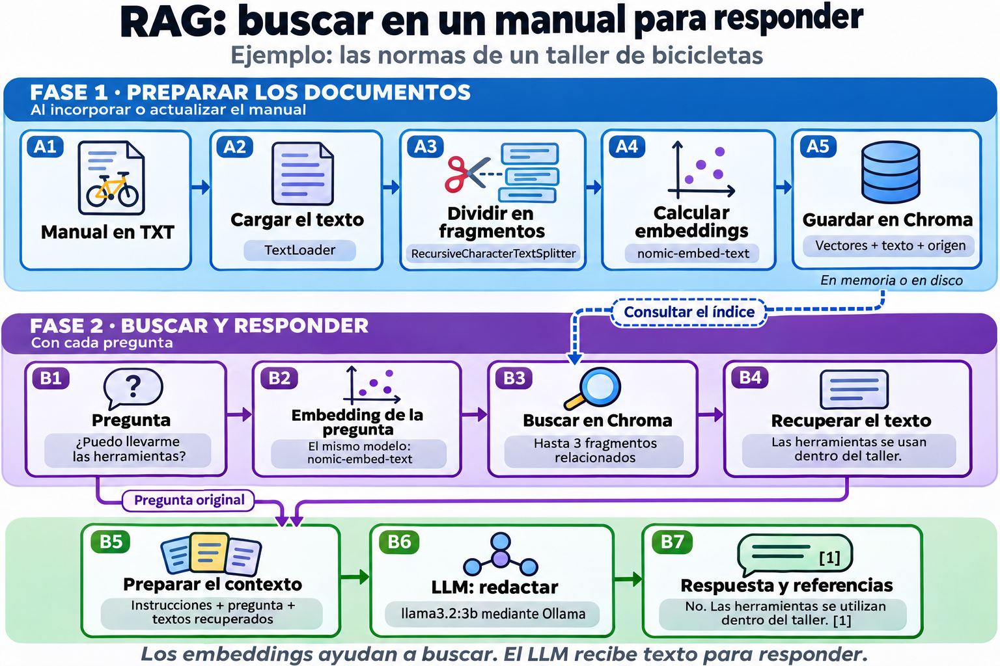

# RAG con Python, LangChain y Ollama

Una práctica para **hacer preguntas sobre un documento de texto**. Primero se carga y divide el archivo, se calculan embeddings y se guardan en Chroma. Después se buscan fragmentos relacionados con la pregunta y un LLM redacta la respuesta con ese contexto.

El ejemplo utiliza el manual ficticio de un taller de bicicletas. Consulta la [teoría de RAG](../README.md#11-rag-buscar-información-antes-de-responder) si necesitas repasar el concepto.

## 1. Preparar el entorno

Necesitas Python 3.11 o 3.12 y Ollama instalado y abierto. Si todavía necesitas instalar Ollama, sigue la [instalación en Windows de los apuntes](../README.md#instalación-y-primera-prueba-en-windows). Los comandos siguientes son para PowerShell y se ejecutan desde la raíz de `IA-docs`:

```powershell
cd .\rag-python
py -3.12 -m venv .venv
.\.venv\Scripts\python.exe -m pip install -r requirements.txt
```

Si tienes Python 3.11, cambia `-3.12` por `-3.11`. Usar directamente el Python del entorno evita tener que activar scripts de PowerShell. Las dependencias tienen rangos de versiones; `requirements.txt` no es un archivo de bloqueo con todas las versiones fijadas.

Descarga los dos modelos que cumplen funciones distintas:

```powershell
ollama pull nomic-embed-text
ollama pull llama3.2:3b
```

| Modelo | Función |
| --- | --- |
| `nomic-embed-text` | Convertir fragmentos y preguntas en vectores para buscarlos. No genera las respuestas del chat. |
| `llama3.2:3b` | Leer la pregunta y los fragmentos recuperados para redactar la respuesta. |

Referencias: [modelo de embeddings](https://ollama.com/library/nomic-embed-text) y [modelo generativo](https://ollama.com/library/llama3.2:3b).

## 2. Ejemplo temporal: todo en memoria

```powershell
.\.venv\Scripts\python.exe ejemplo_temporal.py
```

Carga el archivo incluido y pregunta si se pueden llevar las herramientas a casa. Puedes indicar otra pregunta o un TXT propio:

```powershell
.\.venv\Scripts\python.exe ejemplo_temporal.py "¿Cuándo cierra la inscripción del curso?"
.\.venv\Scripts\python.exe ejemplo_temporal.py "¿Qué materiales debo llevar?" --documento ".\documentos\mis-normas.txt"
```

`chromadb.EphemeralClient()` mantiene el índice en memoria. **Al terminar el proceso, se pierde.** Cada ejecución vuelve a cargar, dividir e indexar el documento. No necesita un servidor Chroma separado.

## 3. Ejemplo persistente: guardar y reutilizar

Primero indexa el documento:

```powershell
.\.venv\Scripts\python.exe ejemplo_persistente.py indexar
```

Después consulta el índice guardado, incluso desde otra terminal situada en esta carpeta:

```powershell
.\.venv\Scripts\python.exe ejemplo_persistente.py consultar "¿Con cuánta antelación debo cancelar una reserva?"
```

`chromadb.PersistentClient(path=...)` guarda los datos en disco automáticamente. **Consultar no vuelve a cargar el TXT ni a calcular los vectores de sus fragmentos**; sí calcula el vector de la nueva pregunta. Ollama sigue siendo necesario para ese cálculo y para generar la respuesta. [Referencia: clientes de Chroma](https://docs.trychroma.com/reference/python/client).

### Elegir la carpeta con CHROMA_DIR

Por defecto se utiliza `.chroma` dentro de este proyecto. Para elegir otra carpeta:

```powershell
$env:CHROMA_DIR = ".\almacen-taller"
.\.venv\Scripts\python.exe ejemplo_persistente.py indexar
.\.venv\Scripts\python.exe ejemplo_persistente.py consultar "¿Cuánto dura una reserva?"
```

**`CHROMA_DIR` es una variable de nuestro código:** su valor se pasa a `PersistentClient`. Las rutas relativas parten de `rag-python`; también puedes indicar una ruta absoluta. En una terminal nueva debes establecer la misma variable para abrir ese mismo almacén. Los datos y la colección se conservan; el valor de la variable solo dura en la terminal actual.

### Actualizar el contenido

Edita el TXT y vuelve a ejecutar `indexar`. Para incorporar otro archivo:

```powershell
.\.venv\Scripts\python.exe ejemplo_persistente.py indexar --documento ".\documentos\mis-normas.txt"
```

El módulo calcula un ID estable a partir del origen, la posición y el contenido de cada fragmento. Reutiliza los que ya existen, incorpora los nuevos y retira las versiones anteriores de **ese archivo**. Los demás documentos permanecen. Los cambios del TXT no se incorporan automáticamente: requieren volver a indexar.

Si cambias el modelo de embeddings o sus prefijos en el código, utiliza otro `CHROMA_DIR` y vuelve a indexar los documentos para mantener compatibles los vectores de documentos y preguntas.

## 4. Entender el código paso a paso

Las funciones comentadas están en [rag.py](rag.py). El recorrido tiene dos fases: **organizar la información para encontrarla** y **utilizar lo encontrado para responder**.



**Cómo leer el esquema:** la franja azul prepara el manual; la violeta busca información y la verde construye la respuesta. La conexión entre Chroma y la búsqueda significa «consultar lo que ya guardamos». La pregunta original también llega al LLM: los fragmentos aportan información, pero la pregunta determina qué hay que contestar.

### Fase 1: dejar el manual preparado

Esta fase se ejecuta al indexar un documento. Se parece a organizar un manual en fichas que luego podemos localizar por su contenido. En el ejemplo temporal se repite en cada ejecución; en el persistente se reutiliza lo guardado.

#### Cargar y dividir

`TextLoader(..., encoding="utf-8").load()` produce objetos `Document`: `page_content` contiene el texto y `metadata`, datos como el origen. Este cargador lee **texto plano**, no el contenido de un PDF binario. Se utiliza `TextLoader` desde `langchain_community.document_loaders`. [Referencia: cargadores de documentos](https://docs.langchain.com/oss/python/integrations/document_loaders).

`RecursiveCharacterTextSplitter` intenta separar por párrafos, saltos de línea y espacios antes de cortar por caracteres:

| Ajuste del ejemplo | Significado |
| --- | --- |
| `chunk_size=600` | Tamaño máximo de cada fragmento, medido con `len`: aquí son caracteres, no tokens. |
| `chunk_overlap=100` | Solapamiento objetivo entre fragmentos. Ayuda a conservar información en los bordes; no obliga a repetir exactamente 100 caracteres en cada separación. |
| `add_start_index=True` | Guarda en los metadatos dónde comienza el fragmento dentro del texto cargado. |

`split_documents` conserva los metadatos; el módulo añade un número de fragmento para localizarlo. [Referencia: división recursiva](https://docs.langchain.com/oss/python/integrations/splitters/recursive_text_splitter).

#### Calcular embeddings y almacenarlos

`EmbeddingsNomic` adapta `OllamaEmbeddings`, importado desde `langchain_ollama`. Añade `search_document:` al calcular vectores de documentos y `search_query:` al calcular el de una pregunta, siguiendo las instrucciones de Nomic. Estos prefijos orientan el cálculo; el texto original almacenado conserva su contenido. [Referencias: integración con Ollama](https://docs.langchain.com/oss/python/integrations/embeddings/ollama) y [prefijos de Nomic](https://huggingface.co/nomic-ai/nomic-embed-text-v1.5#task-instruction-prefixes).

`Chroma`, importado desde `langchain_chroma`, conecta LangChain con `chromadb`. `add_documents` calcula los embeddings mediante la función configurada y guarda vectores, texto, metadatos e IDs. [Referencia: integración con Chroma](https://docs.langchain.com/oss/python/integrations/vectorstores/chroma).

### Fase 2: buscar y responder a una pregunta

Imagina que preguntas **«¿Puedo llevarme las herramientas?»**. El recorrido continúa así:

1. **Representar la pregunta.** Se calcula su embedding para compararla con los fragmentos preparados. Aunque no repita literalmente una frase del manual, puede encontrar contenido relacionado.
2. **Recuperar información.** La búsqueda localiza, entre otros posibles pasajes, la norma que dice que las herramientas se utilizan dentro del taller y no se pueden llevar a casa. Se recupera ese **texto**, con su referencia de origen.
3. **Preparar el contexto y redactar.** Se reúnen las instrucciones, la pregunta original y los textos recuperados. El LLM utiliza ese conjunto para producir una respuesta como «No. Las herramientas deben utilizarse dentro del taller [1]».

El modelo de embeddings ayuda a **encontrar**; el modelo generativo se encarga de **redactar**. Son dos tareas diferentes, por eso el proyecto utiliza dos modelos.

`base.as_retriever(search_kwargs={"k": 3})` crea un buscador que recupera hasta tres fragmentos relacionados. **Este `k` cuenta fragmentos recuperados; no es el `top_k` que filtra posibles tokens al generar.**

El texto recuperado se incorpora a una plantilla con la pregunta. La expresión `plantilla | modelo | StrOutputParser()` conecta tres pasos de LangChain: preparar mensajes, consultar el LLM y obtener el texto de salida. `cadena.invoke(...)` ejecuta ese recorrido. [Referencia: ChatOllama](https://docs.langchain.com/oss/python/integrations/chat/ollama).

Las instrucciones piden responder solo con los pasajes y citar sus números. El programa imprime aparte los fragmentos realmente recuperados: **una búsqueda puede devolver contenido cercano aunque no contenga la respuesta**, y el LLM puede equivocarse al utilizarlo. Las citas generadas deben contrastarse con esos textos.

Por ejemplo, si preguntas cuánto cuesta comprar una bicicleta nueva, el manual no aporta ese precio. El sistema debería indicar que falta la información, aunque la búsqueda haya devuelto textos sobre bicicletas. Recuperar un fragmento relacionado no basta para justificar cualquier respuesta.

## 5. Archivos y configuración

| Archivo | Contenido |
| --- | --- |
| [rag.py](rag.py) | Módulo reutilizable con carga, división, ambas bases, indexación y consulta RAG. |
| [ejemplo_temporal.py](ejemplo_temporal.py) | Flujo completo en una ejecución, con base en memoria. |
| [ejemplo_persistente.py](ejemplo_persistente.py) | Comandos `indexar` y `consultar` para reutilizar la base en disco. |
| [documentos/taller-bicicletas.txt](documentos/taller-bicicletas.txt) | Manual ficticio para aprender con datos conocidos. |
| [requirements.txt](requirements.txt) | Dependencias del proyecto. |

El código utiliza las integraciones separadas `langchain-ollama` y `langchain-chroma`, junto con `langchain-community`, `langchain-text-splitters` y los componentes de `langchain-core`.

Además de `CHROMA_DIR`, puedes configurar:

```powershell
$env:OLLAMA_URL = "http://localhost:11434"
$env:LLM_MODEL = "llama3.2:3b"
```

Si cambias `LLM_MODEL`, descarga antes el modelo elegido con `ollama pull`. Cambiar el generador no exige recalcular los embeddings. Cada consulta es independiente: este ejemplo recupera documentos, pero no guarda historial de preguntas y respuestas.

**Errores habituales:** si no conecta, comprueba que Ollama esté abierto y ambos modelos descargados. Si no encuentra el TXT, revisa su ruta y codificación UTF-8. Si la base persistente está vacía, ejecuta `indexar` y confirma que utilizas el mismo `CHROMA_DIR`. Los programas recogen errores con `try/except`, los muestran en la terminal y terminan con código de salida 1.

**Comprueba lo aprendido**

1. Cierras la terminal y al día siguiente quieres consultar sin volver a calcular los vectores del documento. ¿Qué ejemplo necesitas y qué debe coincidir al abrirlo?
2. Cambias únicamente el modelo que redacta las respuestas. ¿Debes reconstruir los embeddings? ¿Y si cambias el modelo que calcula los vectores?

<details>
<summary>Ver respuestas</summary>

1. El persistente. Debe abrir la misma carpeta `CHROMA_DIR` y la misma colección, con la misma configuración de embeddings. Ollama debe estar disponible para la nueva consulta.
2. Cambiar solo el generador no lo exige. Cambiar el modelo de embeddings requiere volver a representar los documentos y usar esa misma configuración para las preguntas; en este proyecto se hace en un almacén nuevo.

</details>
